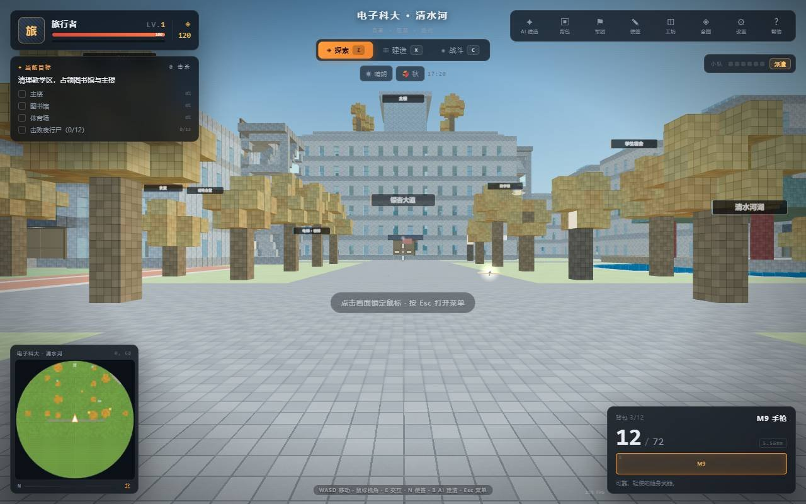
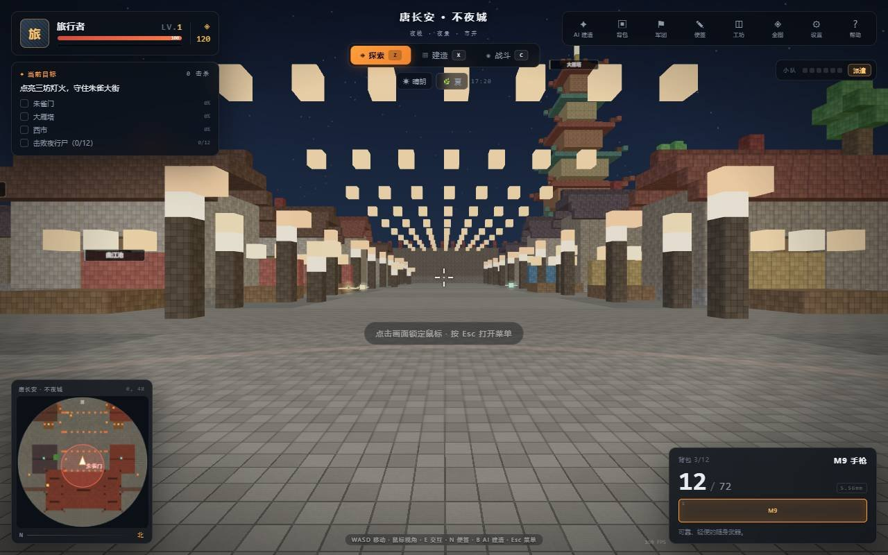
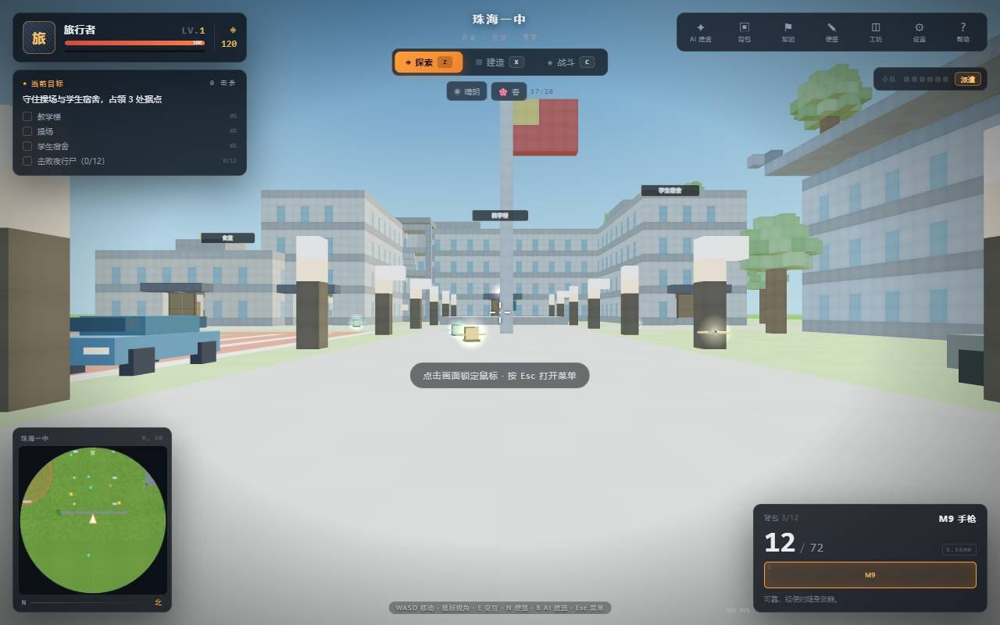
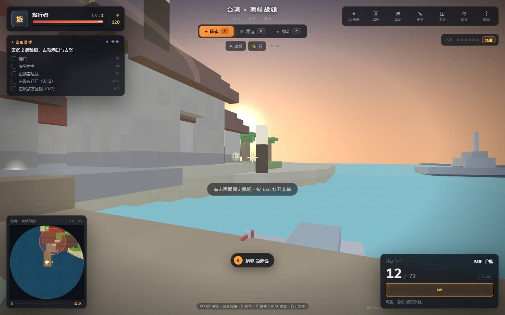
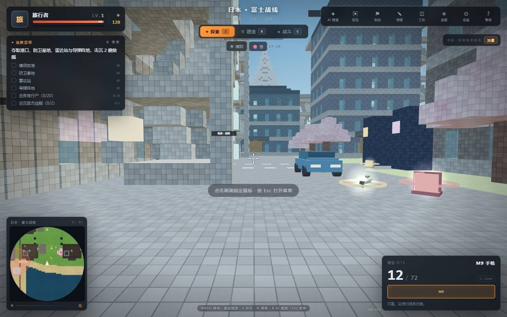
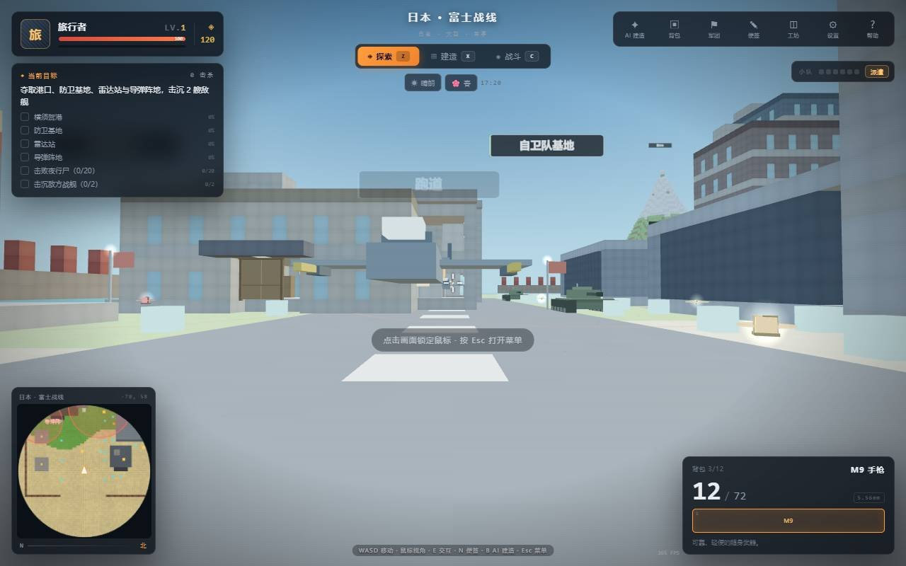
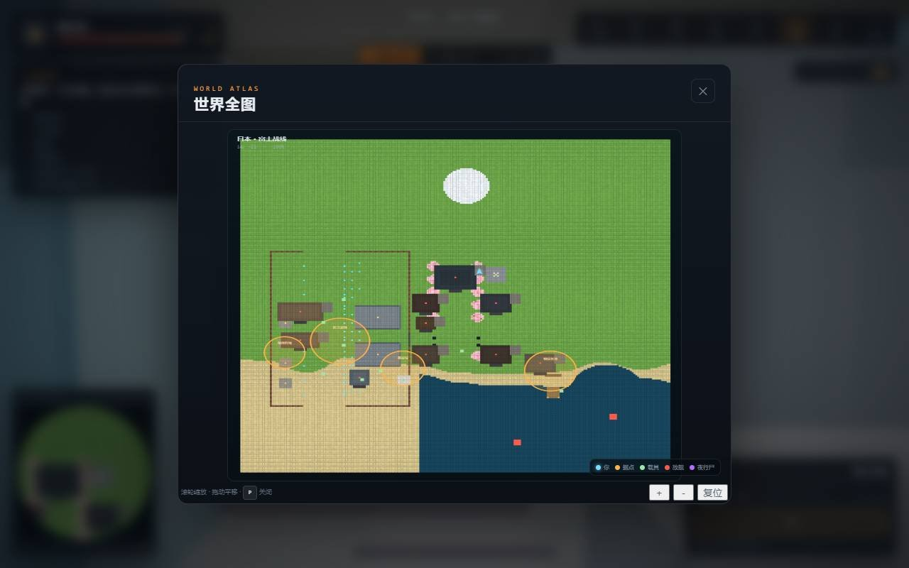
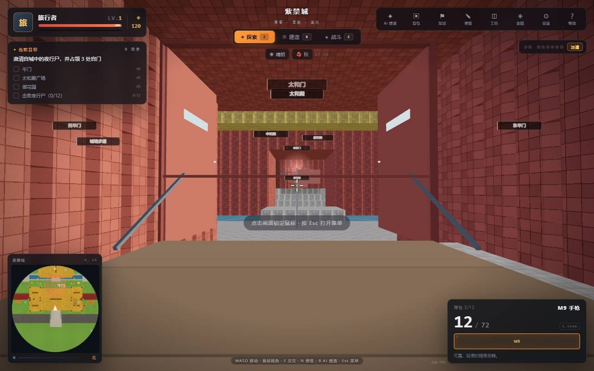
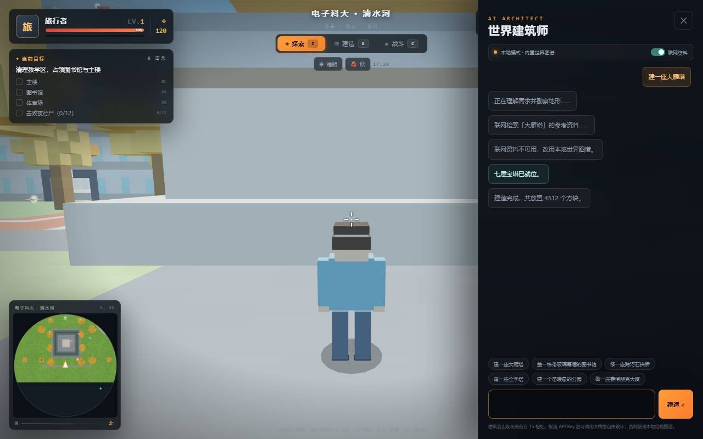
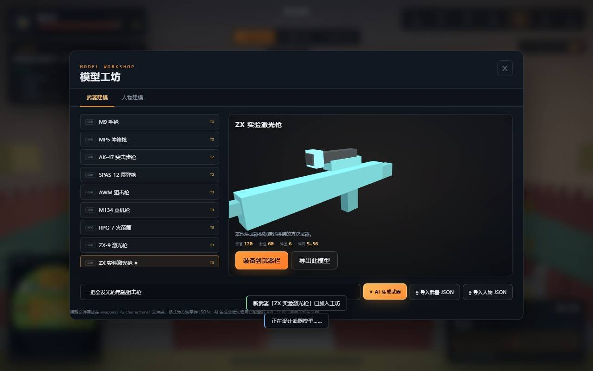

# 迷你世界 · 像素宇宙（MiniWorld Web）

一个可以直接在浏览器里跑的 **3D 世界沙盒**。保留六个紧凑案例世界，新增北京、Washington、Tokyo 三个大型城市区域，以及全球大陆探索。支持探索 / 建造 / 战斗、可走进去的多层建筑、AI 对话建造、世界便签与留言板、天气与季节、士兵小队、载具与海战，以及完整的**世界 / 武器 / 人物模型导入导出**。

**2026-11 第二次更新：**重建 20 cm 踏步的折返楼梯与逐层呼叫的观景电梯；新增胡同/灯笼市集、花园、雕塑广场、海港鱼市及八处洲际考察站。步行到访发现点会记录进探索手册并获得一次性奖励。变更与验证说明见 [本次升级说明](UPGRADE_2026-11-04-v2.md)。

**2026-11 远征升级：**新增连续地形、十种以上载具模型、环线列车、机械支援、无人机编队、防空拦截和航母甲板起飞。完整交付与验收说明见仓库根目录 [UPGRADE_2026-11-04.md](../UPGRADE_2026-11-04.md)。下方原版截图保留为功能参考；最新模型可打开 `tests/model-gallery.html` 检查，该页用 Canvas 投影实际游戏模型，不表示真实 WebGL 画质或帧率。


> 纯前端实现，无需构建步骤。核心依赖仅一份本地 `vendor/three.min.js`（Three.js r150）。

---

## 快速启动

推荐用本地 HTTP 服务打开（AI 联网检索、示例世界加载需要 HTTP 环境）：

```bash
cd MiniWorld
python serve.py 8123
# 或： python -m http.server 8123
```

浏览器访问 <http://127.0.0.1:8123/>

也可以直接双击 `index.html` 打开。所有游戏脚本都是传统 `<script>`，不依赖模块加载；但在 `file://` 下浏览器可能拦截联网检索与 `worlds/` 示例文件的 fetch。

首次启动不需要任何 API Key：AI 建筑师会使用内置的本地结构图谱。填写 API Key 后会自动切换为大模型设计。

---

## 你能玩到什么

### 远征指挥台与装备

按 **U** 或工具栏“指挥台”打开操作面板。三座新城市提供自动巡航的闭合铁路：点击“搭乘环线列车”，`Space` 刹车，`E` 在安全位置下车。

- **协同机械部队**：部署机械队员、四机无人机编队和防空单元，切换跟随/驻守，或一键召回；友方总数限制为 12 个，远离玩家的单位休眠。
- **空防演练**：主动开始后生成三个敌方无人机目标；防空单元发射制导导弹拦截。演练不会自动启动，召回会结束演练并清理相关导弹。
- **航母与舰载机**：Tokyo 海湾已有航母；其他有海水的地图会在附近寻找合适海域。可传送到可行走的甲板，再点击起飞舰载机。航母目前是固定的起降平台。
- **模型升级**：汽车、装甲车、坦克、飞机、巡逻艇、护卫舰、无人机、列车、航母、机械队员与防空单元采用独立轮廓、车轮/炮塔/雷达动画与远近层级；远处切换为一个简化网格。保留轻量级风格化画面。

### 声音与画质设置

设置面板提供总音量、音效、环境、引擎四路控制。爆炸与部分 AI 声音具有距离衰减和左右声像；持续雨声、水下声与引擎音平滑变化。最多同时播放 40 个短音，音频节点播放完即释放；切到后台时挂起音频，避免继续轰鸣。

画质可选自动、流畅、均衡、精细；自动模式按近期帧率调整像素比。可开启性能统计查看 FPS、绘制调用、三角形和地形区块，也可开启减少动态效果。实际设备是否达到目标帧率，需要在本机 WebGL 环境验收。

### 新增城市区域与世界大陆

| 世界 | 可探索范围 | 可体验的内容 |
| --- | --- | --- |
| **北京 · 中轴新境** | 32.768 km × 32.768 km | 中轴宫阙、文化馆、商务楼、两条环路、城际车站、飞行跑道与远郊河流 |
| **Washington · 首都公园** | 32.768 km × 32.768 km | 纪念碑、穹顶大厅、白色行政馆、博物馆、连续河岸与郊野公路 |
| **Tokyo · 湾岸未来** | 32.768 km × 32.768 km | 高塔、交叉路口、霓虹街区、铁路环线、码头与可容纳航母的海湾 |
| **世界大陆 · 地理远征** | 全球经纬范围，横向约 40,030 km | 离线真实大陆轮廓、跨洲地区导航、程序化山地、海岸与海洋 |

在世界地图中使用**地区导航**，可直接前往车站、机场、城市街区、远郊，或跨洲探索。“定位我”显示附近区域；滚轮围绕鼠标所在位置缩放，缩放按钮围绕当前视野中心缩放。大陆地图的南北边界之外显示空白背景。城市中心的体素建筑保持可进入、可拆建；外围建筑有实体碰撞，并随附近地形按需生成。连续地面与外围程序化楼群使用表面网格，不支持逐米挖洞；可以在它们附近建造和编辑自己放置的方块。

**规模与真实程度：**城市坐标以米为单位，每个城市区域的面积约 1,073.74 平方公里；建筑、道路布局和高程是风格化、程序化内容，未接入实景建筑或真实数字高程模型。大陆模式使用 Natural Earth 低分辨率陆地轮廓和等距圆柱投影；坐标单位为米，但投影在高纬度会拉伸东西方向距离。它提供全球地理范围及区域探索，不是逐栋建筑、逐米高程的真实地球复刻。

地面在相机附近按 **256 m × 256 m** 分块加载，近处网格间距 8 m、远处 16/32 m，并通过同一全局高度函数和边缘裙边衔接。标准画质最多保留 **169 块**，低画质最多 **81 块**；每帧最多构建两块，并在单块完成后检查 5 ms 的时间预算。跨洲传送会先准备附近九块，再逐步补齐远景。世界范围变大不会要求浏览器把全世界的建筑常驻内存。

### 六个手工案例世界

| 世界 | 风格 | 玩法亮点 |
| --- | --- | --- |
| 🏯 **紫禁城** | 黄昏 · 中式宫殿 | 中轴三大殿、午门、金水桥、御花园、**可登城的城墙步道与红衣炮、护城河**；入夜后占领三处宫门 |
| 🏮 **唐长安 · 不夜城** | 夜晚 · 灯会市井 | 朱雀大街、灯笼长街、大雁塔、夜市；占领三坊 |
| 🎓 **电子科大 · 清水河** | 秋日校园 | 主楼、图书馆、清水河湖、银杏大道、体育场、食堂、成电会堂、教学楼、宿舍；无人机与校园接驳车 |
| 🏫 **珠海一中** | 春日校园 | U 型教学楼、红色跑道、体育馆、宿舍、食堂、国旗；装甲车与巡逻车 |
| 🌊 **台湾 · 海峡战线** | 黎明 · 海岛 | 港镇、木码头、安平古堡、山顶雷达站、两艘敌舰；巡逻艇海战 |
| 🗻 **日本 · 富士战线** | 白昼 · 大型战区 | 约 233×233 大世界：富士山、霓虹都市、涩谷路口、东京塔、自卫队基地、跑道、机库、雷达、导弹阵地、军港；战斗机 / 坦克 / 导弹 |

示例小岛仍可通过主菜单右上角的 **示例世界** 按钮载入：一个 8700 方块的世界文件，用于演示「导入世界」的完整流程。








### 建筑可以走进去

- 现代建筑保留可开关主入口、教室隔墙和家具；外置折返楼梯改为 20 cm 踏步、40 cm 踏面与 2.4 m 宽双跑，每层开放平台连入室内，顶部连至屋顶。
- 观景电梯有可见轿厢、滑门、楼层安全栏和玻璃井道；在任意楼层候梯区按 `E` 选择目的地。轿厢在其他楼层时先来接人，请留在候梯区；出口被方块堵住时乘客留在轿厢，可选其他楼层。
- 体素地表改为衔接的完整表面，剔除内部不可见面，并合并相邻同色平面；取消会显出格缝的四分格纹理。现代楼顶部仍采用逐层收分，保持原有建筑轮廓。
- 紫禁城城墙上有 **加宽走道**，东西两侧有 **登城步道**，城墙顶布置了可开火的红衣炮。
- 城墙外新增一圈 **护城河与石桥**；地图外围是 **近似无限的地面**（水面世界为无限海面），走出原地图不会掉出世界。

### 世界全图与载具操控

- 按 `P` 或工具栏 **全图** 打开世界全图：可滚轮缩放、拖动平移，显示地形、据点、载具、敌舰、僵尸与玩家位置。
- 所有载具现在用 **A / D 键盘转向**、`W / S` 前进 / 倒车；汽车按住 `Shift` 加速、`Space` 刹车，默认速度已调慢。
- 无人机按 `E` 操控，`Space / Shift` 升降，`V` 切换第一视角，`E` 降落并离开；不会再显示“上车/下车”。
- 战斗机：`W / S` 控制油门，鼠标上拉 / 下压控制爬升 / 俯冲；速度不足时会失速下沉，必须加速才能起飞。靠近地面低速、浅俯冲会自动接地并提示；撞建筑、地形或海面仍会爆炸。初始两架战斗机已移到跑道空位，避免出生时机翼插进控制塔/机库。
- 坦克炮管改为 **独立俯仰**：`滚轮` 或 `↑ / ↓` 调整炮口，炮弹按炮口角度发射；鼠标只控制视角。坦克和战斗机都加入了更严格的碰撞，不再穿过建筑。
- 电梯位于建筑内部的 **独立玻璃电梯井**，与东侧楼梯塔分开；楼梯塔加长、增加两侧防坠护栏，并通过每层 **桥接平台/桥门** 进入建筑。
- 紫禁城城墙加宽到 **4 格**，城防火炮前方留出 **炮口**，炮管不再插进女墙；城垛内侧增加连续护栏，四座角楼打通了十字通道，走到转角不再被塔楼挡住。
- 落水后按住 `Space` 上浮，靠近岸会自动攀爬；如果卡在深水，按 `R` 直接返回最近岸边。
- 楼梯塔的每层平台留有 **上人洞口**，不会再被楼板封住；电梯轿厢有双开滑门和升降动画，进电梯选层后关门、上升，到层后再开门。
- 现代建筑和木屋的房间内会随机生成物资；世界会周期性空投 **坦克 / 战斗机 / 重型火炮**，重炮可以缓慢推动或用 `E` 操作。
- 窗户改成真正的 **透明玻璃**，可以透过玻璃看到室内外；现代楼、木屋、殿宇和电梯井都使用这种玻璃。
- 日本出生点附近新增导弹发射器和火箭弹，拾取后按 `C` 进入战斗，左键即可发射导弹。
- 紫禁城四座主门现在 **左右两扇分别向两侧打开**，不再单侧旋转；门外吊桥同步升降。护城河整体向外移动，水深增加到 5 格，水面以下不可行走，掉下去需要游泳或按 `R` 上岸。
- 建筑编辑与碰撞保持 **1 米体素**；显示层按可见面合并，地面相近材质在顶点间平滑混色，避免每个小方块都出现明显接缝。
- 战斗机的碰撞半径和机身中段检测范围加大，减少机翼穿建筑；坦克/汽车的碰撞盒按车身高度收窄，不会再被头顶空白处的旧碰撞体积卡住。
- 战斗机继续支持 `Space / Shift` 键盘升降，同时保留鼠标俯仰。



### 三种模式

- **探索（Z）**：步行、游泳、拾取、驾驶载具、开关门、阅读便签、与 AI 建造。
- **建造（X）**：10 色调色板，左键执行当前工具，右键快速拆除；支持 1×1×1 到 3×3×3 笔刷，第三人称施工；HUD 提供 **放置 / 摧毁** 按钮，按 `F` 切换。
- **战斗（C）**：僵尸会从远处刷新并围攻；9 种枪械 / 发射器、手雷、地雷、狙击开镜、爆头判定、掉落与击杀奖励；战斗 HUD 常驻显示快捷键，按 `I` 或 `Tab` 可直接查看背包。


### 生存与成长

- 生命、护甲、金币、击杀数；死亡后 3 秒在据点复活并获得 4 秒保护。
- 背包容量由背包等级决定：**帆布背包 12 格 → 战术背包 20 → 远征背包 32**。
- 武器栏按 `1–7` 快捷切换，最多携带 9 件；弹药按 5.56 / 7.62 / 12 号霰弹 / 火箭弹分类管理。
- 空投补给、武器与弹药掉落、医疗包、防弹插板。

### 小队与据点

按 `K` 招募士兵（60 金币/人，最多 6 人）。士兵会跟随并自动射击附近的夜行尸。点击“派遣小队”后，他们会前往最近的未占领据点；玩家或士兵在据点范围内、且范围内没有僵尸时，占领进度增长。全部据点占领 + 完成击杀目标（海战世界还要击沉敌舰）即通关。

### 载具与海战

靠近按 `E` 驾驶，驾驶时左键开火，`E` 下车：

- **坦克**：主炮范围爆炸，高血量。
- **装甲车 / 越野车**：高速机炮 / 快速机动。
- **无人机**：自由飞行侦察，激光射击。
- **战斗机**：F-2 / F-35，垂直起降式街机飞行，双发导弹自动瞄准海面战舰。
- **巡逻艇**：海面高速移动，舰炮带自动瞄准辅助，可直接击沉敌舰。

敌舰现在有完整的受击判定：步枪、坦克炮、战斗机和导弹都能命中；巡逻艇不能穿过敌舰船体，靠近会被船体阻挡。



### 战斗提示与受伤方向

- 战斗 HUD 底部常驻 **快捷键提示条**，屏幕中央上方会提示“夜行尸接近 · 身后 / 左侧……”并闪烁红色警告。
- 被攻击时屏幕中央出现 **红色方向箭头**，箭头指向伤害来源，避免“没看到僵尸就被击倒”。
- 近距离僵尸会显示血条；僵尸隔墙不能抓伤玩家；僵尸从附近刷新时会提示方向并播放低吼。

### 天气 / 季节 / 时间

- `T` 循环：晴朗 → 降雨 → 降雪 → 浓雾 → 雷暴（含闪电与雷声）。
- `Y` 循环：春 → 夏 → 秋 → 冬；树叶会真实地被重新染色，天空、雾、光强同步变化。
- 每个世界有独立的天空预设（白昼 / 黄昏 / 夜晚 / 黎明）。

### 便签与留言板

- 按 `N` 或 `L` 打开便签面板，写下的便签会**钉在你当前的位置**，世界中出现发光木牌；靠近按 `E` 阅读。
- “全球留言”和“给作者”两个频道保存在本机，可点赞、发布、删除自己的世界便签。

### AI 世界建筑师

按 `B` 或点击工具栏“AI 建造”：

1. 输入“建一座大雁塔”“盖一栋玻璃幕墙图书馆”“修一座石拱桥”。
2. 开启“联网资料”时，会尝试从中文维基百科检索参考资料与图片（浏览器网络受限时自动跳过）。
3. 未配置 API：使用内置的 **15 种结构图谱**（宝塔、宫殿、城堡、桥、金字塔、小屋、喷泉、体育场、现代楼、摩天楼、长城、公园、雕像、战舰、园林）。
4. 配置 API：调用 OpenAI 兼容的 `/chat/completions`，让模型输出方块指令 JSON；失败自动回退本地方案。
5. 建造会在你前方 20 格逐块生长，显示进度、粒子与音效；锚点会自动避开海面寻找最近的陆地。

支持的指令：`fill` / `ring` / `tree` / `lamp` / `clear`，规则写在 [skills/world-build.md](skills/world-build.md)。



### 模型工坊

按 `O` 打开：

- **武器建模**：3D 实时预览；AI 根据描述生成方块武器（优先 API，失败用本地生成器）；导入 / 导出 `weapons/*.weapon.json`；一键装备到武器栏。
- **人物建模**：预设皮肤与颜色预览、导入 / 导出 `characters/*.character.json`、应用到第三人称角色。
- 自定义武器和皮肤会保存在本机 localStorage。



### 世界文件

- 设置面板 → **导出当前世界**：下载 `.miniworld.json`，包含全部方块、元数据、出生点、据点、载具、便签。
- **导入世界文件**：读取上述文件并在网页中重建世界。
- 菜单上的 **示例世界** 会加载 `worlds/sample-island.miniworld.json`（一个 8700 方块的小岛，用于验证导入流程）。
- 世界进度（角色状态、天气季节、据点、建筑改动）会自动保存到浏览器 localStorage，每 20 秒以及退出时保存。

---

## 操作总览

| 按键 | 功能 |
| --- | --- |
| `W A S D` | 移动 |
| 鼠标 | 视角（点击画面锁定鼠标） |
| `Space` / `Shift` | 跳跃/上浮 · 疾跑 |
| `Z` / `X` / `C` | 探索 / 建造 / 战斗 |
| `左键` / `右键` | 射击/放置 · 瞄准/拆除 |
| `R` | 换弹 |
| `G` / `M` | 手雷 / 地雷 |
| `1–7` | 切换武器 |
| `1–0`（建造模式） | 选择方块颜色 |
| `[` / `]`（建造模式） | 调整笔刷 |
| `E` | 拾取 / 驾驶 / 降落 / 下车 / 开门 / 城门与吊桥 / 乘电梯 / 开炮 / 读便签 |
| `A / D` | 载具转向（替代鼠标转向） |
| `Shift` | 汽车加速 · 飞机下降 |
| `Space` | 汽车刹车 · 飞机上升 |
| `V` | 步行第一 / 第三人称；无人机 / 战斗机切换座舱视角 |
| `R` | 落水时返回最近岸边；战斗中换弹 |
| `滚轮` / `↑↓` | 坦克炮口俯仰 · 城防火炮俯仰 |
| `P` | 打开世界全图（Esc / 右上角 ✕ 关闭） |
| `U` | 远征指挥台：列车、机械部队、无人机、防空演练、航母与舰载机 |
| `N` / `L` | 写便签 / 便签与留言板 |
| `I` / `K` / `O` | 背包 / 军团 / 模型工坊（战斗中也可按 `I` 或 `Tab` 开背包） |
| `F` | 建造模式：切换放置 / 摧毁 |
| `B` / `H` | AI 建筑师 / 帮助 |
| `T` / `Y` | 天气 / 季节 |
| `Esc` | 暂停 / 关闭面板 |

---

## 文件结构

```text
MiniWorld/
├── index.html                  # 页面骨架与所有 UI 面板
├── css/style.css               # 完整视觉样式（菜单 / HUD / 面板 / 响应式）
├── js/
│   ├── data.js                 # 武器、物品、角色、世界、调色板等静态数据
│   ├── util.js                 # 随机、噪声、颜色、存储等工具
│   ├── geography.js            # 城市元数据、全球坐标、Natural Earth 离线轮廓
│   ├── terrain.js              # 连续地面、近远景层级、有界流式区块与外围城市
│   ├── world.js                # 体素可见面合并、碰撞、射线、GPU 水面波浪
│   ├── worldgen.js             # 六个案例、三座城市核心与大陆出生点生成
│   ├── models.js               # 武器视图模型、人物、载具、拾取物、光晕
│   ├── vehicle-models.js       # 新载具几何、动画支点、远近层级与资源回收
│   ├── advanced.js             # 列车、机械部队、无人机、空防与航母甲板
│   ├── audio.js                # WebAudio 合成音效（无音频素材）
│   ├── entities.js             # 僵尸、士兵、载具、敌舰、据点、便签、投掷物
│   ├── combat.js               # 射击、爆炸、粒子、弹道
│   ├── player.js               # 玩家移动、背包、武器、生命
│   ├── architect.js            # AI 建筑师：本地图谱 + API + 维基检索
│   ├── ui.js                   # 菜单、HUD、小地图、所有面板交互
│   ├── expedition-ui.js        # 大地图、地区导航与指挥台
│   └── game.js                 # 主控制器、场景、循环、存档、导入导出
├── vendor/three.min.js         # Three.js r150（本地）
├── worlds/                     # 世界文件与示例
├── weapons/                    # 武器模型 JSON（AK-47 / AWM / RPG-7 示例）
├── characters/                 # 人物外观 JSON（旅行者 / 士兵）
├── skills/                     # AI 建造 / 武器切换 / 模型工坊技能说明
├── prompt/prompt.md            # 需求原始说明
├── assets/                     # README 截图
├── serve.py                    # 带 no-store 的本地静态服务器
└── README.md
```

---

## 配置大模型

设置面板（主菜单右上角或游戏内 `Esc` → 设置）：

- **API 地址**：OpenAI 兼容端点根地址，例如 `https://api.deepseek.com`
- **API Key**：只保存在当前浏览器的 localStorage，通过 `Authorization: Bearer` 直接发往你填写的端点
- **模型**：例如 `deepseek-chat`
- **联网检索资料**：是否尝试检索维基百科（失败不影响建造）

点击“测试连接”会发送一次极小的 `chat/completions` 请求验证配置。

> 注意：API Key 不会上传到除你配置的端点之外的任何地方。请不要在公共电脑上保存 Key。

---

## 技术说明

- **渲染**：Three.js WebGL；体素按 16×16 chunk 进行隐藏面剔除和贪心平面合并。网格具备正确的包围球和视锥剔除；区块边缘的编辑会重建相邻区块。网格顶点使用区块局部坐标，减少大陆坐标下的浮点抖动。水波在顶点着色器中更新，避免每帧向 GPU 重传水面顶点。
- **地形**：城市采用确定性连续高度场；大陆陆海轮廓来自随代码附带的 Natural Earth 数据，高程采用种子化噪声。地图取样只查询高度，不触发区块生成。
- **存档**：只保存“生成后编辑过的方块”diff，避免把整张地图写进 localStorage；世界文件导出时才序列化全部方块。
- **UI**：原生 DOM + CSS，无框架；HUD 与面板均为可样式化组件。
- **音效**：WebAudio 振荡器与噪声实时合成，没有音频文件。
- **性能**：无阴影贴图、无后处理；流式地形区块数、每帧生成数和缓存容量都有上限。实际帧率取决于设备、浏览器和场景；屏幕右下角显示实时 FPS。

### 几何与逻辑验收

```bash
node --test MiniWorld/tests/*.test.cjs
```

该命令使用仓库自带的 Three.js，在 Node 中检查地形、地图、载具、导弹、列车、资源回收和音频调度；世界测试文件包含八组地形与存档检查。音频测试使用最小 Web Audio fake，仅验证节点连接、上限和回收，不生成声音。测试不需要安装额外依赖，也不代替真实浏览器的 WebGL 画面、听感与帧率验收。

### 扩展世界

在 `js/data.js` 中注册世界元数据，在 `js/worldgen.js` 中实现生成函数，并在 `GENERATORS` 映射中加上 id 即可。生成时使用 `Builder` 的 `fill / fillRing / roof / hall / modern / tree / lamp / wallRect` 等工具，最后返回 `spawn / zones / vehicles / pickups`。

### 扩展武器

在模型工坊中 AI 生成或导入 JSON，即可在本次会话中装备；若想永久内置，把 JSON 放入 `weapons/` 并参考 `js/data.js` 的 `MW.WEAPONS` 结构添加。

---

## 已知限制

- **单人游戏**：当前版本没有联网对战或服务器同步；“全球留言板”是本地存储的氛围向功能。
- **AI 联网检索**依赖浏览器能否访问维基百科；部分网络环境会被 CORS 或代理拦截，此时自动回退本地图谱。
- **寻路**：僵尸与士兵使用轻量级直线 + 台阶规避移动，不会绕远路，复杂建筑内可能卡住。
- **移动端**：需要键盘与鼠标，触屏仅能浏览菜单。
- 可编辑建筑的物理网格仍是 **1×1×1 米体素**，连续地面采用单独的高度场。大陆轮廓不包含每条街道、小岛或实时地图信息，海拔也不是测量数据。
- 载具、航母甲板与机械支援系统采用轻量级街机物理；未实现完整舰船舱室、潜艇系统或真实飞行动力学。
- 案例世界是**风格化重建**，不是测绘级 1:1 还原；电子科大与珠海一中已按校园轴线、主楼、图书馆、湖区、操场、宿舍、食堂等主要地标布置，并加了地标牌。

---

## 许可

本项目为演示性质，代码可自由学习与修改。Three.js 遵循其 MIT 许可证。

新增大陆轮廓使用 Natural Earth 的 `ne_110m_land` 数据（公共领域），保留 127 个外环、共 5,091 个坐标点，经纬度四舍五入至四位小数后嵌入 `js/geography.js`。数据与许可详见 [DATA_SOURCES.md](DATA_SOURCES.md)。
