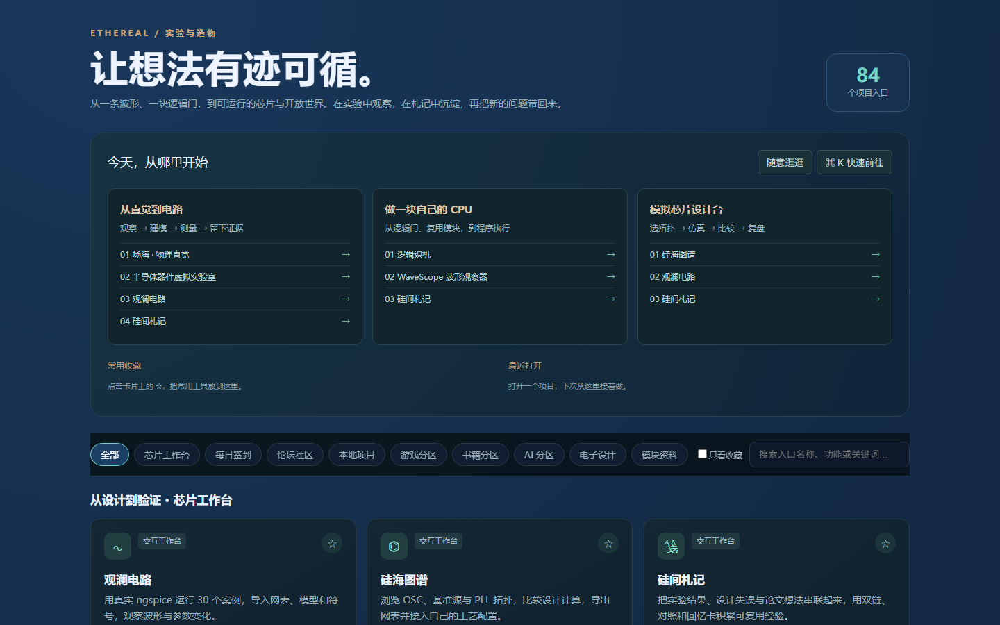

<div align="center">

[](https://etherealnymph.github.io/web-projects/index.html#projects) 

# Web Projects · 实验与造物

**Etherealnymph's collection of browser labs, learning tools and games.**

Etherealnymph 的浏览器实验、学习工具与游戏集合。

[](README_EN.md) [](README_CN.md) [](README.md)

**English** · [简体中文](README_CN.md) · [README index](README.md)

<a href="docs/portal.png"></a>

</div>

## Quick start · 快速开始

| | |
| --- | --- |
| Portal · 总入口 | [etherealnymph.github.io/web-projects/index.html#projects](https://etherealnymph.github.io/web-projects/index.html#projects) |
| English | [README_EN.md](README_EN.md) |
| 简体中文 | [README_CN.md](README_CN.md) |
| Original notes · 原说明 | [README_ORIGINAL.md](README_ORIGINAL.md) |

### English

A collection of self-contained browser projects: circuit and device labs, study tools, physics and math playgrounds, games, and a few server-backed applications. Most are static pages that need no build step and no account; data stays in the browser unless a project explicitly documents a backend.

### 简体中文

一组自包含的浏览器项目：电路与器件实验室、学习工具、物理与数学沙盒、游戏，以及少数需要服务端的应用。绝大多数是无需构建、无需账号的静态页面；除项目明确说明的后端外，数据都留在浏览器里。

## Projects

| Project | README | Live page | Description |
| --- | --- | --- | --- |
| **Analog Atlas** / 硅海图谱 | [EN](analog-atlas/README_EN.md) · [中文](analog-atlas/README_CN.md) | [open](https://etherealnymph.github.io/web-projects/analog-atlas/) | Analog design-space explorer for oscillators, references and PLLs. |
| **Bilingual Dictionary** / 中英双语词典 | [EN](bilingual-dictionary/README_EN.md) · [中文](bilingual-dictionary/README_CN.md) | [open](https://etherealnymph.github.io/web-projects/bilingual-dictionary/) | 1,684-entry EN⇄ZH dictionary for electronics and CS. |
| **Blog Platform** / 博客平台 | [EN](blog-platform/README_EN.md) · [中文](blog-platform/README_CN.md) | — | Express + MongoDB blog with invite-only accounts (server-side). |
| **Circuit Lab** / 观澜电路 | [EN](circuit-lab/README_EN.md) · [中文](circuit-lab/README_CN.md) | [open](https://etherealnymph.github.io/web-projects/circuit-lab/) | Real ngspice WebAssembly circuit simulation workbench. |
| **Field Drift** / 场海 | [EN](field-drift/README_EN.md) · [中文](field-drift/README_CN.md) | [open](https://etherealnymph.github.io/web-projects/field-drift/) | Electromagnetic drifting game, nine physics labs and a field studio. |
| **Fourier Contour** / 圆上之圆 | [EN](fourier-contour/README_EN.md) · [中文](fourier-contour/README_CN.md) | [open](https://etherealnymph.github.io/web-projects/fourier-contour/) | Epicycle drawing and image → Fourier parameter documents. |
| **GM/ID Studio** / GM/ID 设计工作台 | [EN](gm-id-studio/README_EN.md) · [中文](gm-id-studio/README_CN.md) | [open](https://etherealnymph.github.io/web-projects/gm-id-studio/dist/GM-ID-Studio.html) | gm/Id transistor sizing workbench on a TSMC 0.18 µm RF model card. |
| **Insight Space** / 体悟集 | [EN](insight-space/README_EN.md) · [中文](insight-space/README_CN.md) | [open](https://etherealnymph.github.io/web-projects/insight-space/) | Private invite-only journal with optional Supabase backend. |
| **Life Guide** / 高性价比人生指南 | [EN](life-guide/README_EN.md) · [中文](life-guide/README_CN.md) | [open](https://etherealnymph.github.io/web-projects/life-guide/) | 767 life recommendations scored by cost, payoff and evidence. |
| **Logic Loom** / 逻辑织机 | [EN](logic-loom/README_EN.md) · [中文](logic-loom/README_CN.md) | [open](https://etherealnymph.github.io/web-projects/logic-loom/) | Build an 8-bit CPU from NAND gates in 20 levels. |
| **Math Competition** / 大学生数学竞赛 | [EN](math-competition/README_EN.md) · [中文](math-competition/README_CN.md) | [open](https://etherealnymph.github.io/web-projects/math-competition/web/) | 208 competition problems with full solutions and a projector. |
| **Mini World** / 迷你世界 | [EN](mini-world/README_EN.md) · [中文](mini-world/README_CN.md) | [open](https://etherealnymph.github.io/web-projects/mini-world/) | Browser 3D voxel sandbox with ten worlds and vehicles. |
| **Number Sense Trainer** / 数感训练场 | [EN](number-sense-trainer.src/README_EN.md) · [中文](number-sense-trainer.src/README_CN.md) | [open](https://etherealnymph.github.io/web-projects/number-sense-trainer.html) |  |
| **Semiconductor Devices** / 半导体物理与器件 | [EN](semiconductor-devices/README_EN.md) · [中文](semiconductor-devices/README_CN.md) | [open](https://etherealnymph.github.io/web-projects/semiconductor-devices/) | One-page-per-question semiconductor physics final review. |
| **Silicon Notes** / 硅间札记 | [EN](silicon-notes/README_EN.md) · [中文](silicon-notes/README_CN.md) | [open](https://etherealnymph.github.io/web-projects/silicon-notes/) | Local-first chip-design notebook with evidence tracking. |
| **Tidal Soundscape** / 潮汐声景 | [EN](soundscape/README_EN.md) · [中文](soundscape/README_CN.md) | [open](https://etherealnymph.github.io/web-projects/soundscape/) | 18-layer real-time synthesized soundscape mixer. |
| **SPICE RF Calculator** / TSMC RF 器件计算器 | [EN](spice-rf-calculator/README_EN.md) · [中文](spice-rf-calculator/README_CN.md) | [open](https://etherealnymph.github.io/web-projects/spice-rf-calculator/spice-rf-calculator.html) | BSIM3v3 DC / small-signal / RF device calculator. |
| **Stock Trading Simulator** / 股市训练场 | [EN](stock-trading-simulator/README_EN.md) · [中文](stock-trading-simulator/README_CN.md) | [open](https://etherealnymph.github.io/web-projects/stock-trading-simulator/stock-trading-simulator.html) | Simulated A-share trading terminal with optional quote API. |
| **Stock Quote API** / A 股行情后端 | [EN](stock-quote-api/README_EN.md) · [中文](stock-quote-api/README_CN.md) | — | FastAPI + AKShare quote service (server-side). |

## Single-page projects

| Page | Live | What it is |
| --- | --- | --- |
| **Project Portal** | [index.html](https://etherealnymph.github.io/web-projects/index.html) | The portal with search, filters, favourites and learning paths. |
| **AI Tools Directory** | [ai-tools.html](https://etherealnymph.github.io/web-projects/ai-tools.html) | A curated directory of AI tools and services. |
| **Neon Rush 3D** | [neon-rush-3d.html](https://etherealnymph.github.io/web-projects/neon-rush-3d.html) | A neon-styled 3D endless runner built on local Three.js. |
| **Cat Playground** | [cat-playground.html](https://etherealnymph.github.io/web-projects/cat-playground.html) | A cat-themed interactive page. |
| **Cosmic History** | [cosmic-history.html](https://etherealnymph.github.io/web-projects/cosmic-history.html) | An interactive lesson on the origin and evolution of the solar system. |
| **DS-2000 Oscilloscope** | [ds-2000-oscilloscope.html](https://etherealnymph.github.io/web-projects/ds-2000-oscilloscope.html) | A simulated digital storage oscilloscope. |
| **DS-2000 Oscilloscope FFT** | [ds-2000-oscilloscope-fft.html](https://etherealnymph.github.io/web-projects/ds-2000-oscilloscope-fft.html) | The oscilloscope with FFT spectrum analysis. |
| **WaveScope** | [wave-scope.html](https://etherealnymph.github.io/web-projects/wave-scope.html) | Another waveform viewer for analog signals. |
| **Ecosystem Simulator** | [ecosystem-simulator.html](https://etherealnymph.github.io/web-projects/ecosystem-simulator.html) | Watch populations, resources and environment change over time. |
| **EMC Filter Lab** | [emc-filter-lab.html](https://etherealnymph.github.io/web-projects/emc-filter-lab.html) | Common-mode / differential-mode signals and EMC filters. |
| **ESP32C3 Panel** | [esp32c3-panel.html](https://etherealnymph.github.io/web-projects/esp32c3-panel.html) | An interactive control and hardware experiment page for ESP32C3. |
| **Fourier Legacy Lab** | [fourier-legacy.html](https://etherealnymph.github.io/web-projects/fourier-legacy.html) | The earlier Fourier experiment page, kept for comparison. |
| **Light Scattering Lab** | [light-scattering-lab.html](https://etherealnymph.github.io/web-projects/light-scattering-lab.html) | Rayleigh scattering, Mie scattering and geometric optics. |
| **PID Control Lab** | [pid-control-lab.html](https://etherealnymph.github.io/web-projects/pid-control-lab.html) | Visualise PID parameters against system response. |
| **PN Junction Lab** | [pn-junction-lab.html](https://etherealnymph.github.io/web-projects/pn-junction-lab.html) | PN-junction dynamics, parameters and characteristic curves. |
| **Vocabulary Quiz 180** | [vocabulary-quiz-180.html](https://etherealnymph.github.io/web-projects/vocabulary-quiz-180.html) | 180 English vocabulary multiple-choice questions. |
| **Sea War** | [seawar.html](https://etherealnymph.github.io/web-projects/seawar.html) | A Canvas real-time sea-territory strategy game with optional Supabase multiplayer. |
| **War Simulator** | [war-simulator.html](https://etherealnymph.github.io/web-projects/war-simulator.html) | A war simulation and strategy game. |
| **Lucky Slots** | [lucky-slots.html](https://etherealnymph.github.io/web-projects/lucky-slots.html) | A lightweight slot-machine game. |
| **Homework 1** | [homework-1.html](https://etherealnymph.github.io/web-projects/homework-1.html) | Course / lab homework page. |
| **Homework 3** | [homework-3.html](https://etherealnymph.github.io/web-projects/homework-3.html) | Course / lab homework page. |

## Local server

```bash
python -m http.server 8123
# http://127.0.0.1:8123/
```

---

**Contact · 联系方式:** Etherealnymph · [2115487769@qq.com](mailto:2115487769@qq.com)
