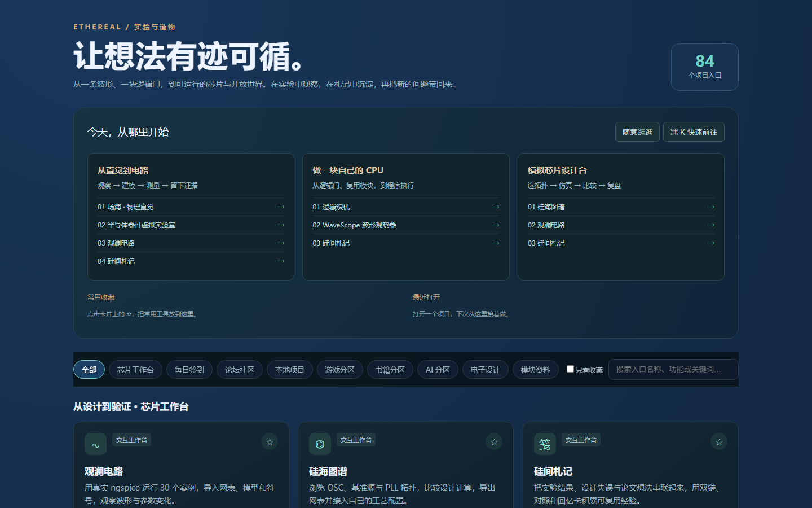

<div align="center">

[](https://etherealnymph.github.io/web-projects/index.html#projects) 

# 实验与造物 · Web Projects

**Etherealnymph 的浏览器实验、学习工具与游戏集合。**

[](README_EN.md) [](README_CN.md) [](README.md)

[English](README_EN.md) · **简体中文** · [README 索引](README.md)

<a href="docs/portal.png"></a>

</div>

## 项目简介

一组自包含的浏览器项目：电路与器件实验室、学习工具、物理与数学沙盒、游戏，以及少数需要服务端的应用。绝大多数是无需构建、无需账号的静态页面；除项目明确说明的后端外，数据都留在浏览器里。

大多数项目是纯 HTML/CSS/JavaScript，可直接打开。使用 ES Module、WebAssembly 或 JSON 数据的页面需要通过 HTTP 访问。两个项目需要服务端：**博客平台**（Node.js + MongoDB）与 **A 股行情后端**（FastAPI + AKShare）。

## 快速开始

| | |
| --- | --- |
| 项目总入口 | [index.html#projects](https://etherealnymph.github.io/web-projects/index.html#projects) |
| 本地 | `python -m http.server 8123`，打开 `http://127.0.0.1:8123/` |
| English | [README_EN.md](README_EN.md) |

## 项目

| 项目 | README | 网页 | 说明 |
| --- | --- | --- | --- |
| **硅海图谱** / Analog Atlas | [EN](analog-atlas/README_EN.md) · [中文](analog-atlas/README_CN.md) | [打开](https://etherealnymph.github.io/web-projects/analog-atlas/) | 振荡器、基准源与 PLL 的模拟设计空间浏览器。 |
| **中英双语词典** / Bilingual Dictionary | [EN](bilingual-dictionary/README_EN.md) · [中文](bilingual-dictionary/README_CN.md) | [打开](https://etherealnymph.github.io/web-projects/bilingual-dictionary/) | 1,684 词条的电子与计算机中英词典。 |
| **博客平台** / Blog Platform | [EN](blog-platform/README_EN.md) · [中文](blog-platform/README_CN.md) | — | Express + MongoDB 博客，邀请码注册（需服务端）。 |
| **观澜电路** / Circuit Lab | [EN](circuit-lab/README_EN.md) · [中文](circuit-lab/README_CN.md) | [打开](https://etherealnymph.github.io/web-projects/circuit-lab/) | 真实 ngspice WebAssembly 电路仿真工作台。 |
| **场海** / Field Drift | [EN](field-drift/README_EN.md) · [中文](field-drift/README_CN.md) | [打开](https://etherealnymph.github.io/web-projects/field-drift/) | 电磁漂流游戏、九个物理实验与场实验室。 |
| **圆上之圆** / Fourier Contour | [EN](fourier-contour/README_EN.md) · [中文](fourier-contour/README_CN.md) | [打开](https://etherealnymph.github.io/web-projects/fourier-contour/) | 圆上之圆绘图与图片转傅里叶参数文档。 |
| **GM/ID 设计工作台** / GM/ID Studio | [EN](gm-id-studio/README_EN.md) · [中文](gm-id-studio/README_CN.md) | [打开](https://etherealnymph.github.io/web-projects/gm-id-studio/dist/GM-ID-Studio.html) | 基于 TSMC 0.18 µm RF 模型卡的 gm/Id 设计工作台。 |
| **体悟集** / Insight Space | [EN](insight-space/README_EN.md) · [中文](insight-space/README_CN.md) | [打开](https://etherealnymph.github.io/web-projects/insight-space/) | 私人邀请制体悟空间，可选 Supabase 后端。 |
| **高性价比人生指南** / Life Guide | [EN](life-guide/README_EN.md) · [中文](life-guide/README_CN.md) | [打开](https://etherealnymph.github.io/web-projects/life-guide/) | 767 条按成本、收益与证据分级的生活建议。 |
| **逻辑织机** / Logic Loom | [EN](logic-loom/README_EN.md) · [中文](logic-loom/README_CN.md) | [打开](https://etherealnymph.github.io/web-projects/logic-loom/) | 20 关从 NAND 门搭出 8 位 CPU。 |
| **大学生数学竞赛** / Math Competition | [EN](math-competition/README_EN.md) · [中文](math-competition/README_CN.md) | [打开](https://etherealnymph.github.io/web-projects/math-competition/web/) | 208 道竞赛题、完整解答与一题一屏放映。 |
| **迷你世界** / Mini World | [EN](mini-world/README_EN.md) · [中文](mini-world/README_CN.md) | [打开](https://etherealnymph.github.io/web-projects/mini-world/) | 浏览器 3D 方块沙盒，十个世界与载具。 |
| **数感训练场** / Number Sense Trainer | [EN](number-sense-trainer.src/README_EN.md) · [中文](number-sense-trainer.src/README_CN.md) | [打开](https://etherealnymph.github.io/web-projects/number-sense-trainer.html) |  |
| **开源电路 EDA** / OpenCircuit EDA | [中文](opencircuit-eda/README.md) | [打开](https://etherealnymph.github.io/web-projects/opencircuit-eda/) | 浏览器内运行的 Spice 风格 EDA：原理图绘制、网表解析、MNA 直流/瞬态/交流仿真、示波器、频谱仪与 PDK 工艺库。 |
| **半导体物理与器件** / Semiconductor Devices | [EN](semiconductor-devices/README_EN.md) · [中文](semiconductor-devices/README_CN.md) | [打开](https://etherealnymph.github.io/web-projects/semiconductor-devices/) | 一页一题的半导体物理期末复习。 |
| **硅间札记** / Silicon Notes | [EN](silicon-notes/README_EN.md) · [中文](silicon-notes/README_CN.md) | [打开](https://etherealnymph.github.io/web-projects/silicon-notes/) | 本地优先的芯片设计笔记，带证据链。 |
| **潮汐声景** / Tidal Soundscape | [EN](soundscape/README_EN.md) · [中文](soundscape/README_CN.md) | [打开](https://etherealnymph.github.io/web-projects/soundscape/) | 18 层实时合成声景混音器。 |
| **TSMC RF 器件计算器** / SPICE RF Calculator | [EN](spice-rf-calculator/README_EN.md) · [中文](spice-rf-calculator/README_CN.md) | [打开](https://etherealnymph.github.io/web-projects/spice-rf-calculator/spice-rf-calculator.html) | BSIM3v3 直流 / 小信号 / RF 器件计算器。 |
| **股市训练场** / Stock Trading Simulator | [EN](stock-trading-simulator/README_EN.md) · [中文](stock-trading-simulator/README_CN.md) | [打开](https://etherealnymph.github.io/web-projects/stock-trading-simulator/stock-trading-simulator.html) | A 股模拟交易终端，可选行情后端。 |
| **A 股行情后端** / Stock Quote API | [EN](stock-quote-api/README_EN.md) · [中文](stock-quote-api/README_CN.md) | — | FastAPI + AKShare 行情服务（需服务端）。 |

## 单页项目

| 页面 | 网页 | 说明 |
| --- | --- | --- |
| **项目总入口** | [index.html](https://etherealnymph.github.io/web-projects/index.html) | 带搜索、筛选、收藏与学习路线的总入口。 |
| **AI 工具大全** | [ai-tools.html](https://etherealnymph.github.io/web-projects/ai-tools.html) | AI 工具与资源集合入口。 |
| **霓虹疾驰** | [neon-rush-3d.html](https://etherealnymph.github.io/web-projects/neon-rush-3d.html) | 霓虹风格 3D 跑酷游戏，使用本地 Three.js。 |
| **猫咪互动页** | [cat-playground.html](https://etherealnymph.github.io/web-projects/cat-playground.html) | 以猫咪为主题的互动娱乐页面。 |
| **宇宙历史** | [cosmic-history.html](https://etherealnymph.github.io/web-projects/cosmic-history.html) | 太阳系起源与演化的互动科普。 |
| **数字存储示波器** | [ds-2000-oscilloscope.html](https://etherealnymph.github.io/web-projects/ds-2000-oscilloscope.html) | 模拟数字存储示波器的波形观察页。 |
| **示波器 FFT 版** | [ds-2000-oscilloscope-fft.html](https://etherealnymph.github.io/web-projects/ds-2000-oscilloscope-fft.html) | 带 FFT 频谱分析的数字示波器。 |
| **波形观察器** | [wave-scope.html](https://etherealnymph.github.io/web-projects/wave-scope.html) | 用于观察模拟信号的波形工具。 |
| **生态系统模拟器** | [ecosystem-simulator.html](https://etherealnymph.github.io/web-projects/ecosystem-simulator.html) | 观察生物、资源与环境动态变化的模拟器。 |
| **EMC 滤波器实验室** | [emc-filter-lab.html](https://etherealnymph.github.io/web-projects/emc-filter-lab.html) | 共模、差模信号与 EMC 滤波器分析。 |
| **ESP32C3 控制面板** | [esp32c3-panel.html](https://etherealnymph.github.io/web-projects/esp32c3-panel.html) | 面向 ESP32C3 的交互控制与硬件实验页。 |
| **早期傅里叶实验** | [fourier-legacy.html](https://etherealnymph.github.io/web-projects/fourier-legacy.html) | 早期傅里叶实验页面，可与新版对照。 |
| **光的散射实验室** | [light-scattering-lab.html](https://etherealnymph.github.io/web-projects/light-scattering-lab.html) | 瑞利散射、米氏散射与几何光学演示。 |
| **控制算法可视化实验室** | [pid-control-lab.html](https://etherealnymph.github.io/web-projects/pid-control-lab.html) | 可视化 PID 参数与系统响应。 |
| **半导体器件虚拟实验室** | [pn-junction-lab.html](https://etherealnymph.github.io/web-projects/pn-junction-lab.html) | PN 结动力学、参数与特性曲线。 |
| **词汇选择题刷题** | [vocabulary-quiz-180.html](https://etherealnymph.github.io/web-projects/vocabulary-quiz-180.html) | 180 题英语词汇选择题练习。 |
| **怒海争锋** | [seawar.html](https://etherealnymph.github.io/web-projects/seawar.html) | Canvas 即时海域领地战，可选 Supabase 联网。 |
| **铁血战线** | [war-simulator.html](https://etherealnymph.github.io/web-projects/war-simulator.html) | 战争模拟与策略对抗。 |
| **幸运老虎机** | [lucky-slots.html](https://etherealnymph.github.io/web-projects/lucky-slots.html) | 轻量老虎机小游戏。 |
| **作业 1** | [homework-1.html](https://etherealnymph.github.io/web-projects/homework-1.html) | 课程或实验作业页面。 |
| **作业 3** | [homework-3.html](https://etherealnymph.github.io/web-projects/homework-3.html) | 课程或实验作业页面。 |

## 目录结构

```text
web-projects/
├─ index.html              # 总入口：搜索、筛选、收藏与学习路线
├─ assets/portal/          # 总入口样式与脚本
├─ <project>/              # 每个项目一个目录，含 README_EN / README_CN
├─ <page>.html             # 单页实验、游戏与工具
├─ stock-quote-api/        # FastAPI + AKShare 行情服务
└─ docs/portal.png
```

## 约定

- 每个项目目录保留 `README.md`（索引）、`README_EN.md`、`README_CN.md`，必要时附 `README_ORIGINAL.md` 保存原详细说明。
- 截图放在 `<project>/docs/`。
- 在线地址规则：`https://etherealnymph.github.io/web-projects/<path>`。

## 作者

**Etherealnymph** — [2115487769@qq.com](mailto:2115487769@qq.com)

更多项目：[web-projects](https://github.com/Etherealnymph/web-projects) · [项目总入口](https://etherealnymph.github.io/web-projects/index.html#projects)
