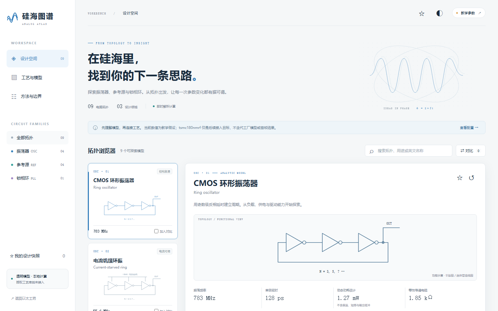

  

# Analog Atlas · 硅海图谱

**A zero-build design-space explorer for analog building blocks: ring and LC oscillators, voltage references and a charge-pump PLL.**

无需构建的模拟电路设计空间浏览器：环形 / LC 振荡器、电压基准与电荷泵 PLL。

  

**English** · [简体中文](README_CN.md) · [README index](README.md) · [All projects](../README.md)

## Quick links · 快速入口

| | |
| --- | --- |
| Project portal · 项目总入口 | [etherealnymph.github.io/web-projects/index.html#projects](https://etherealnymph.github.io/web-projects/index.html#projects) |
| Live page · 在线页面 | [https://etherealnymph.github.io/web-projects/analog-atlas/](https://etherealnymph.github.io/web-projects/analog-atlas/) |
| English | [README_EN.md](README_EN.md) |
| 简体中文 | [README_CN.md](README_CN.md) |
| Original detailed notes / 原详细说明 | [README_ORIGINAL.md](README_ORIGINAL.md) |

### English

Analog Atlas turns nine analytical analog topologies into an explorable design space. Move one parameter and the readouts are recomputed in the browser, with trade-off and sensitivity charts that show what the change costs.

### 简体中文

硅海图谱把九种解析式模拟拓扑变成可探索的设计空间。拖动一个参数，频率、延迟、功耗、增益与相位裕度会在浏览器内重新计算，并用权衡与局部敏感性图说明这次改动的代价。

---

**Contact · 联系方式:** Etherealnymph · [2115487769@qq.com](mailto:2115487769@qq.com)
