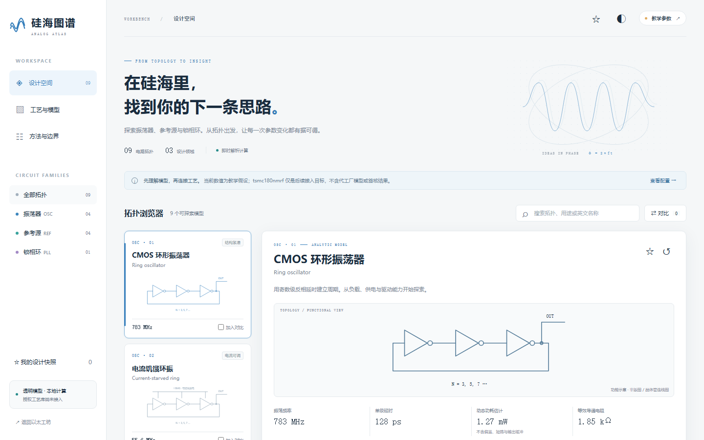

<div align="center">

[](https://etherealnymph.github.io/web-projects/analog-atlas/) [](https://etherealnymph.github.io/web-projects/index.html#projects) 

# 硅海图谱

**无需构建的模拟电路设计空间浏览器：环形 / LC 振荡器、电压基准与电荷泵 PLL。**

[](README_EN.md) [](README_CN.md) [](README.md)

[English](README_EN.md) · **简体中文** · [README 索引](README.md) · [全部项目](../README.md)

<a href="docs/screenshot.png"></a>

</div>

## 项目简介

硅海图谱把九种解析式模拟拓扑变成可探索的设计空间。拖动一个参数，频率、延迟、功耗、增益与相位裕度会在浏览器内重新计算，并用权衡与局部敏感性图说明这次改动的代价。

## 功能

- 九种拓扑：CMOS 环振、电流饥饿环振、交叉耦合 LC、恒流张弛、带隙、PTAT、CTAT、β 倍增基准与 Type-II 电荷泵 PLL。
- 拓扑浏览器支持分类筛选、搜索、原创原理图，以及最多四项设计的并排对比。
- 带单位的参数滑块、目标反算、81 点真实重算扫描，以及权衡与局部敏感性图。
- PLL 工作台：C₁∥(R+C₂) 无源滤波器综合、开环增益与相位、闭环相位传递、RK4 相位阶跃响应，并给出超调与 2% 稳定时间。
- 可导出 SPICE 网表、扫描 CSV 与 JSON 设计快照；支持明暗主题、键盘图表读数与手机布局。
- 通过同源 `ethereal.workspace.handoff.v1` 把通用教学网表交给观澜电路，资料不会上传。

## 网页入口

| 入口 | 链接 |
| --- | --- |
| 项目总入口 | [etherealnymph.github.io/web-projects/index.html#projects](https://etherealnymph.github.io/web-projects/index.html#projects) |
| 直接页面 | [https://etherealnymph.github.io/web-projects/analog-atlas/](https://etherealnymph.github.io/web-projects/analog-atlas/) |
| 本地 | 在仓库根目录执行 `python -m http.server 8123`，打开 `http://127.0.0.1:8123/analog-atlas/`。 |

## 项目结构

```text
analog-atlas/
├─ index.html              # entry, native ES modules, no build step
├─ app.mjs                 # UI shell and routing
├─ catalog.mjs             # topology registry
├─ models.mjs              # the nine analytical models
├─ netlists.mjs            # SPICE netlist generation
├─ chart-scale.mjs
├─ process.schema.json     # process-configuration schema
├─ style.css / favicon.svg
├─ examples/               # teaching process + example design snapshots
├─ docs/screenshot.png
└─ tests/                  # node:test suites for models and UI
```

原详细说明：[README_ORIGINAL.md](README_ORIGINAL.md)。

## 边界与说明

- 没有载入任何代工厂 PDK。`tsmc180nmrf` 只是预留的接入目标；默认供电、µnCox、阈值与温度系数是教学参数，不是工艺数据。
- 用户提供的工艺配置会标记为 `mode: user-supplied`，只表示由用户提供，不代表已验证或已授权。

## 其他项目

| 项目 | README | 网页 |
| --- | --- | --- |
| **Bilingual Dictionary** / 中英双语词典 | [README](../bilingual-dictionary/README.md) | [打开](https://etherealnymph.github.io/web-projects/bilingual-dictionary/) |
| **Blog Platform** / 博客平台 | [README](../blog-platform/README.md) | — *(需服务端)* |
| **Circuit Lab** / 观澜电路 | [README](../circuit-lab/README.md) | [打开](https://etherealnymph.github.io/web-projects/circuit-lab/) |
| **Field Drift** / 场海 | [README](../field-drift/README.md) | [打开](https://etherealnymph.github.io/web-projects/field-drift/) |
| **Fourier Contour** / 圆上之圆 | [README](../fourier-contour/README.md) | [打开](https://etherealnymph.github.io/web-projects/fourier-contour/) |
| **GM/ID Studio** / GM/ID 设计工作台 | [README](../gm-id-studio/README.md) | [打开](https://etherealnymph.github.io/web-projects/gm-id-studio/dist/GM-ID-Studio.html) |
| **Insight Space** / 体悟集 | [README](../insight-space/README.md) | [打开](https://etherealnymph.github.io/web-projects/insight-space/) |
| **Life Guide** / 高性价比人生指南 | [README](../life-guide/README.md) | [打开](https://etherealnymph.github.io/web-projects/life-guide/) |
| **Logic Loom** / 逻辑织机 | [README](../logic-loom/README.md) | [打开](https://etherealnymph.github.io/web-projects/logic-loom/) |
| **Math Competition** / 大学生数学竞赛 | [README](../math-competition/README.md) | [打开](https://etherealnymph.github.io/web-projects/math-competition/web/) |
| **Mini World** / 迷你世界 | [README](../mini-world/README.md) | [打开](https://etherealnymph.github.io/web-projects/mini-world/) |
| **Number Sense Trainer** / 数感训练场 | [README](../number-sense-trainer.src/README.md) | [打开](https://etherealnymph.github.io/web-projects/number-sense-trainer.html) |
| **Semiconductor Devices** / 半导体物理与器件 | [README](../semiconductor-devices/README.md) | [打开](https://etherealnymph.github.io/web-projects/semiconductor-devices/) |
| **Silicon Notes** / 硅间札记 | [README](../silicon-notes/README.md) | [打开](https://etherealnymph.github.io/web-projects/silicon-notes/) |
| **Tidal Soundscape** / 潮汐声景 | [README](../soundscape/README.md) | [打开](https://etherealnymph.github.io/web-projects/soundscape/) |
| **SPICE RF Calculator** / TSMC RF 器件计算器 | [README](../spice-rf-calculator/README.md) | [打开](https://etherealnymph.github.io/web-projects/spice-rf-calculator/spice-rf-calculator.html) |
| **Stock Trading Simulator** / 股市训练场 | [README](../stock-trading-simulator/README.md) | [打开](https://etherealnymph.github.io/web-projects/stock-trading-simulator/stock-trading-simulator.html) |
| **Stock Quote API** / A 股行情后端 | [README](../stock-quote-api/README.md) | — *(需服务端)* |


更多单页实验、游戏与工具见[仓库根 README](../README.md)。

## 作者

**Etherealnymph** — [2115487769@qq.com](mailto:2115487769@qq.com)

更多项目：[web-projects](https://github.com/Etherealnymph/web-projects) · [项目总入口](https://etherealnymph.github.io/web-projects/index.html#projects)
