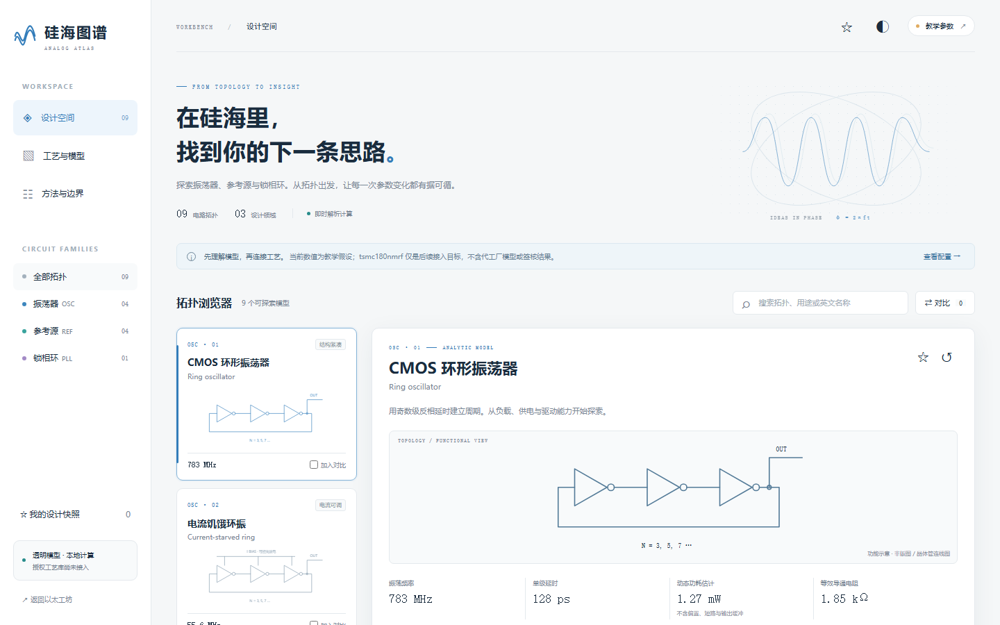

<div align="center">

[](https://etherealnymph.github.io/web-projects/analog-atlas/) [](https://etherealnymph.github.io/web-projects/index.html#projects) 

# Analog Atlas

**A zero-build design-space explorer for analog building blocks: ring and LC oscillators, voltage references and a charge-pump PLL.**

[](README_EN.md) [](README_CN.md) [](README.md)

**English** · [简体中文](README_CN.md) · [README index](README.md) · [All projects](../README.md)

<a href="docs/screenshot.png"></a>

</div>

## Overview

Analog Atlas turns nine analytical analog topologies into an explorable design space. Move one parameter and the readouts are recomputed in the browser, with trade-off and sensitivity charts that show what the change costs.

## Features

- Nine topologies: CMOS ring, current-starved ring, cross-coupled LC, constant-current relaxation, bandgap, PTAT, CTAT, β-multiplier reference and a Type-II charge-pump PLL.
- Topology browser with category filters, search, original schematics and side-by-side comparison of up to four designs.
- Unit-aware sliders, target back-calculation, 81-point re-simulation scans and trade-off / local-sensitivity charts.
- PLL workbench: C₁∥(R+C₂) passive-filter synthesis, open-loop gain and phase, closed-loop phase transfer, RK4 phase-step response with overshoot and 2 % settling time.
- Export SPICE netlists, scan CSV and JSON design snapshots; light/dark themes, keyboard chart readout and a mobile layout.
- Hands generic teaching netlists to Circuit Lab through the same-origin `ethereal.workspace.handoff.v1` key — nothing is uploaded.

## Live entry

| Entry | Link |
| --- | --- |
| Project portal | [etherealnymph.github.io/web-projects/index.html#projects](https://etherealnymph.github.io/web-projects/index.html#projects) |
| Direct page | [https://etherealnymph.github.io/web-projects/analog-atlas/](https://etherealnymph.github.io/web-projects/analog-atlas/) |
| Local | `python -m http.server 8123` at the repository root, then open `http://127.0.0.1:8123/analog-atlas/`. |

## Project structure

```text
analog-atlas/
├─ index.html              # entry, native ES modules, no build step
├─ app.mjs                 # UI shell and routing
├─ catalog.mjs             # topology registry
├─ models.mjs              # the nine analytical models
├─ netlists.mjs            # SPICE netlist generation
├─ chart-scale.mjs
├─ process.schema.json     # process-configuration schema
├─ style.css / favicon.svg
├─ examples/               # teaching process + example design snapshots
├─ docs/screenshot.png
└─ tests/                  # node:test suites for models and UI
```

Original detailed notes (Chinese): [README_ORIGINAL.md](README_ORIGINAL.md).

## Boundaries and notes

- No foundry PDK is loaded. `tsmc180nmrf` is only a named future target; the default supply, µnCox, threshold and temperature coefficients are teaching values, not silicon data.
- A user-supplied process is marked `mode: user-supplied`. That means user-provided — it does not imply a verified or licensed process.

## Other projects

| Project | README | Live page |
| --- | --- | --- |
| **Bilingual Dictionary** / 中英双语词典 | [README](../bilingual-dictionary/README.md) | [Open](https://etherealnymph.github.io/web-projects/bilingual-dictionary/) |
| **Blog Platform** / 博客平台 | [README](../blog-platform/README.md) | — *(server-side)* |
| **Circuit Lab** / 观澜电路 | [README](../circuit-lab/README.md) | [Open](https://etherealnymph.github.io/web-projects/circuit-lab/) |
| **Field Drift** / 场海 | [README](../field-drift/README.md) | [Open](https://etherealnymph.github.io/web-projects/field-drift/) |
| **Fourier Contour** / 圆上之圆 | [README](../fourier-contour/README.md) | [Open](https://etherealnymph.github.io/web-projects/fourier-contour/) |
| **GM/ID Studio** / GM/ID 设计工作台 | [README](../gm-id-studio/README.md) | [Open](https://etherealnymph.github.io/web-projects/gm-id-studio/dist/GM-ID-Studio.html) |
| **Insight Space** / 体悟集 | [README](../insight-space/README.md) | [Open](https://etherealnymph.github.io/web-projects/insight-space/) |
| **Life Guide** / 高性价比人生指南 | [README](../life-guide/README.md) | [Open](https://etherealnymph.github.io/web-projects/life-guide/) |
| **Logic Loom** / 逻辑织机 | [README](../logic-loom/README.md) | [Open](https://etherealnymph.github.io/web-projects/logic-loom/) |
| **Math Competition** / 大学生数学竞赛 | [README](../math-competition/README.md) | [Open](https://etherealnymph.github.io/web-projects/math-competition/web/) |
| **Mini World** / 迷你世界 | [README](../mini-world/README.md) | [Open](https://etherealnymph.github.io/web-projects/mini-world/) |
| **Number Sense Trainer** / 数感训练场 | [README](../number-sense-trainer.src/README.md) | [Open](https://etherealnymph.github.io/web-projects/number-sense-trainer.html) |
| **Semiconductor Devices** / 半导体物理与器件 | [README](../semiconductor-devices/README.md) | [Open](https://etherealnymph.github.io/web-projects/semiconductor-devices/) |
| **Silicon Notes** / 硅间札记 | [README](../silicon-notes/README.md) | [Open](https://etherealnymph.github.io/web-projects/silicon-notes/) |
| **Tidal Soundscape** / 潮汐声景 | [README](../soundscape/README.md) | [Open](https://etherealnymph.github.io/web-projects/soundscape/) |
| **SPICE RF Calculator** / TSMC RF 器件计算器 | [README](../spice-rf-calculator/README.md) | [Open](https://etherealnymph.github.io/web-projects/spice-rf-calculator/spice-rf-calculator.html) |
| **Stock Trading Simulator** / 股市训练场 | [README](../stock-trading-simulator/README.md) | [Open](https://etherealnymph.github.io/web-projects/stock-trading-simulator/stock-trading-simulator.html) |
| **Stock Quote API** / A 股行情后端 | [README](../stock-quote-api/README.md) | — *(server-side)* |


More single-page labs, games and tools are listed in the [repository README](../README.md).

## Author

**Etherealnymph** — [2115487769@qq.com](mailto:2115487769@qq.com)

More projects: [web-projects](https://github.com/Etherealnymph/web-projects) · [portal](https://etherealnymph.github.io/web-projects/index.html#projects)
