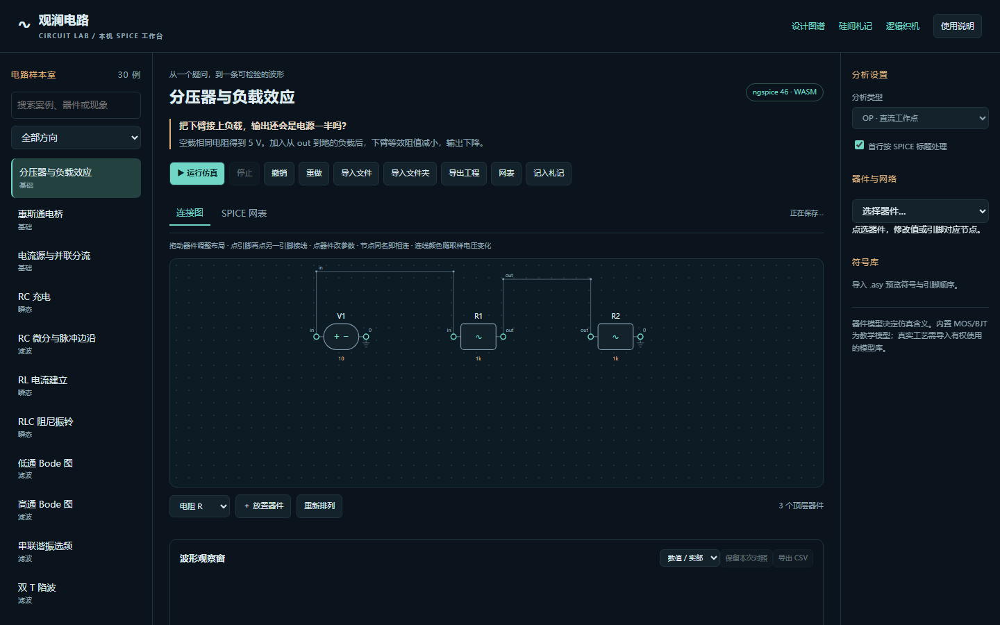

  

# Circuit Lab · 观澜电路

**A browser SPICE workbench running real ngspice 46 WebAssembly locally — no CDN, no upload.**

在浏览器里运行真实 ngspice 46 WebAssembly 的 SPICE 工作台：无 CDN、不上传。

  

**English** · [简体中文](README_CN.md) · [README index](README.md) · [All projects](../README.md)

## Quick links · 快速入口

| | |
| --- | --- |
| Project portal · 项目总入口 | [etherealnymph.github.io/web-projects/index.html#projects](https://etherealnymph.github.io/web-projects/index.html#projects) |
| Live page · 在线页面 | [https://etherealnymph.github.io/web-projects/circuit-lab/](https://etherealnymph.github.io/web-projects/circuit-lab/) |
| English | [README_EN.md](README_EN.md) |
| 简体中文 | [README_CN.md](README_CN.md) |
| Original detailed notes / 原详细说明 | [README_ORIGINAL.md](README_ORIGINAL.md) |

### English

Circuit Lab packs a schematic editor, a netlist editor and a waveform viewer around a genuine ngspice 46 WebAssembly engine. Models and files stay on your machine: everything runs in a Web Worker and no third-party CDN is contacted at runtime.

### 简体中文

观澜电路把原理图编辑器、网表编辑器和波形观察窗接到真实的 ngspice 46 WebAssembly 引擎上。模型与文件都留在本机：计算在 Web Worker 内完成，运行时不访问任何第三方 CDN。

---

**Contact · 联系方式:** Etherealnymph · [2115487769@qq.com](mailto:2115487769@qq.com)
