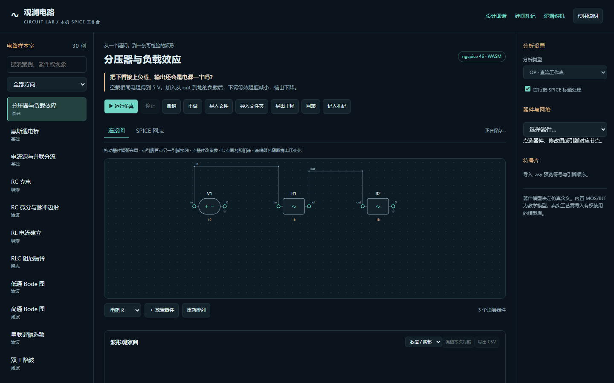

<div align="center">

[](https://etherealnymph.github.io/web-projects/circuit-lab/) [](https://etherealnymph.github.io/web-projects/index.html#projects) 

# 观澜电路

**在浏览器里运行真实 ngspice 46 WebAssembly 的 SPICE 工作台：无 CDN、不上传。**

[](README_EN.md) [](README_CN.md) [](README.md)

[English](README_EN.md) · **简体中文** · [README 索引](README.md) · [全部项目](../README.md)

<a href="docs/screenshot.png"></a>

</div>

## 项目简介

观澜电路把原理图编辑器、网表编辑器和波形观察窗接到真实的 ngspice 46 WebAssembly 引擎上。模型与文件都留在本机：计算在 Web Worker 内完成，运行时不访问任何第三方 CDN。

## 功能

- 30 个内置案例：分压、电桥、RC/RL/RLC、整流、电流镜、差分对、运放、环振 / LC 振荡、PLL 滤波与变压器。
- 拖动器件布局、点选引脚连线、修改参数与节点名、增删器件、编辑原始网表、撤销 / 重做。
- 可导入 `.cir/.sp/.spice/.net` 网表、`.lib/.mod/.inc` 模型，以及 LTspice `.asy` 符号和带引用符号的 `.asc` 原理图。
- 支持 OP、TRAN、AC、DC 分析；波形取样、AC 幅度 / 相位、以虚线对照上一次结果，并可导出完整复数 CSV。
- 全部在浏览器内完成：模型与文件在 Worker 中本地处理，运行时不依赖第三方 CDN。

## 网页入口

| 入口 | 链接 |
| --- | --- |
| 项目总入口 | [etherealnymph.github.io/web-projects/index.html#projects](https://etherealnymph.github.io/web-projects/index.html#projects) |
| 直接页面 | [https://etherealnymph.github.io/web-projects/circuit-lab/](https://etherealnymph.github.io/web-projects/circuit-lab/) |
| 本地 | 在仓库根目录起静态服务（`python -m http.server 8123`），打开 `http://127.0.0.1:8123/circuit-lab/`。 |

## 项目结构

```text
circuit-lab/
├─ index.html
├─ js/                     # editor, netlist, analysis and waveform modules
├─ style.css
├─ vendor/                 # ngspice 46 WebAssembly + worker
├─ examples/               # example projects and models
├─ tools/                  # conversion helpers (.asc/.asy → netlist)
├─ docs/screenshot.png
└─ tests/                  # node:test + browser smoke tests
```

原详细说明：[README_ORIGINAL.md](README_ORIGINAL.md)。

## 边界与说明

- 通用器件模型仅用于教学。真实设计需要获得授权的工艺模型。

## 其他项目

| 项目 | README | 网页 |
| --- | --- | --- |
| **Analog Atlas** / 硅海图谱 | [README](../analog-atlas/README.md) | [打开](https://etherealnymph.github.io/web-projects/analog-atlas/) |
| **Bilingual Dictionary** / 中英双语词典 | [README](../bilingual-dictionary/README.md) | [打开](https://etherealnymph.github.io/web-projects/bilingual-dictionary/) |
| **Blog Platform** / 博客平台 | [README](../blog-platform/README.md) | — *(需服务端)* |
| **Field Drift** / 场海 | [README](../field-drift/README.md) | [打开](https://etherealnymph.github.io/web-projects/field-drift/) |
| **Fourier Contour** / 圆上之圆 | [README](../fourier-contour/README.md) | [打开](https://etherealnymph.github.io/web-projects/fourier-contour/) |
| **GM/ID Studio** / GM/ID 设计工作台 | [README](../gm-id-studio/README.md) | [打开](https://etherealnymph.github.io/web-projects/gm-id-studio/dist/GM-ID-Studio.html) |
| **Insight Space** / 体悟集 | [README](../insight-space/README.md) | [打开](https://etherealnymph.github.io/web-projects/insight-space/) |
| **Life Guide** / 高性价比人生指南 | [README](../life-guide/README.md) | [打开](https://etherealnymph.github.io/web-projects/life-guide/) |
| **Logic Loom** / 逻辑织机 | [README](../logic-loom/README.md) | [打开](https://etherealnymph.github.io/web-projects/logic-loom/) |
| **Math Competition** / 大学生数学竞赛 | [README](../math-competition/README.md) | [打开](https://etherealnymph.github.io/web-projects/math-competition/web/) |
| **Mini World** / 迷你世界 | [README](../mini-world/README.md) | [打开](https://etherealnymph.github.io/web-projects/mini-world/) |
| **Number Sense Trainer** / 数感训练场 | [README](../number-sense-trainer.src/README.md) | [打开](https://etherealnymph.github.io/web-projects/number-sense-trainer.html) |
| **Semiconductor Devices** / 半导体物理与器件 | [README](../semiconductor-devices/README.md) | [打开](https://etherealnymph.github.io/web-projects/semiconductor-devices/) |
| **Silicon Notes** / 硅间札记 | [README](../silicon-notes/README.md) | [打开](https://etherealnymph.github.io/web-projects/silicon-notes/) |
| **Tidal Soundscape** / 潮汐声景 | [README](../soundscape/README.md) | [打开](https://etherealnymph.github.io/web-projects/soundscape/) |
| **SPICE RF Calculator** / TSMC RF 器件计算器 | [README](../spice-rf-calculator/README.md) | [打开](https://etherealnymph.github.io/web-projects/spice-rf-calculator/spice-rf-calculator.html) |
| **Stock Trading Simulator** / 股市训练场 | [README](../stock-trading-simulator/README.md) | [打开](https://etherealnymph.github.io/web-projects/stock-trading-simulator/stock-trading-simulator.html) |
| **Stock Quote API** / A 股行情后端 | [README](../stock-quote-api/README.md) | — *(需服务端)* |


更多单页实验、游戏与工具见[仓库根 README](../README.md)。

## 作者

**Etherealnymph** — [2115487769@qq.com](mailto:2115487769@qq.com)

更多项目：[web-projects](https://github.com/Etherealnymph/web-projects) · [项目总入口](https://etherealnymph.github.io/web-projects/index.html#projects)
