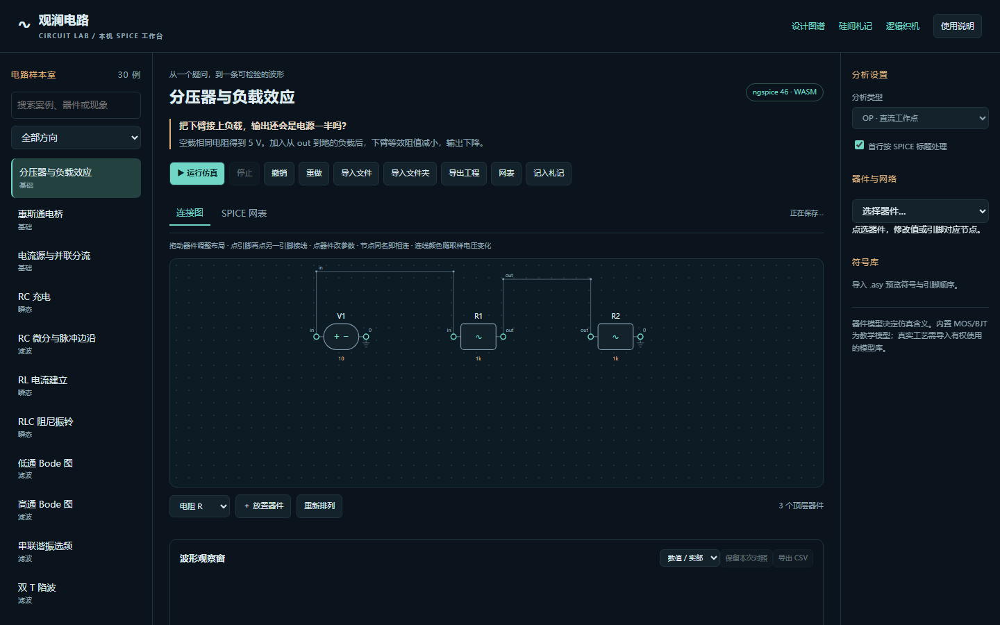

<div align="center">

[](https://etherealnymph.github.io/web-projects/circuit-lab/) [](https://etherealnymph.github.io/web-projects/index.html#projects) 

# Circuit Lab

**A browser SPICE workbench running real ngspice 46 WebAssembly locally — no CDN, no upload.**

[](README_EN.md) [](README_CN.md) [](README.md)

**English** · [简体中文](README_CN.md) · [README index](README.md) · [All projects](../README.md)

<a href="docs/screenshot.png"></a>

</div>

## Overview

Circuit Lab packs a schematic editor, a netlist editor and a waveform viewer around a genuine ngspice 46 WebAssembly engine. Models and files stay on your machine: everything runs in a Web Worker and no third-party CDN is contacted at runtime.

## Features

- 30 built-in cases: dividers, bridges, RC/RL/RLC, rectifiers, current mirrors, differential pairs, op-amps, ring/LC oscillators, PLL filters and transformers.
- Drag components, click pins to wire nets, edit values and node names, add or remove parts, edit the raw netlist, undo/redo.
- Import `.cir/.sp/.spice/.net` netlists, `.lib/.mod/.inc` models, LTspice `.asy` symbols and `.asc` schematics with their referenced symbols.
- Run OP, TRAN, AC and DC analyses; sample traces, read AC magnitude/phase, compare with the previous run as a dashed ghost, export complex CSV.
- Everything stays in the browser: models and files are processed locally in a Worker, with no third-party CDN at runtime.

## Live entry

| Entry | Link |
| --- | --- |
| Project portal | [etherealnymph.github.io/web-projects/index.html#projects](https://etherealnymph.github.io/web-projects/index.html#projects) |
| Direct page | [https://etherealnymph.github.io/web-projects/circuit-lab/](https://etherealnymph.github.io/web-projects/circuit-lab/) |
| Local | Serve the repository root (`python -m http.server 8123`) and open `http://127.0.0.1:8123/circuit-lab/`. |

## Project structure

```text
circuit-lab/
├─ index.html
├─ js/                     # editor, netlist, analysis and waveform modules
├─ style.css
├─ vendor/                 # ngspice 46 WebAssembly + worker
├─ examples/               # example projects and models
├─ tools/                  # conversion helpers (.asc/.asy → netlist)
├─ docs/screenshot.png
└─ tests/                  # node:test + browser smoke tests
```

Original detailed notes (Chinese): [README_ORIGINAL.md](README_ORIGINAL.md).

## Boundaries and notes

- Generic device models are for teaching. Real designs need authorised foundry models.

## Other projects

| Project | README | Live page |
| --- | --- | --- |
| **Analog Atlas** / 硅海图谱 | [README](../analog-atlas/README.md) | [Open](https://etherealnymph.github.io/web-projects/analog-atlas/) |
| **Bilingual Dictionary** / 中英双语词典 | [README](../bilingual-dictionary/README.md) | [Open](https://etherealnymph.github.io/web-projects/bilingual-dictionary/) |
| **Blog Platform** / 博客平台 | [README](../blog-platform/README.md) | — *(server-side)* |
| **Field Drift** / 场海 | [README](../field-drift/README.md) | [Open](https://etherealnymph.github.io/web-projects/field-drift/) |
| **Fourier Contour** / 圆上之圆 | [README](../fourier-contour/README.md) | [Open](https://etherealnymph.github.io/web-projects/fourier-contour/) |
| **GM/ID Studio** / GM/ID 设计工作台 | [README](../gm-id-studio/README.md) | [Open](https://etherealnymph.github.io/web-projects/gm-id-studio/dist/GM-ID-Studio.html) |
| **Insight Space** / 体悟集 | [README](../insight-space/README.md) | [Open](https://etherealnymph.github.io/web-projects/insight-space/) |
| **Life Guide** / 高性价比人生指南 | [README](../life-guide/README.md) | [Open](https://etherealnymph.github.io/web-projects/life-guide/) |
| **Logic Loom** / 逻辑织机 | [README](../logic-loom/README.md) | [Open](https://etherealnymph.github.io/web-projects/logic-loom/) |
| **Math Competition** / 大学生数学竞赛 | [README](../math-competition/README.md) | [Open](https://etherealnymph.github.io/web-projects/math-competition/web/) |
| **Mini World** / 迷你世界 | [README](../mini-world/README.md) | [Open](https://etherealnymph.github.io/web-projects/mini-world/) |
| **Number Sense Trainer** / 数感训练场 | [README](../number-sense-trainer.src/README.md) | [Open](https://etherealnymph.github.io/web-projects/number-sense-trainer.html) |
| **Semiconductor Devices** / 半导体物理与器件 | [README](../semiconductor-devices/README.md) | [Open](https://etherealnymph.github.io/web-projects/semiconductor-devices/) |
| **Silicon Notes** / 硅间札记 | [README](../silicon-notes/README.md) | [Open](https://etherealnymph.github.io/web-projects/silicon-notes/) |
| **Tidal Soundscape** / 潮汐声景 | [README](../soundscape/README.md) | [Open](https://etherealnymph.github.io/web-projects/soundscape/) |
| **SPICE RF Calculator** / TSMC RF 器件计算器 | [README](../spice-rf-calculator/README.md) | [Open](https://etherealnymph.github.io/web-projects/spice-rf-calculator/spice-rf-calculator.html) |
| **Stock Trading Simulator** / 股市训练场 | [README](../stock-trading-simulator/README.md) | [Open](https://etherealnymph.github.io/web-projects/stock-trading-simulator/stock-trading-simulator.html) |
| **Stock Quote API** / A 股行情后端 | [README](../stock-quote-api/README.md) | — *(server-side)* |


More single-page labs, games and tools are listed in the [repository README](../README.md).

## Author

**Etherealnymph** — [2115487769@qq.com](mailto:2115487769@qq.com)

More projects: [web-projects](https://github.com/Etherealnymph/web-projects) · [portal](https://etherealnymph.github.io/web-projects/index.html#projects)
