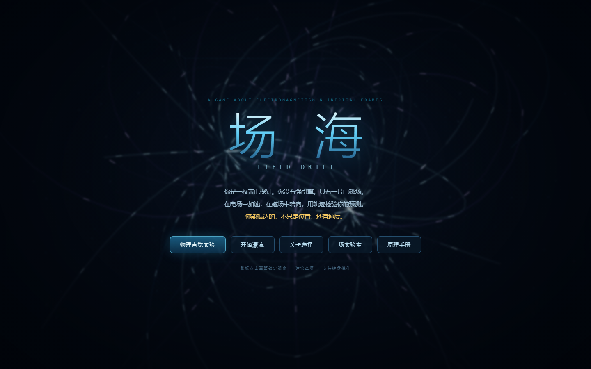

  

# Field Drift · 场海

**An electromagnetic sandbox: drift through q(E+v×B) fields, run nine intuition labs, and build your own field sources.**

电磁场沙盒：在 q(E+v×B) 场中漂流，做九个物理直觉实验，并搭建自己的场源。

  

**English** · [简体中文](README_CN.md) · [README index](README.md) · [All projects](../README.md)

## Quick links · 快速入口

| | |
| --- | --- |
| Project portal · 项目总入口 | [etherealnymph.github.io/web-projects/index.html#projects](https://etherealnymph.github.io/web-projects/index.html#projects) |
| Live page · 在线页面 | [https://etherealnymph.github.io/web-projects/field-drift/](https://etherealnymph.github.io/web-projects/field-drift/) |
| English | [README_EN.md](README_EN.md) |
| 简体中文 | [README_CN.md](README_CN.md) |

### English

Field Drift turns the Lorentz force into something you can steer. The same page hosts a seven-level drifting campaign, nine guided physics labs with explicit model boundaries, and a field studio where you place charges and currents and inspect the resulting potentials.

### 简体中文

场海把洛伦兹力变成可以亲手操纵的东西。同一个页面里有七关漂流战役、九个标明模型边界的物理直觉实验，以及可以放置电荷与电流、查看电势与磁矢势的场实验室。

---

**Contact · 联系方式:** Etherealnymph · [2115487769@qq.com](mailto:2115487769@qq.com)
