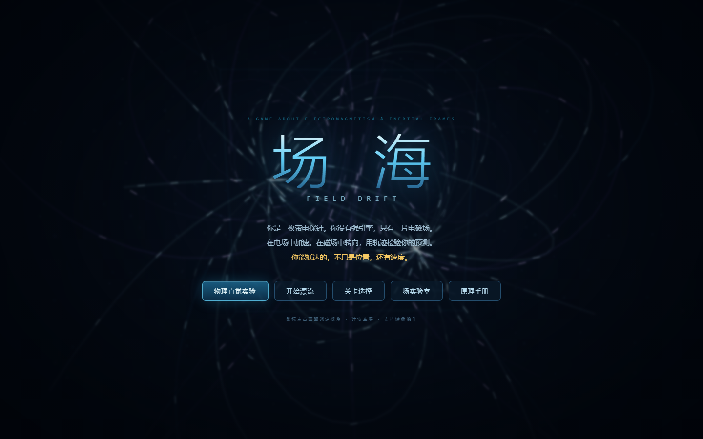

<div align="center">

[](https://etherealnymph.github.io/web-projects/field-drift/) [](https://etherealnymph.github.io/web-projects/index.html#projects) 

# 场海

**电磁场沙盒：在 q(E+v×B) 场中漂流，做九个物理直觉实验，并搭建自己的场源。**

[](README_EN.md) [](README_CN.md) [](README.md)

[English](README_EN.md) · **简体中文** · [README 索引](README.md) · [全部项目](../README.md)

<a href="docs/screenshot.png"></a>

</div>

## 项目简介

场海把洛伦兹力变成可以亲手操纵的东西。同一个页面里有七关漂流战役、九个标明模型边界的物理直觉实验，以及可以放置电荷与电流、查看电势与磁矢势的场实验室。

## 功能

- 九个引导实验：磁场回旋、速度选择器、阻力与霍耳漂移、单摆、受迫共振、带阻力抛体、圆轨道到逃逸、磁通感应与驻波。
- 七关漂流战役使用相对论 Boris 积分器、固定 1/120 秒步长、0.93c 速度上限，门的计时按实际完成的物理步长计算。
- 场实验室：放置电荷、偶极子、线 / 面 / 体电流与螺线管，实时查看 φ 电势与 A 磁矢势切面。
- 给出轨迹、受力、能量与功率读数，每个案例都显示方程与适用范围。
- 支持鼠标、键盘与触屏；预测提示只保留在当前页面。

## 网页入口

| 入口 | 链接 |
| --- | --- |
| 项目总入口 | [etherealnymph.github.io/web-projects/index.html#projects](https://etherealnymph.github.io/web-projects/index.html#projects) |
| 直接页面 | [https://etherealnymph.github.io/web-projects/field-drift/](https://etherealnymph.github.io/web-projects/field-drift/) |
| 本地 | 直接打开 `field-drift/index.html`，或在根目录起服务后打开 `http://127.0.0.1:8123/field-drift/`。 |

## 项目结构

```text
field-drift/
├─ index.html              # menu, labs, campaign and field studio
├─ css/
├─ js/                     # integrators, field sources, rendering, UI
├─ docs/screenshot.png
├─ DESIGN.md               # physics models, units and boundaries
└─ tests/                  # node:test physics and UI tests
```

## 边界与说明

- 力学实验使用 SI 单位；电磁轨迹采用 c = m = 1。每个实验页都写有自己的约定。
- 矢量箭头使用压缩长度映射——方向可靠，大小应以读数为准。

## 其他项目

| 项目 | README | 网页 |
| --- | --- | --- |
| **Analog Atlas** / 硅海图谱 | [README](../analog-atlas/README.md) | [打开](https://etherealnymph.github.io/web-projects/analog-atlas/) |
| **Bilingual Dictionary** / 中英双语词典 | [README](../bilingual-dictionary/README.md) | [打开](https://etherealnymph.github.io/web-projects/bilingual-dictionary/) |
| **Blog Platform** / 博客平台 | [README](../blog-platform/README.md) | — *(需服务端)* |
| **Circuit Lab** / 观澜电路 | [README](../circuit-lab/README.md) | [打开](https://etherealnymph.github.io/web-projects/circuit-lab/) |
| **Fourier Contour** / 圆上之圆 | [README](../fourier-contour/README.md) | [打开](https://etherealnymph.github.io/web-projects/fourier-contour/) |
| **GM/ID Studio** / GM/ID 设计工作台 | [README](../gm-id-studio/README.md) | [打开](https://etherealnymph.github.io/web-projects/gm-id-studio/dist/GM-ID-Studio.html) |
| **Insight Space** / 体悟集 | [README](../insight-space/README.md) | [打开](https://etherealnymph.github.io/web-projects/insight-space/) |
| **Life Guide** / 高性价比人生指南 | [README](../life-guide/README.md) | [打开](https://etherealnymph.github.io/web-projects/life-guide/) |
| **Logic Loom** / 逻辑织机 | [README](../logic-loom/README.md) | [打开](https://etherealnymph.github.io/web-projects/logic-loom/) |
| **Math Competition** / 大学生数学竞赛 | [README](../math-competition/README.md) | [打开](https://etherealnymph.github.io/web-projects/math-competition/web/) |
| **Mini World** / 迷你世界 | [README](../mini-world/README.md) | [打开](https://etherealnymph.github.io/web-projects/mini-world/) |
| **Number Sense Trainer** / 数感训练场 | [README](../number-sense-trainer.src/README.md) | [打开](https://etherealnymph.github.io/web-projects/number-sense-trainer.html) |
| **Semiconductor Devices** / 半导体物理与器件 | [README](../semiconductor-devices/README.md) | [打开](https://etherealnymph.github.io/web-projects/semiconductor-devices/) |
| **Silicon Notes** / 硅间札记 | [README](../silicon-notes/README.md) | [打开](https://etherealnymph.github.io/web-projects/silicon-notes/) |
| **Tidal Soundscape** / 潮汐声景 | [README](../soundscape/README.md) | [打开](https://etherealnymph.github.io/web-projects/soundscape/) |
| **SPICE RF Calculator** / TSMC RF 器件计算器 | [README](../spice-rf-calculator/README.md) | [打开](https://etherealnymph.github.io/web-projects/spice-rf-calculator/spice-rf-calculator.html) |
| **Stock Trading Simulator** / 股市训练场 | [README](../stock-trading-simulator/README.md) | [打开](https://etherealnymph.github.io/web-projects/stock-trading-simulator/stock-trading-simulator.html) |
| **Stock Quote API** / A 股行情后端 | [README](../stock-quote-api/README.md) | — *(需服务端)* |


更多单页实验、游戏与工具见[仓库根 README](../README.md)。

## 作者

**Etherealnymph** — [2115487769@qq.com](mailto:2115487769@qq.com)

更多项目：[web-projects](https://github.com/Etherealnymph/web-projects) · [项目总入口](https://etherealnymph.github.io/web-projects/index.html#projects)
