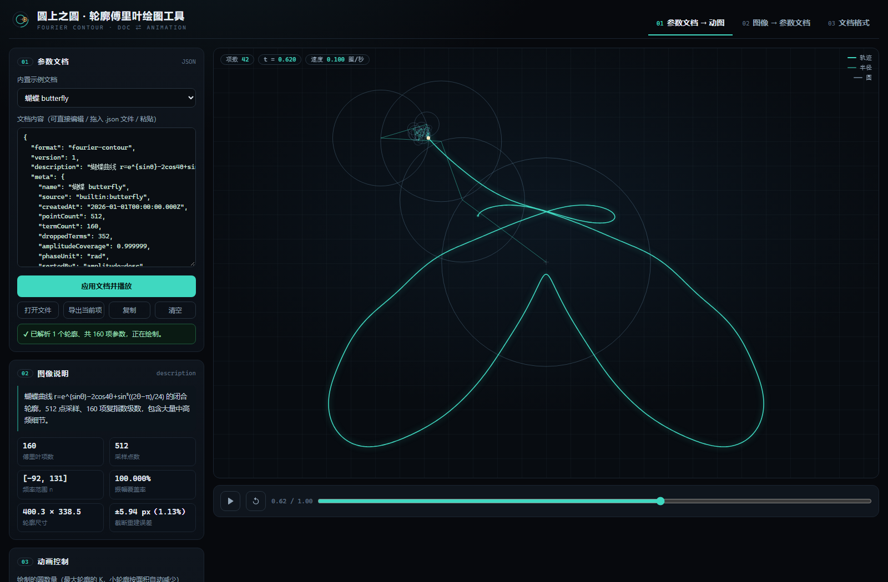

  

# Fourier Contour · 圆上之圆

**Draw any outline with epicycles — and turn images into editable Fourier parameter documents.**

用圆上之圆画出任意轮廓，也能把图片转换成可编辑的傅里叶参数文档。

  

**English** · [简体中文](README_CN.md) · [README index](README.md) · [All projects](../README.md)

## Quick links · 快速入口

| | |
| --- | --- |
| Project portal · 项目总入口 | [etherealnymph.github.io/web-projects/index.html#projects](https://etherealnymph.github.io/web-projects/index.html#projects) |
| Live page · 在线页面 | [https://etherealnymph.github.io/web-projects/fourier-contour/](https://etherealnymph.github.io/web-projects/fourier-contour/) |
| English | [README_EN.md](README_EN.md) |
| 简体中文 | [README_CN.md](README_CN.md) |
| Original detailed notes / 原详细说明 | [README_ORIGINAL.md](README_ORIGINAL.md) |

### English

A two-way tool: feed it a Fourier parameter document and watch a pen trace the whole outline, or feed it an image and get back a readable, editable parameter document that reproduces every contour — including interior holes.

### 简体中文

一个双向工具：传入傅里叶系数参数文档，就能看到笔尖一笔画出整条轮廓；传入图片，则会把全部轮廓（含内部孔洞）做傅里叶展开，导出一份可读、可编辑、可版本管理的参数文档。

---

**Contact · 联系方式:** Etherealnymph · [2115487769@qq.com](mailto:2115487769@qq.com)
