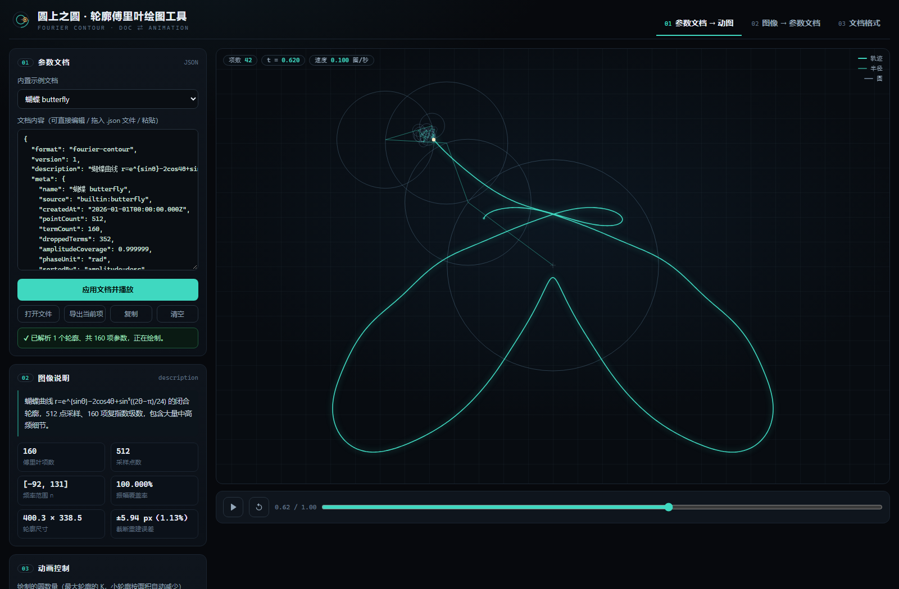

<div align="center">

[](https://etherealnymph.github.io/web-projects/fourier-contour/) [](https://etherealnymph.github.io/web-projects/index.html#projects) 

# 圆上之圆

**用圆上之圆画出任意轮廓，也能把图片转换成可编辑的傅里叶参数文档。**

[](README_EN.md) [](README_CN.md) [](README.md)

[English](README_EN.md) · **简体中文** · [README 索引](README.md) · [全部项目](../README.md)

<a href="docs/screenshot.png"></a>

</div>

## 项目简介

一个双向工具：传入傅里叶系数参数文档，就能看到笔尖一笔画出整条轮廓；传入图片，则会把全部轮廓（含内部孔洞）做傅里叶展开，导出一份可读、可编辑、可版本管理的参数文档。

## 功能

- 参数文档 → 动图：播放经典的“圆上之圆”动画，多轮廓时多条链条同时作画。
- 图像 → 参数文档：提取全部轮廓（包括孔洞），做傅里叶展开，导出可编辑的参数文档。
- 速度可调：每圈 0.5 秒到 60 秒，或 0.5×–20× 预设；支持滚轮缩放、拖动平移与双击复位。
- 空格、方向键等快捷键；内置三个示例。
- 零依赖、零构建、零后端：双击 `index.html` 即可使用。

## 网页入口

| 入口 | 链接 |
| --- | --- |
| 项目总入口 | [etherealnymph.github.io/web-projects/index.html#projects](https://etherealnymph.github.io/web-projects/index.html#projects) |
| 直接页面 | [https://etherealnymph.github.io/web-projects/fourier-contour/](https://etherealnymph.github.io/web-projects/fourier-contour/) |
| 本地 | 双击 `fourier-contour/index.html`，或在根目录起服务后打开 `http://127.0.0.1:8123/fourier-contour/`。 |

## 项目结构

```text
fourier-contour/
├─ index.html              # both directions of the tool
├─ assets/                 # example images and parameter documents
├─ docs/                   # screenshot, previews and parameter-format spec
├─ tools/                  # helper scripts
├─ package.json
└─ README.md / README_EN.md / README_CN.md
```

原详细说明：[README_ORIGINAL.md](README_ORIGINAL.md)。

## 其他项目

| 项目 | README | 网页 |
| --- | --- | --- |
| **Analog Atlas** / 硅海图谱 | [README](../analog-atlas/README.md) | [打开](https://etherealnymph.github.io/web-projects/analog-atlas/) |
| **Bilingual Dictionary** / 中英双语词典 | [README](../bilingual-dictionary/README.md) | [打开](https://etherealnymph.github.io/web-projects/bilingual-dictionary/) |
| **Blog Platform** / 博客平台 | [README](../blog-platform/README.md) | — *(需服务端)* |
| **Circuit Lab** / 观澜电路 | [README](../circuit-lab/README.md) | [打开](https://etherealnymph.github.io/web-projects/circuit-lab/) |
| **Field Drift** / 场海 | [README](../field-drift/README.md) | [打开](https://etherealnymph.github.io/web-projects/field-drift/) |
| **GM/ID Studio** / GM/ID 设计工作台 | [README](../gm-id-studio/README.md) | [打开](https://etherealnymph.github.io/web-projects/gm-id-studio/dist/GM-ID-Studio.html) |
| **Insight Space** / 体悟集 | [README](../insight-space/README.md) | [打开](https://etherealnymph.github.io/web-projects/insight-space/) |
| **Life Guide** / 高性价比人生指南 | [README](../life-guide/README.md) | [打开](https://etherealnymph.github.io/web-projects/life-guide/) |
| **Logic Loom** / 逻辑织机 | [README](../logic-loom/README.md) | [打开](https://etherealnymph.github.io/web-projects/logic-loom/) |
| **Math Competition** / 大学生数学竞赛 | [README](../math-competition/README.md) | [打开](https://etherealnymph.github.io/web-projects/math-competition/web/) |
| **Mini World** / 迷你世界 | [README](../mini-world/README.md) | [打开](https://etherealnymph.github.io/web-projects/mini-world/) |
| **Number Sense Trainer** / 数感训练场 | [README](../number-sense-trainer.src/README.md) | [打开](https://etherealnymph.github.io/web-projects/number-sense-trainer.html) |
| **Semiconductor Devices** / 半导体物理与器件 | [README](../semiconductor-devices/README.md) | [打开](https://etherealnymph.github.io/web-projects/semiconductor-devices/) |
| **Silicon Notes** / 硅间札记 | [README](../silicon-notes/README.md) | [打开](https://etherealnymph.github.io/web-projects/silicon-notes/) |
| **Tidal Soundscape** / 潮汐声景 | [README](../soundscape/README.md) | [打开](https://etherealnymph.github.io/web-projects/soundscape/) |
| **SPICE RF Calculator** / TSMC RF 器件计算器 | [README](../spice-rf-calculator/README.md) | [打开](https://etherealnymph.github.io/web-projects/spice-rf-calculator/spice-rf-calculator.html) |
| **Stock Trading Simulator** / 股市训练场 | [README](../stock-trading-simulator/README.md) | [打开](https://etherealnymph.github.io/web-projects/stock-trading-simulator/stock-trading-simulator.html) |
| **Stock Quote API** / A 股行情后端 | [README](../stock-quote-api/README.md) | — *(需服务端)* |


更多单页实验、游戏与工具见[仓库根 README](../README.md)。

## 作者

**Etherealnymph** — [2115487769@qq.com](mailto:2115487769@qq.com)

更多项目：[web-projects](https://github.com/Etherealnymph/web-projects) · [项目总入口](https://etherealnymph.github.io/web-projects/index.html#projects)
