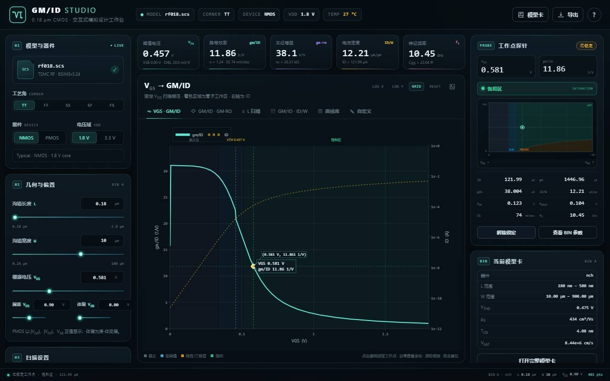

  

# GM/ID Studio · GM/ID 设计工作台

**An interactive gm/Id design workbench built on a TSMC 0.18 µm RF BSIM3v3.24 model card.**

基于 TSMC 0.18 µm RF BSIM3v3.24 模型卡的交互式 gm/Id 设计工作台。

  

**English** · [简体中文](README_CN.md) · [README index](README.md) · [All projects](../README.md)

## Quick links · 快速入口

| | |
| --- | --- |
| Project portal · 项目总入口 | [etherealnymph.github.io/web-projects/index.html#projects](https://etherealnymph.github.io/web-projects/index.html#projects) |
| Live page · 在线页面 | [https://etherealnymph.github.io/web-projects/gm-id-studio/dist/GM-ID-Studio.html](https://etherealnymph.github.io/web-projects/gm-id-studio/dist/GM-ID-Studio.html) |
| English | [README_EN.md](README_EN.md) |
| 简体中文 | [README_CN.md](README_CN.md) |
| Original detailed notes / 原详细说明 | [README_ORIGINAL.md](README_ORIGINAL.md) |

### English

GM/ID Studio plots the relationships a CMOS designer actually sizes with: VGS → gm/Id, gm/Id → intrinsic gain, L sweeps and current density. Click any curve to lock an operating point and read every small-signal quantity behind it.

### 简体中文

GM/ID Studio 画出 CMOS 设计真正用来定尺寸的几条关系：VGS → gm/Id、gm/Id → 本征增益、L 扫描与电流密度。点击曲线即可锁定工作点，读出背后的全部小信号量。

---

**Contact · 联系方式:** Etherealnymph · [2115487769@qq.com](mailto:2115487769@qq.com)
