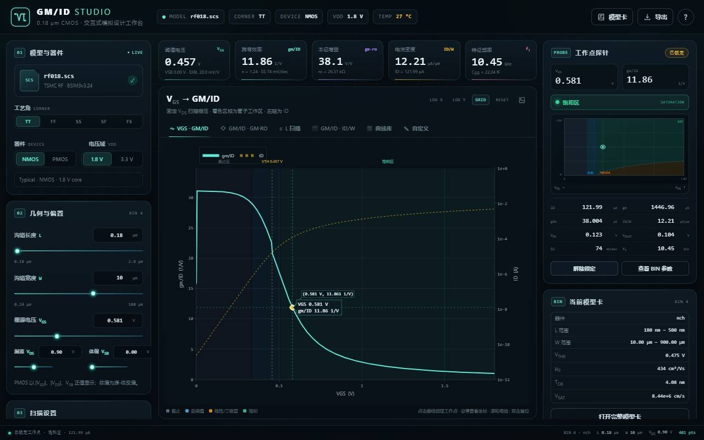

<div align="center">

[](https://etherealnymph.github.io/web-projects/gm-id-studio/dist/GM-ID-Studio.html) [](https://etherealnymph.github.io/web-projects/index.html#projects) 

# GM/ID 设计工作台

**基于 TSMC 0.18 µm RF BSIM3v3.24 模型卡的交互式 gm/Id 设计工作台。**

[](README_EN.md) [](README_CN.md) [](README.md)

[English](README_EN.md) · **简体中文** · [README 索引](README.md) · [全部项目](../README.md)

<a href="docs/screenshot.jpg"></a>

</div>

## 项目简介

GM/ID Studio 画出 CMOS 设计真正用来定尺寸的几条关系：VGS → gm/Id、gm/Id → 本征增益、L 扫描与电流密度。点击曲线即可锁定工作点，读出背后的全部小信号量。

## 功能

- VGS → gm/Id：左轴 gm/Id、右轴 ID，按截止 / 亚阈值 / 线性 / 饱和着色。
- GM/ID → GM·RO（本征增益）、L 扫描，以及 GM/ID → ID/W 电流密度设计图。
- 六组辅助曲线：ID–VGS、gm–VGS、gds–VGS、fT–GM/ID、ID–VDS 输出族与 GM/ID–VOV。
- 任选 X / Y 指标、L 或 VDS 曲线族，并支持 `gm/Id*1e3`、`gm*ro` 之类的 Y 表达式。
- 工作点探针：锁定一点即可读 VTH、VOV、VDSAT、ID、gm、gds、ID/W、SS 与 fT。
- 模型卡检查器：匹配的 BSIM3 BIN、全部 16 个 BIN 与来源 SHA-256；最终以单文件离线 HTML 交付。

## 网页入口

| 入口 | 链接 |
| --- | --- |
| 项目总入口 | [etherealnymph.github.io/web-projects/index.html#projects](https://etherealnymph.github.io/web-projects/index.html#projects) |
| 直接页面 | [https://etherealnymph.github.io/web-projects/gm-id-studio/dist/GM-ID-Studio.html](https://etherealnymph.github.io/web-projects/gm-id-studio/dist/GM-ID-Studio.html) |
| 本地 | 双击 `dist/GM-ID-Studio.html`（或 `Start-GM-ID-Studio.bat`）。不需要 Python、Node 或任何服务。 |

## 项目结构

```text
gm-id-studio/
├─ dist/GM-ID-Studio.html   # single-file offline build (entry)
├─ src/                      # application source and TSMC model parsing
├─ tools/                    # model checks, sweeps, build scripts
├─ vendor/
├─ model-data.json
├─ preview.jpg
├─ docs/screenshot.jpg
├─ Start-GM-ID-Studio.bat    # Windows launcher
└─ README.md / README_EN.md / README_CN.md
```

原详细说明：[README_ORIGINAL.md](README_ORIGINAL.md)。

## 边界与说明

- 设计曲线由随包的 `rf018.scs` 模型数据计算。再次分发模型参数前请确认模型卡授权。

## 其他项目

| 项目 | README | 网页 |
| --- | --- | --- |
| **Analog Atlas** / 硅海图谱 | [README](../analog-atlas/README.md) | [打开](https://etherealnymph.github.io/web-projects/analog-atlas/) |
| **Bilingual Dictionary** / 中英双语词典 | [README](../bilingual-dictionary/README.md) | [打开](https://etherealnymph.github.io/web-projects/bilingual-dictionary/) |
| **Blog Platform** / 博客平台 | [README](../blog-platform/README.md) | — *(需服务端)* |
| **Circuit Lab** / 观澜电路 | [README](../circuit-lab/README.md) | [打开](https://etherealnymph.github.io/web-projects/circuit-lab/) |
| **Field Drift** / 场海 | [README](../field-drift/README.md) | [打开](https://etherealnymph.github.io/web-projects/field-drift/) |
| **Fourier Contour** / 圆上之圆 | [README](../fourier-contour/README.md) | [打开](https://etherealnymph.github.io/web-projects/fourier-contour/) |
| **Insight Space** / 体悟集 | [README](../insight-space/README.md) | [打开](https://etherealnymph.github.io/web-projects/insight-space/) |
| **Life Guide** / 高性价比人生指南 | [README](../life-guide/README.md) | [打开](https://etherealnymph.github.io/web-projects/life-guide/) |
| **Logic Loom** / 逻辑织机 | [README](../logic-loom/README.md) | [打开](https://etherealnymph.github.io/web-projects/logic-loom/) |
| **Math Competition** / 大学生数学竞赛 | [README](../math-competition/README.md) | [打开](https://etherealnymph.github.io/web-projects/math-competition/web/) |
| **Mini World** / 迷你世界 | [README](../mini-world/README.md) | [打开](https://etherealnymph.github.io/web-projects/mini-world/) |
| **Number Sense Trainer** / 数感训练场 | [README](../number-sense-trainer.src/README.md) | [打开](https://etherealnymph.github.io/web-projects/number-sense-trainer.html) |
| **Semiconductor Devices** / 半导体物理与器件 | [README](../semiconductor-devices/README.md) | [打开](https://etherealnymph.github.io/web-projects/semiconductor-devices/) |
| **Silicon Notes** / 硅间札记 | [README](../silicon-notes/README.md) | [打开](https://etherealnymph.github.io/web-projects/silicon-notes/) |
| **Tidal Soundscape** / 潮汐声景 | [README](../soundscape/README.md) | [打开](https://etherealnymph.github.io/web-projects/soundscape/) |
| **SPICE RF Calculator** / TSMC RF 器件计算器 | [README](../spice-rf-calculator/README.md) | [打开](https://etherealnymph.github.io/web-projects/spice-rf-calculator/spice-rf-calculator.html) |
| **Stock Trading Simulator** / 股市训练场 | [README](../stock-trading-simulator/README.md) | [打开](https://etherealnymph.github.io/web-projects/stock-trading-simulator/stock-trading-simulator.html) |
| **Stock Quote API** / A 股行情后端 | [README](../stock-quote-api/README.md) | — *(需服务端)* |


更多单页实验、游戏与工具见[仓库根 README](../README.md)。

## 作者

**Etherealnymph** — [2115487769@qq.com](mailto:2115487769@qq.com)

更多项目：[web-projects](https://github.com/Etherealnymph/web-projects) · [项目总入口](https://etherealnymph.github.io/web-projects/index.html#projects)
