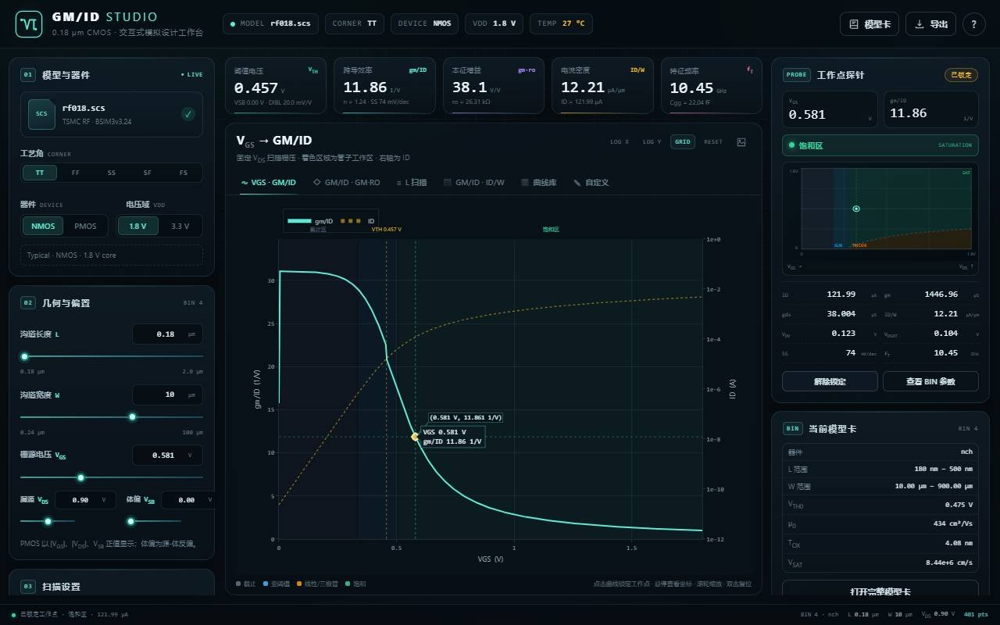

<div align="center">

[](https://etherealnymph.github.io/web-projects/gm-id-studio/dist/GM-ID-Studio.html) [](https://etherealnymph.github.io/web-projects/index.html#projects) 

# GM/ID Studio

**An interactive gm/Id design workbench built on a TSMC 0.18 µm RF BSIM3v3.24 model card.**

[](README_EN.md) [](README_CN.md) [](README.md)

**English** · [简体中文](README_CN.md) · [README index](README.md) · [All projects](../README.md)

<a href="docs/screenshot.jpg"></a>

</div>

## Overview

GM/ID Studio plots the relationships a CMOS designer actually sizes with: VGS → gm/Id, gm/Id → intrinsic gain, L sweeps and current density. Click any curve to lock an operating point and read every small-signal quantity behind it.

## Features

- VGS → gm/Id with drain current on the right axis, coloured by cutoff / subthreshold / linear / saturation.
- gm/Id → gm·ro (intrinsic gain), L sweep and gm/Id → ID/W current-density design chart.
- Six auxiliary curve families: ID–VGS, gm–VGS, gds–VGS, fT–gm/Id, ID–VDS output family and gm/Id–VOV.
- Custom X/Y metrics, L or VDS curve families and Y expressions such as `gm/Id*1e3` or `gm*ro`.
- Operating-point probe: lock a point to read VTH, VOV, VDSAT, ID, gm, gds, ID/W, SS and fT.
- Model-card inspector: matched BSIM3 bin, all 16 bins and the source SHA-256; ships as one offline HTML file.

## Live entry

| Entry | Link |
| --- | --- |
| Project portal | [etherealnymph.github.io/web-projects/index.html#projects](https://etherealnymph.github.io/web-projects/index.html#projects) |
| Direct page | [https://etherealnymph.github.io/web-projects/gm-id-studio/dist/GM-ID-Studio.html](https://etherealnymph.github.io/web-projects/gm-id-studio/dist/GM-ID-Studio.html) |
| Local | Double-click `dist/GM-ID-Studio.html` (or `Start-GM-ID-Studio.bat`). No Python, Node or server is needed. |

## Project structure

```text
gm-id-studio/
├─ dist/GM-ID-Studio.html   # single-file offline build (entry)
├─ src/                      # application source and TSMC model parsing
├─ tools/                    # model checks, sweeps, build scripts
├─ vendor/
├─ model-data.json
├─ preview.jpg
├─ docs/screenshot.jpg
├─ Start-GM-ID-Studio.bat    # Windows launcher
└─ README.md / README_EN.md / README_CN.md
```

Original detailed notes (Chinese): [README_ORIGINAL.md](README_ORIGINAL.md).

## Boundaries and notes

- Design curves are computed from the bundled `rf018.scs` model data. Check the model-card licence before redistributing the parameters.

## Other projects

| Project | README | Live page |
| --- | --- | --- |
| **Analog Atlas** / 硅海图谱 | [README](../analog-atlas/README.md) | [Open](https://etherealnymph.github.io/web-projects/analog-atlas/) |
| **Bilingual Dictionary** / 中英双语词典 | [README](../bilingual-dictionary/README.md) | [Open](https://etherealnymph.github.io/web-projects/bilingual-dictionary/) |
| **Blog Platform** / 博客平台 | [README](../blog-platform/README.md) | — *(server-side)* |
| **Circuit Lab** / 观澜电路 | [README](../circuit-lab/README.md) | [Open](https://etherealnymph.github.io/web-projects/circuit-lab/) |
| **Field Drift** / 场海 | [README](../field-drift/README.md) | [Open](https://etherealnymph.github.io/web-projects/field-drift/) |
| **Fourier Contour** / 圆上之圆 | [README](../fourier-contour/README.md) | [Open](https://etherealnymph.github.io/web-projects/fourier-contour/) |
| **Insight Space** / 体悟集 | [README](../insight-space/README.md) | [Open](https://etherealnymph.github.io/web-projects/insight-space/) |
| **Life Guide** / 高性价比人生指南 | [README](../life-guide/README.md) | [Open](https://etherealnymph.github.io/web-projects/life-guide/) |
| **Logic Loom** / 逻辑织机 | [README](../logic-loom/README.md) | [Open](https://etherealnymph.github.io/web-projects/logic-loom/) |
| **Math Competition** / 大学生数学竞赛 | [README](../math-competition/README.md) | [Open](https://etherealnymph.github.io/web-projects/math-competition/web/) |
| **Mini World** / 迷你世界 | [README](../mini-world/README.md) | [Open](https://etherealnymph.github.io/web-projects/mini-world/) |
| **Number Sense Trainer** / 数感训练场 | [README](../number-sense-trainer.src/README.md) | [Open](https://etherealnymph.github.io/web-projects/number-sense-trainer.html) |
| **Semiconductor Devices** / 半导体物理与器件 | [README](../semiconductor-devices/README.md) | [Open](https://etherealnymph.github.io/web-projects/semiconductor-devices/) |
| **Silicon Notes** / 硅间札记 | [README](../silicon-notes/README.md) | [Open](https://etherealnymph.github.io/web-projects/silicon-notes/) |
| **Tidal Soundscape** / 潮汐声景 | [README](../soundscape/README.md) | [Open](https://etherealnymph.github.io/web-projects/soundscape/) |
| **SPICE RF Calculator** / TSMC RF 器件计算器 | [README](../spice-rf-calculator/README.md) | [Open](https://etherealnymph.github.io/web-projects/spice-rf-calculator/spice-rf-calculator.html) |
| **Stock Trading Simulator** / 股市训练场 | [README](../stock-trading-simulator/README.md) | [Open](https://etherealnymph.github.io/web-projects/stock-trading-simulator/stock-trading-simulator.html) |
| **Stock Quote API** / A 股行情后端 | [README](../stock-quote-api/README.md) | — *(server-side)* |


More single-page labs, games and tools are listed in the [repository README](../README.md).

## Author

**Etherealnymph** — [2115487769@qq.com](mailto:2115487769@qq.com)

More projects: [web-projects](https://github.com/Etherealnymph/web-projects) · [portal](https://etherealnymph.github.io/web-projects/index.html#projects)
