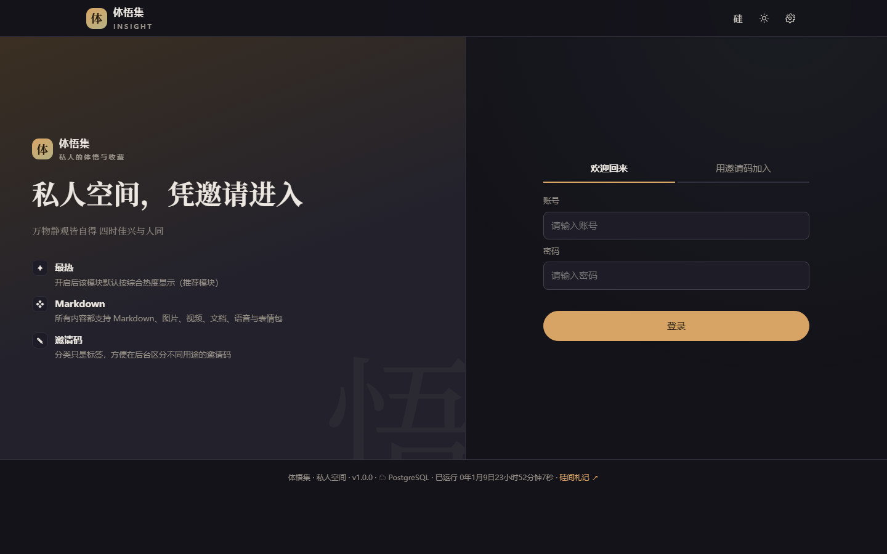

<div align="center">

[](https://etherealnymph.github.io/web-projects/insight-space/) [](https://etherealnymph.github.io/web-projects/index.html#projects) 

# 体悟集

**可部署为静态站点的私人「体悟」空间，可选 Supabase 后端支持真实多人账号。**

[](README_EN.md) [](README_CN.md) [](README.md)

[English](README_EN.md) · **简体中文** · [README 索引](README.md) · [全部项目](../README.md)

<a href="docs/screenshot.png"></a>

</div>

## 项目简介

体悟集是一个小型私人社区站点：推荐、日记、诗歌、文案与评论，配合邀请码注册和超管后台。不配置任何后端时使用浏览器 IndexedDB 直接运行；接入 Supabase 后则有真实账号与跨设备同步。

## 功能

- 推荐（按综合热度排序）、日记、诗歌、文案、评论等模块，超管可在后台自由增删改。
- 邀请码注册：超管管理邀请码与账号；邀请码停用或过期后对应访问立即失效。
- 内容支持图片、视频、文档、Markdown 正文、语音与表情包。
- 点赞、踩、收藏与多级评论；个人主页可改昵称与密码，支持中英文切换与日夜主题。
- 两种模式：本地 IndexedDB（打开即用）或 Supabase（真实账号、权限与跨设备同步）。
- 无需构建：原生 ES Module，Supabase SDK 固定在本地。

## 网页入口

| 入口 | 链接 |
| --- | --- |
| 项目总入口 | [etherealnymph.github.io/web-projects/index.html#projects](https://etherealnymph.github.io/web-projects/index.html#projects) |
| 直接页面 | [https://etherealnymph.github.io/web-projects/insight-space/](https://etherealnymph.github.io/web-projects/insight-space/) |
| 本地 | 直接打开 `insight-space/index.html`，或在根目录起服务后打开 `http://127.0.0.1:8123/insight-space/`。 |

## 项目结构

```text
insight-space/
├─ index.html
├─ src/                    # modules, router, data layer
├─ assets/
├─ supabase/               # schema, migrations and operations
├─ proxy/                  # optional local API proxy
├─ tests/                  # UI fixture + frontend/data tests
├─ tools/
├─ vendor/
└─ docs/                   # upgrade and deployment guides + screenshot
```

原详细说明：[README_ORIGINAL.md](README_ORIGINAL.md)。

## 边界与说明

- 本地模式只是“一个人一台浏览器”：没有服务端权限校验，清缓存会丢数据。需要多人使用时请配置 Supabase。

## 其他项目

| 项目 | README | 网页 |
| --- | --- | --- |
| **Analog Atlas** / 硅海图谱 | [README](../analog-atlas/README.md) | [打开](https://etherealnymph.github.io/web-projects/analog-atlas/) |
| **Bilingual Dictionary** / 中英双语词典 | [README](../bilingual-dictionary/README.md) | [打开](https://etherealnymph.github.io/web-projects/bilingual-dictionary/) |
| **Blog Platform** / 博客平台 | [README](../blog-platform/README.md) | — *(需服务端)* |
| **Circuit Lab** / 观澜电路 | [README](../circuit-lab/README.md) | [打开](https://etherealnymph.github.io/web-projects/circuit-lab/) |
| **Field Drift** / 场海 | [README](../field-drift/README.md) | [打开](https://etherealnymph.github.io/web-projects/field-drift/) |
| **Fourier Contour** / 圆上之圆 | [README](../fourier-contour/README.md) | [打开](https://etherealnymph.github.io/web-projects/fourier-contour/) |
| **GM/ID Studio** / GM/ID 设计工作台 | [README](../gm-id-studio/README.md) | [打开](https://etherealnymph.github.io/web-projects/gm-id-studio/dist/GM-ID-Studio.html) |
| **Life Guide** / 高性价比人生指南 | [README](../life-guide/README.md) | [打开](https://etherealnymph.github.io/web-projects/life-guide/) |
| **Logic Loom** / 逻辑织机 | [README](../logic-loom/README.md) | [打开](https://etherealnymph.github.io/web-projects/logic-loom/) |
| **Math Competition** / 大学生数学竞赛 | [README](../math-competition/README.md) | [打开](https://etherealnymph.github.io/web-projects/math-competition/web/) |
| **Mini World** / 迷你世界 | [README](../mini-world/README.md) | [打开](https://etherealnymph.github.io/web-projects/mini-world/) |
| **Number Sense Trainer** / 数感训练场 | [README](../number-sense-trainer.src/README.md) | [打开](https://etherealnymph.github.io/web-projects/number-sense-trainer.html) |
| **Semiconductor Devices** / 半导体物理与器件 | [README](../semiconductor-devices/README.md) | [打开](https://etherealnymph.github.io/web-projects/semiconductor-devices/) |
| **Silicon Notes** / 硅间札记 | [README](../silicon-notes/README.md) | [打开](https://etherealnymph.github.io/web-projects/silicon-notes/) |
| **Tidal Soundscape** / 潮汐声景 | [README](../soundscape/README.md) | [打开](https://etherealnymph.github.io/web-projects/soundscape/) |
| **SPICE RF Calculator** / TSMC RF 器件计算器 | [README](../spice-rf-calculator/README.md) | [打开](https://etherealnymph.github.io/web-projects/spice-rf-calculator/spice-rf-calculator.html) |
| **Stock Trading Simulator** / 股市训练场 | [README](../stock-trading-simulator/README.md) | [打开](https://etherealnymph.github.io/web-projects/stock-trading-simulator/stock-trading-simulator.html) |
| **Stock Quote API** / A 股行情后端 | [README](../stock-quote-api/README.md) | — *(需服务端)* |


更多单页实验、游戏与工具见[仓库根 README](../README.md)。

## 作者

**Etherealnymph** — [2115487769@qq.com](mailto:2115487769@qq.com)

更多项目：[web-projects](https://github.com/Etherealnymph/web-projects) · [项目总入口](https://etherealnymph.github.io/web-projects/index.html#projects)
