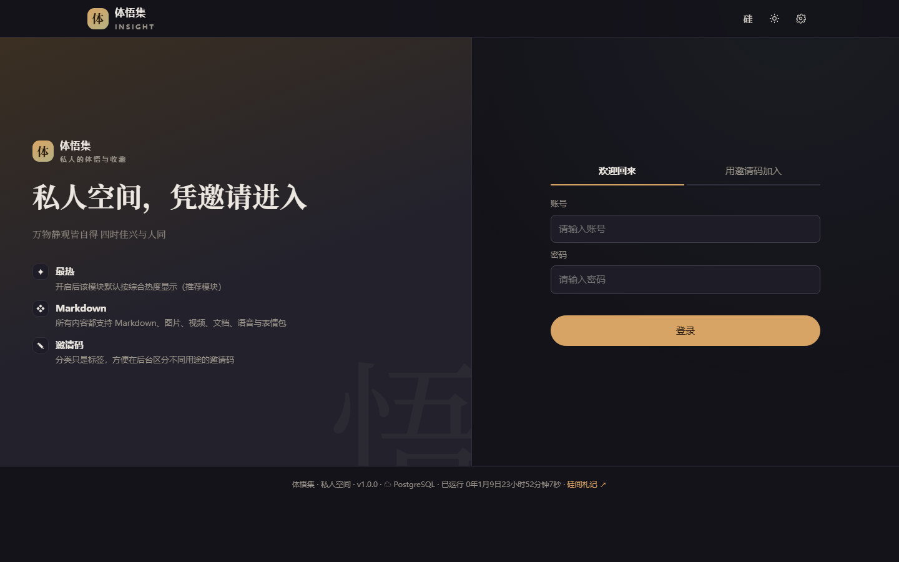

<div align="center">

[](https://etherealnymph.github.io/web-projects/insight-space/) [](https://etherealnymph.github.io/web-projects/index.html#projects) 

# Insight Space

**A private, invite-only insight journal that ships as a static site, with an optional Supabase backend for real multi-user accounts.**

[](README_EN.md) [](README_CN.md) [](README.md)

**English** · [简体中文](README_CN.md) · [README index](README.md) · [All projects](../README.md)

<a href="docs/screenshot.png"></a>

</div>

## Overview

Insight Space is a small private community site: recommendations, diaries, poetry, copy writing and comments, with invite-code onboarding and a superadmin console. It runs with zero configuration on IndexedDB, or against Supabase for real accounts and cross-device sync.

## Features

- Modules for recommendations (ranked by combined heat), diaries, poetry, copy writing and comments; the superadmin can add, edit and remove any module.
- Invite-code registration: the superadmin manages codes and accounts; disabling or expiring a code cuts access immediately.
- Rich content: images, video, documents, Markdown, voice notes and stickers.
- Likes, dislikes, favourites and multi-level threaded comments; profile with nickname/password, English/Chinese switch and light/dark themes.
- Two modes: local IndexedDB (open and go) or Supabase (real accounts, permissions, cross-device sync).
- No build step: native ES modules with a pinned local Supabase SDK.

## Live entry

| Entry | Link |
| --- | --- |
| Project portal | [etherealnymph.github.io/web-projects/index.html#projects](https://etherealnymph.github.io/web-projects/index.html#projects) |
| Direct page | [https://etherealnymph.github.io/web-projects/insight-space/](https://etherealnymph.github.io/web-projects/insight-space/) |
| Local | Open `insight-space/index.html`, or serve the root and open `http://127.0.0.1:8123/insight-space/`. |

## Project structure

```text
insight-space/
├─ index.html
├─ src/                    # modules, router, data layer
├─ assets/
├─ supabase/               # schema, migrations and operations
├─ proxy/                  # optional local API proxy
├─ tests/                  # UI fixture + frontend/data tests
├─ tools/
├─ vendor/
└─ docs/                   # upgrade and deployment guides + screenshot
```

Original detailed notes (Chinese): [README_ORIGINAL.md](README_ORIGINAL.md).

## Boundaries and notes

- Local mode is one person on one browser: there is no server-side permission check and clearing storage loses the data. Use Supabase for multi-user deployments.

## Other projects

| Project | README | Live page |
| --- | --- | --- |
| **Analog Atlas** / 硅海图谱 | [README](../analog-atlas/README.md) | [Open](https://etherealnymph.github.io/web-projects/analog-atlas/) |
| **Bilingual Dictionary** / 中英双语词典 | [README](../bilingual-dictionary/README.md) | [Open](https://etherealnymph.github.io/web-projects/bilingual-dictionary/) |
| **Blog Platform** / 博客平台 | [README](../blog-platform/README.md) | — *(server-side)* |
| **Circuit Lab** / 观澜电路 | [README](../circuit-lab/README.md) | [Open](https://etherealnymph.github.io/web-projects/circuit-lab/) |
| **Field Drift** / 场海 | [README](../field-drift/README.md) | [Open](https://etherealnymph.github.io/web-projects/field-drift/) |
| **Fourier Contour** / 圆上之圆 | [README](../fourier-contour/README.md) | [Open](https://etherealnymph.github.io/web-projects/fourier-contour/) |
| **GM/ID Studio** / GM/ID 设计工作台 | [README](../gm-id-studio/README.md) | [Open](https://etherealnymph.github.io/web-projects/gm-id-studio/dist/GM-ID-Studio.html) |
| **Life Guide** / 高性价比人生指南 | [README](../life-guide/README.md) | [Open](https://etherealnymph.github.io/web-projects/life-guide/) |
| **Logic Loom** / 逻辑织机 | [README](../logic-loom/README.md) | [Open](https://etherealnymph.github.io/web-projects/logic-loom/) |
| **Math Competition** / 大学生数学竞赛 | [README](../math-competition/README.md) | [Open](https://etherealnymph.github.io/web-projects/math-competition/web/) |
| **Mini World** / 迷你世界 | [README](../mini-world/README.md) | [Open](https://etherealnymph.github.io/web-projects/mini-world/) |
| **Number Sense Trainer** / 数感训练场 | [README](../number-sense-trainer.src/README.md) | [Open](https://etherealnymph.github.io/web-projects/number-sense-trainer.html) |
| **Semiconductor Devices** / 半导体物理与器件 | [README](../semiconductor-devices/README.md) | [Open](https://etherealnymph.github.io/web-projects/semiconductor-devices/) |
| **Silicon Notes** / 硅间札记 | [README](../silicon-notes/README.md) | [Open](https://etherealnymph.github.io/web-projects/silicon-notes/) |
| **Tidal Soundscape** / 潮汐声景 | [README](../soundscape/README.md) | [Open](https://etherealnymph.github.io/web-projects/soundscape/) |
| **SPICE RF Calculator** / TSMC RF 器件计算器 | [README](../spice-rf-calculator/README.md) | [Open](https://etherealnymph.github.io/web-projects/spice-rf-calculator/spice-rf-calculator.html) |
| **Stock Trading Simulator** / 股市训练场 | [README](../stock-trading-simulator/README.md) | [Open](https://etherealnymph.github.io/web-projects/stock-trading-simulator/stock-trading-simulator.html) |
| **Stock Quote API** / A 股行情后端 | [README](../stock-quote-api/README.md) | — *(server-side)* |


More single-page labs, games and tools are listed in the [repository README](../README.md).

## Author

**Etherealnymph** — [2115487769@qq.com](mailto:2115487769@qq.com)

More projects: [web-projects](https://github.com/Etherealnymph/web-projects) · [portal](https://etherealnymph.github.io/web-projects/index.html#projects)
