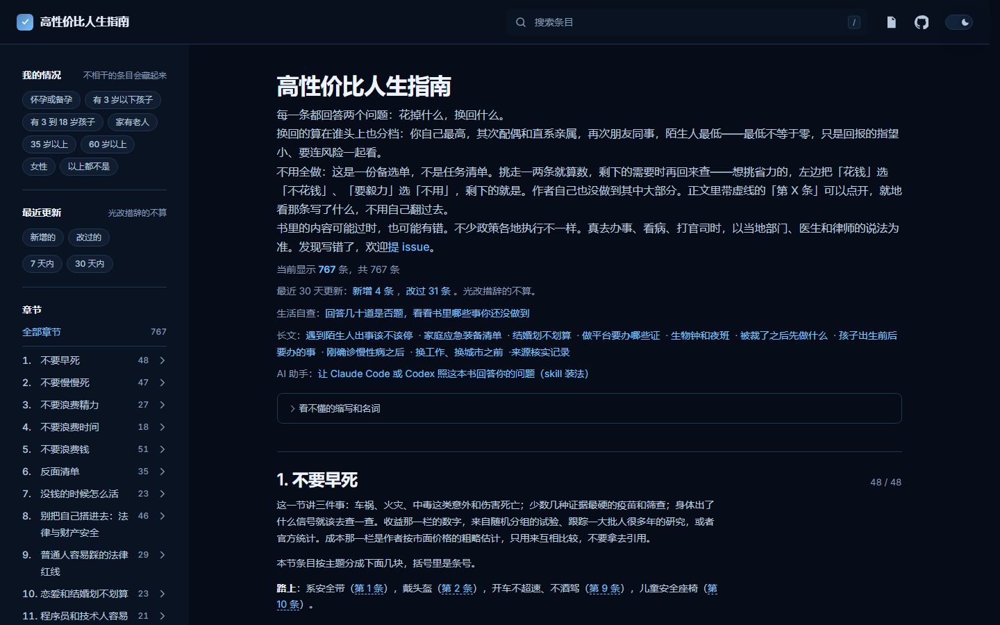

  

# Life Guide · 高性价比人生指南

**767 recommendations scored by what they cost, what they return and how strong the evidence is.**

767 条建议，每条写明花掉什么、换回什么、证据有多硬。

  

**English** · [简体中文](README_CN.md) · [README index](README.md) · [All projects](../README.md)

## Quick links · 快速入口

| | |
| --- | --- |
| Project portal · 项目总入口 | [etherealnymph.github.io/web-projects/index.html#projects](https://etherealnymph.github.io/web-projects/index.html#projects) |
| Live page · 在线页面 | [https://etherealnymph.github.io/web-projects/life-guide/](https://etherealnymph.github.io/web-projects/life-guide/) |
| English | [README_EN.md](README_EN.md) |
| 简体中文 | [README_CN.md](README_CN.md) |
| Original detailed notes / 原详细说明 | [README_ORIGINAL.md](README_ORIGINAL.md) |

### English

A searchable life guide built around cost-benefit: every entry states the money, time and willpower it costs, the payoff, an evidence grade and a journal or official source. It is a menu of options, not a checklist.

### 简体中文

一份按性价比组织的可检索生活指南：每条建议都写明花的钱、时间和毅力，换回什么，证据等级，以及期刊或官方来源。它是备选单，不是任务清单。

---

**Contact · 联系方式:** Etherealnymph · [2115487769@qq.com](mailto:2115487769@qq.com)
