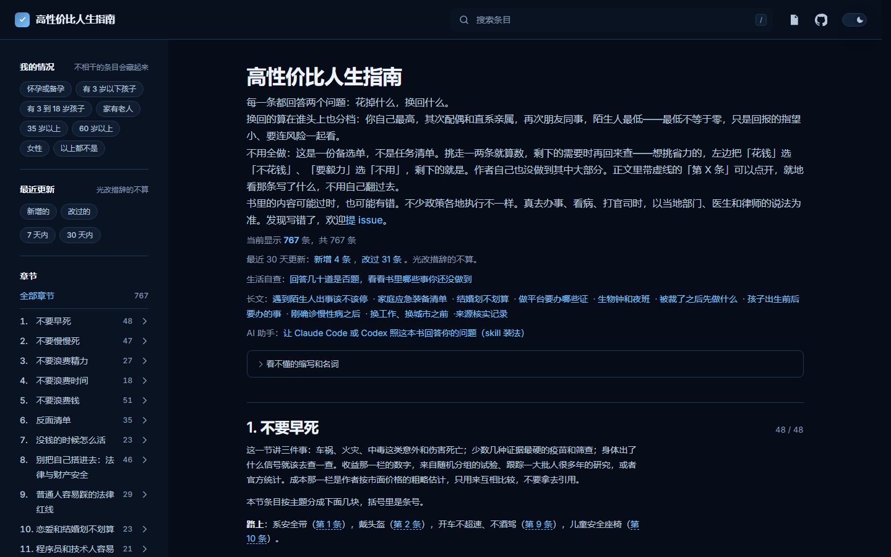

<div align="center">

[](https://etherealnymph.github.io/web-projects/life-guide/) [](https://etherealnymph.github.io/web-projects/index.html#projects) 

# Life Guide

**767 recommendations scored by what they cost, what they return and how strong the evidence is.**

[](README_EN.md) [](README_CN.md) [](README.md)

**English** · [简体中文](README_CN.md) · [README index](README.md) · [All projects](../README.md)

<a href="docs/screenshot.png"></a>

</div>

## Overview

A searchable life guide built around cost-benefit: every entry states the money, time and willpower it costs, the payoff, an evidence grade and a journal or official source. It is a menu of options, not a checklist.

## Features

- Every entry states cost (money / time / willpower), payoff, evidence grade (A/B/C) and a journal or official source.
- Filter by cost dimensions and life situation; search all 767 entries.
- Eleven chapters, from 'don't die early' to law, money, insurance, relationships and emigration.
- Self-checks, a starter guide, long-form essays, an abbreviation glossary and update feeds.
- Skill files under `skills/` let an AI assistant answer from the book.

## Live entry

| Entry | Link |
| --- | --- |
| Project portal | [etherealnymph.github.io/web-projects/index.html#projects](https://etherealnymph.github.io/web-projects/index.html#projects) |
| Direct page | [https://etherealnymph.github.io/web-projects/life-guide/](https://etherealnymph.github.io/web-projects/life-guide/) |
| Local | Open `life-guide/index.html`, or serve the root and open `http://127.0.0.1:8123/life-guide/`. |

## Project structure

```text
life-guide/
├─ index.html              # searchable book
├─ book/                   # chapter content
├─ docs/                   # guides + screenshot
├─ ads/                    # advertising assets
├─ skills/                 # agent skill files
├─ tools/                  # build and check scripts
├─ selfcheck.html
├─ og.png / robots.txt / sitemap.xml / updates.json
└─ README.md / README_EN.md / README_CN.md
```

Original detailed notes (Chinese): [README_ORIGINAL.md](README_ORIGINAL.md).

## Boundaries and notes

- Content follows mainland-China regulations and institutions at the time of writing; policies differ by region and change over time. It is information, not medical, legal or financial advice.
- Derived from the upstream HowToLiveBetter project — see `LICENSE` and `LICENSE-CODE`.

## Other projects

| Project | README | Live page |
| --- | --- | --- |
| **Analog Atlas** / 硅海图谱 | [README](../analog-atlas/README.md) | [Open](https://etherealnymph.github.io/web-projects/analog-atlas/) |
| **Bilingual Dictionary** / 中英双语词典 | [README](../bilingual-dictionary/README.md) | [Open](https://etherealnymph.github.io/web-projects/bilingual-dictionary/) |
| **Blog Platform** / 博客平台 | [README](../blog-platform/README.md) | — *(server-side)* |
| **Circuit Lab** / 观澜电路 | [README](../circuit-lab/README.md) | [Open](https://etherealnymph.github.io/web-projects/circuit-lab/) |
| **Field Drift** / 场海 | [README](../field-drift/README.md) | [Open](https://etherealnymph.github.io/web-projects/field-drift/) |
| **Fourier Contour** / 圆上之圆 | [README](../fourier-contour/README.md) | [Open](https://etherealnymph.github.io/web-projects/fourier-contour/) |
| **GM/ID Studio** / GM/ID 设计工作台 | [README](../gm-id-studio/README.md) | [Open](https://etherealnymph.github.io/web-projects/gm-id-studio/dist/GM-ID-Studio.html) |
| **Insight Space** / 体悟集 | [README](../insight-space/README.md) | [Open](https://etherealnymph.github.io/web-projects/insight-space/) |
| **Logic Loom** / 逻辑织机 | [README](../logic-loom/README.md) | [Open](https://etherealnymph.github.io/web-projects/logic-loom/) |
| **Math Competition** / 大学生数学竞赛 | [README](../math-competition/README.md) | [Open](https://etherealnymph.github.io/web-projects/math-competition/web/) |
| **Mini World** / 迷你世界 | [README](../mini-world/README.md) | [Open](https://etherealnymph.github.io/web-projects/mini-world/) |
| **Number Sense Trainer** / 数感训练场 | [README](../number-sense-trainer.src/README.md) | [Open](https://etherealnymph.github.io/web-projects/number-sense-trainer.html) |
| **Semiconductor Devices** / 半导体物理与器件 | [README](../semiconductor-devices/README.md) | [Open](https://etherealnymph.github.io/web-projects/semiconductor-devices/) |
| **Silicon Notes** / 硅间札记 | [README](../silicon-notes/README.md) | [Open](https://etherealnymph.github.io/web-projects/silicon-notes/) |
| **Tidal Soundscape** / 潮汐声景 | [README](../soundscape/README.md) | [Open](https://etherealnymph.github.io/web-projects/soundscape/) |
| **SPICE RF Calculator** / TSMC RF 器件计算器 | [README](../spice-rf-calculator/README.md) | [Open](https://etherealnymph.github.io/web-projects/spice-rf-calculator/spice-rf-calculator.html) |
| **Stock Trading Simulator** / 股市训练场 | [README](../stock-trading-simulator/README.md) | [Open](https://etherealnymph.github.io/web-projects/stock-trading-simulator/stock-trading-simulator.html) |
| **Stock Quote API** / A 股行情后端 | [README](../stock-quote-api/README.md) | — *(server-side)* |


More single-page labs, games and tools are listed in the [repository README](../README.md).

## Author

**Etherealnymph** — [2115487769@qq.com](mailto:2115487769@qq.com)

More projects: [web-projects](https://github.com/Etherealnymph/web-projects) · [portal](https://etherealnymph.github.io/web-projects/index.html#projects)
