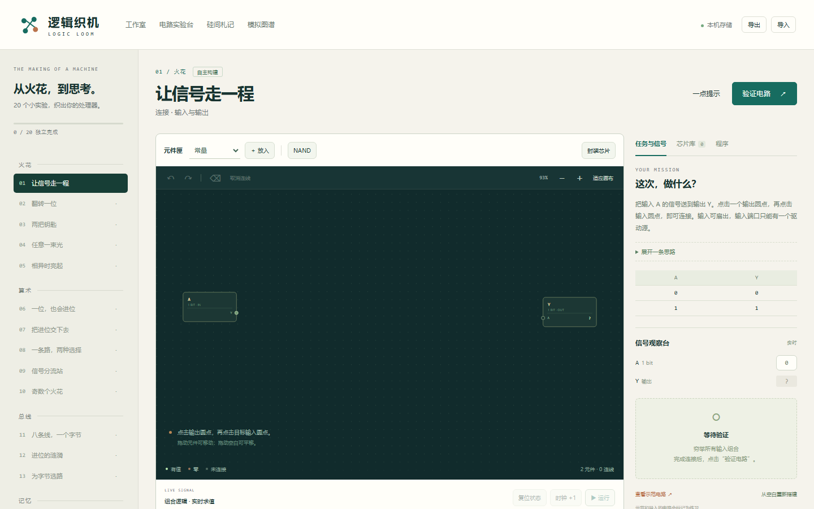

  

# Logic Loom · 逻辑织机

**Build a working 8-bit CPU out of NAND gates, one progressive level at a time.**

从 NAND 门开始，一关一关搭出能执行汇编程序的 8 位 CPU。

  

**English** · [简体中文](README_CN.md) · [README index](README.md) · [All projects](../README.md)

## Quick links · 快速入口

| | |
| --- | --- |
| Project portal · 项目总入口 | [etherealnymph.github.io/web-projects/index.html#projects](https://etherealnymph.github.io/web-projects/index.html#projects) |
| Live page · 在线页面 | [https://etherealnymph.github.io/web-projects/logic-loom/](https://etherealnymph.github.io/web-projects/logic-loom/) |
| English | [README_EN.md](README_EN.md) |
| 简体中文 | [README_CN.md](README_CN.md) |
| Original detailed notes / 原详细说明 | [README_ORIGINAL.md](README_ORIGINAL.md) |

### English

Twenty levels take you from your first wire to the LL-8 CPU, with a free-play bench alongside. The editor checks widths, drivers and combinational loops, so a circuit that passes really behaves like the hardware it models.

### 简体中文

二十个关卡从第一根导线一路搭到 LL-8 CPU，另有自由实验台。编辑器会检查位宽、驱动与组合环路，因此通过验证的电路确实具备它所模拟的硬件行为。

---

**Contact · 联系方式:** Etherealnymph · [2115487769@qq.com](mailto:2115487769@qq.com)
