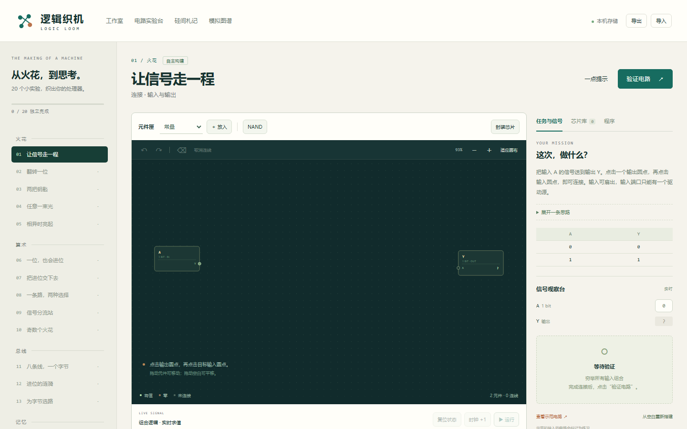

<div align="center">

[](https://etherealnymph.github.io/web-projects/logic-loom/) [](https://etherealnymph.github.io/web-projects/index.html#projects) 

# 逻辑织机

**从 NAND 门开始，一关一关搭出能执行汇编程序的 8 位 CPU。**

[](README_EN.md) [](README_CN.md) [](README.md)

[English](README_EN.md) · **简体中文** · [README 索引](README.md) · [全部项目](../README.md)

<a href="docs/screenshot.png"></a>

</div>

## 项目简介

二十个关卡从第一根导线一路搭到 LL-8 CPU，另有自由实验台。编辑器会检查位宽、驱动与组合环路，因此通过验证的电路确实具备它所模拟的硬件行为。

## 功能

- 20 关：连线 → 用 NAND 合成 NOT/AND/OR/XOR → 半加 / 全加 → MUX/DEMUX/奇偶 → 8 位 ALU → PC → 指令译码 → LL-8 CPU。
- SVG 网表编辑器：拖动、平移缩放、按端口连线、删除、撤销 / 重做；输入端单驱动、输出可扇出，并检查位宽与组合环路。
- 实时信号、二进制输出、真值表，以及失败时给出的反例。
- 同步时钟语义：寄存器与 RAM 在边沿同时更新；清零优先于使能。
- 芯片库可保存可复用的组合子电路，并检查递归与缺失依赖。
- 每关自动保存、工程 JSON 导入导出、键盘操作与减少动态效果支持。

## 网页入口

| 入口 | 链接 |
| --- | --- |
| 项目总入口 | [etherealnymph.github.io/web-projects/index.html#projects](https://etherealnymph.github.io/web-projects/index.html#projects) |
| 直接页面 | [https://etherealnymph.github.io/web-projects/logic-loom/](https://etherealnymph.github.io/web-projects/logic-loom/) |
| 本地 | 在根目录起服务（`python -m http.server 8000`），打开 `http://localhost:8000/logic-loom/`；ES Module 不能用 `file://` 打开。 |

## 项目结构

```text
logic-loom/
├─ index.html
├─ app.js                 # editor and level UI
├─ engine.js              # netlist evaluation and timing semantics
├─ levels.js              # 20 level definitions
├─ storage.js             # local saves and project files
├─ style.css
├─ docs/screenshot.png
├─ tests/                 # node:test engine suites
└─ package.json
```

原详细说明：[README_ORIGINAL.md](README_ORIGINAL.md)。

## 边界与说明

- 连线上的虚线动画只是信号状态的视觉提示，不是模拟的物理传播延迟。

## 其他项目

| 项目 | README | 网页 |
| --- | --- | --- |
| **Analog Atlas** / 硅海图谱 | [README](../analog-atlas/README.md) | [打开](https://etherealnymph.github.io/web-projects/analog-atlas/) |
| **Bilingual Dictionary** / 中英双语词典 | [README](../bilingual-dictionary/README.md) | [打开](https://etherealnymph.github.io/web-projects/bilingual-dictionary/) |
| **Blog Platform** / 博客平台 | [README](../blog-platform/README.md) | — *(需服务端)* |
| **Circuit Lab** / 观澜电路 | [README](../circuit-lab/README.md) | [打开](https://etherealnymph.github.io/web-projects/circuit-lab/) |
| **Field Drift** / 场海 | [README](../field-drift/README.md) | [打开](https://etherealnymph.github.io/web-projects/field-drift/) |
| **Fourier Contour** / 圆上之圆 | [README](../fourier-contour/README.md) | [打开](https://etherealnymph.github.io/web-projects/fourier-contour/) |
| **GM/ID Studio** / GM/ID 设计工作台 | [README](../gm-id-studio/README.md) | [打开](https://etherealnymph.github.io/web-projects/gm-id-studio/dist/GM-ID-Studio.html) |
| **Insight Space** / 体悟集 | [README](../insight-space/README.md) | [打开](https://etherealnymph.github.io/web-projects/insight-space/) |
| **Life Guide** / 高性价比人生指南 | [README](../life-guide/README.md) | [打开](https://etherealnymph.github.io/web-projects/life-guide/) |
| **Math Competition** / 大学生数学竞赛 | [README](../math-competition/README.md) | [打开](https://etherealnymph.github.io/web-projects/math-competition/web/) |
| **Mini World** / 迷你世界 | [README](../mini-world/README.md) | [打开](https://etherealnymph.github.io/web-projects/mini-world/) |
| **Number Sense Trainer** / 数感训练场 | [README](../number-sense-trainer.src/README.md) | [打开](https://etherealnymph.github.io/web-projects/number-sense-trainer.html) |
| **Semiconductor Devices** / 半导体物理与器件 | [README](../semiconductor-devices/README.md) | [打开](https://etherealnymph.github.io/web-projects/semiconductor-devices/) |
| **Silicon Notes** / 硅间札记 | [README](../silicon-notes/README.md) | [打开](https://etherealnymph.github.io/web-projects/silicon-notes/) |
| **Tidal Soundscape** / 潮汐声景 | [README](../soundscape/README.md) | [打开](https://etherealnymph.github.io/web-projects/soundscape/) |
| **SPICE RF Calculator** / TSMC RF 器件计算器 | [README](../spice-rf-calculator/README.md) | [打开](https://etherealnymph.github.io/web-projects/spice-rf-calculator/spice-rf-calculator.html) |
| **Stock Trading Simulator** / 股市训练场 | [README](../stock-trading-simulator/README.md) | [打开](https://etherealnymph.github.io/web-projects/stock-trading-simulator/stock-trading-simulator.html) |
| **Stock Quote API** / A 股行情后端 | [README](../stock-quote-api/README.md) | — *(需服务端)* |


更多单页实验、游戏与工具见[仓库根 README](../README.md)。

## 作者

**Etherealnymph** — [2115487769@qq.com](mailto:2115487769@qq.com)

更多项目：[web-projects](https://github.com/Etherealnymph/web-projects) · [项目总入口](https://etherealnymph.github.io/web-projects/index.html#projects)
