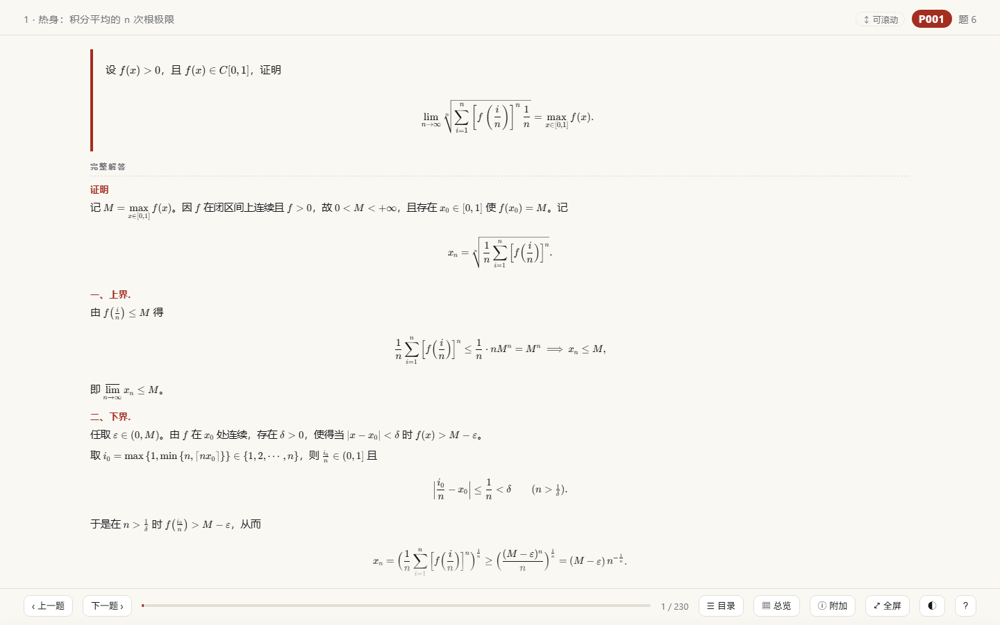

  

# Math Competition · 大学生数学竞赛

**208 competition problems with worked solutions, margin notes and a one-problem-per-screen projector.**

208 道竞赛题，配完整解答、评注与一题一屏的放映页。

  

**English** · [简体中文](README_CN.md) · [README index](README.md) · [All projects](../README.md)

## Quick links · 快速入口

| | |
| --- | --- |
| Project portal · 项目总入口 | [etherealnymph.github.io/web-projects/index.html#projects](https://etherealnymph.github.io/web-projects/index.html#projects) |
| Live page · 在线页面 | [https://etherealnymph.github.io/web-projects/math-competition/web/](https://etherealnymph.github.io/web-projects/math-competition/web/) |
| English | [README_EN.md](README_EN.md) |
| 简体中文 | [README_CN.md](README_CN.md) |

### English

Everything here came from 295 photos of 22 lectures, de-duplicated into 208 problems. The projector turns them into 230 slides with KaTeX typesetting, full solutions and commentary, so the same page works for revision and for presenting.

### 简体中文

全部内容来自 22 个场次、295 张照片，去重后整理为 208 道题。放映页把它们做成 230 页幻灯片，用 KaTeX 排版公式，附完整解答与评注，既能自己复习也能直接当课件放。

---

**Contact · 联系方式:** Etherealnymph · [2115487769@qq.com](mailto:2115487769@qq.com)
