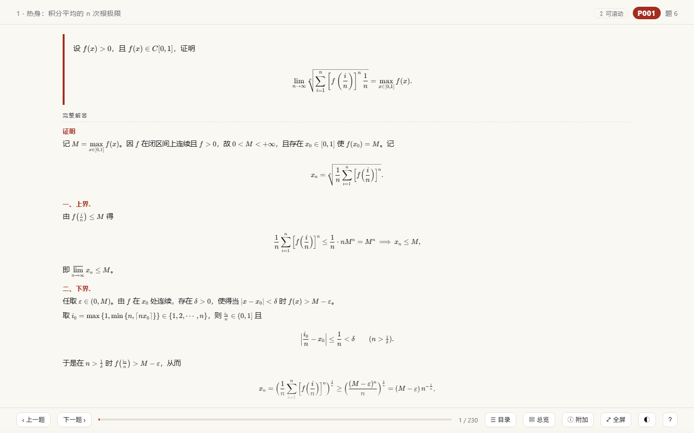

<div align="center">

[](https://etherealnymph.github.io/web-projects/math-competition/web/) [](https://etherealnymph.github.io/web-projects/index.html#projects) 

# 大学生数学竞赛

**208 道竞赛题，配完整解答、评注与一题一屏的放映页。**

[](README_EN.md) [](README_CN.md) [](README.md)

[English](README_EN.md) · **简体中文** · [README 索引](README.md) · [全部项目](../README.md)

<a href="docs/screenshot.png"></a>

</div>

## 项目简介

全部内容来自 22 个场次、295 张照片，去重后整理为 208 道题。放映页把它们做成 230 页幻灯片，用 KaTeX 排版公式，附完整解答与评注，既能自己复习也能直接当课件放。

## 功能

- 295 张照片、22 个场次，去重后得到 208 道题（254 条页面记录）。
- 230 页放映内容，含 KaTeX 题面、完整解答、评注与原照片链接。
- 快捷键：→/空格下一题、← 上一题、M 目录、O 总览、G 跳题号、T 评注、D 主题、F 全屏。
- 24 个分区（含模拟卷）；每道题都有可分享的锚点，例如 `#p028`。
- 复习文档包含赛制、考点分布、8 周计划、14 天冲刺与公式速查。
- 完全离线；`index.html` 与 `vendor/katex/` 必须放在同一目录。

## 网页入口

| 入口 | 链接 |
| --- | --- |
| 项目总入口 | [etherealnymph.github.io/web-projects/index.html#projects](https://etherealnymph.github.io/web-projects/index.html#projects) |
| 直接页面 | [https://etherealnymph.github.io/web-projects/math-competition/web/](https://etherealnymph.github.io/web-projects/math-competition/web/) |
| 本地 | 直接打开 `math-competition/web/index.html`，或在根目录起服务后打开 `http://127.0.0.1:8123/math-competition/web/`。 |

## 项目结构

```text
math-competition/
├─ web/index.html            # projector entry (230 slides)
├─ web/README.md             # slide shortcuts and usage
├─ 00_照片时间排序清单.md      # photo timeline
├─ 01_题目全集.md              # all 208 problems + solutions
├─ 02_大学生数学竞赛复习文档.md  # revision plan
├─ docs/                     # mock papers, photos and screenshot
├─ _work/                    # rename map and intermediate artefacts
└─ README.md / README_EN.md / README_CN.md
```

## 边界与说明

- 有 34 张照片偏模糊 / 反光，题面中不确定的字符用 `[?]` 标注，建议对照原图复核。

## 其他项目

| 项目 | README | 网页 |
| --- | --- | --- |
| **Analog Atlas** / 硅海图谱 | [README](../analog-atlas/README.md) | [打开](https://etherealnymph.github.io/web-projects/analog-atlas/) |
| **Bilingual Dictionary** / 中英双语词典 | [README](../bilingual-dictionary/README.md) | [打开](https://etherealnymph.github.io/web-projects/bilingual-dictionary/) |
| **Blog Platform** / 博客平台 | [README](../blog-platform/README.md) | — *(需服务端)* |
| **Circuit Lab** / 观澜电路 | [README](../circuit-lab/README.md) | [打开](https://etherealnymph.github.io/web-projects/circuit-lab/) |
| **Field Drift** / 场海 | [README](../field-drift/README.md) | [打开](https://etherealnymph.github.io/web-projects/field-drift/) |
| **Fourier Contour** / 圆上之圆 | [README](../fourier-contour/README.md) | [打开](https://etherealnymph.github.io/web-projects/fourier-contour/) |
| **GM/ID Studio** / GM/ID 设计工作台 | [README](../gm-id-studio/README.md) | [打开](https://etherealnymph.github.io/web-projects/gm-id-studio/dist/GM-ID-Studio.html) |
| **Insight Space** / 体悟集 | [README](../insight-space/README.md) | [打开](https://etherealnymph.github.io/web-projects/insight-space/) |
| **Life Guide** / 高性价比人生指南 | [README](../life-guide/README.md) | [打开](https://etherealnymph.github.io/web-projects/life-guide/) |
| **Logic Loom** / 逻辑织机 | [README](../logic-loom/README.md) | [打开](https://etherealnymph.github.io/web-projects/logic-loom/) |
| **Mini World** / 迷你世界 | [README](../mini-world/README.md) | [打开](https://etherealnymph.github.io/web-projects/mini-world/) |
| **Number Sense Trainer** / 数感训练场 | [README](../number-sense-trainer.src/README.md) | [打开](https://etherealnymph.github.io/web-projects/number-sense-trainer.html) |
| **Semiconductor Devices** / 半导体物理与器件 | [README](../semiconductor-devices/README.md) | [打开](https://etherealnymph.github.io/web-projects/semiconductor-devices/) |
| **Silicon Notes** / 硅间札记 | [README](../silicon-notes/README.md) | [打开](https://etherealnymph.github.io/web-projects/silicon-notes/) |
| **Tidal Soundscape** / 潮汐声景 | [README](../soundscape/README.md) | [打开](https://etherealnymph.github.io/web-projects/soundscape/) |
| **SPICE RF Calculator** / TSMC RF 器件计算器 | [README](../spice-rf-calculator/README.md) | [打开](https://etherealnymph.github.io/web-projects/spice-rf-calculator/spice-rf-calculator.html) |
| **Stock Trading Simulator** / 股市训练场 | [README](../stock-trading-simulator/README.md) | [打开](https://etherealnymph.github.io/web-projects/stock-trading-simulator/stock-trading-simulator.html) |
| **Stock Quote API** / A 股行情后端 | [README](../stock-quote-api/README.md) | — *(需服务端)* |


更多单页实验、游戏与工具见[仓库根 README](../README.md)。

## 作者

**Etherealnymph** — [2115487769@qq.com](mailto:2115487769@qq.com)

更多项目：[web-projects](https://github.com/Etherealnymph/web-projects) · [项目总入口](https://etherealnymph.github.io/web-projects/index.html#projects)
