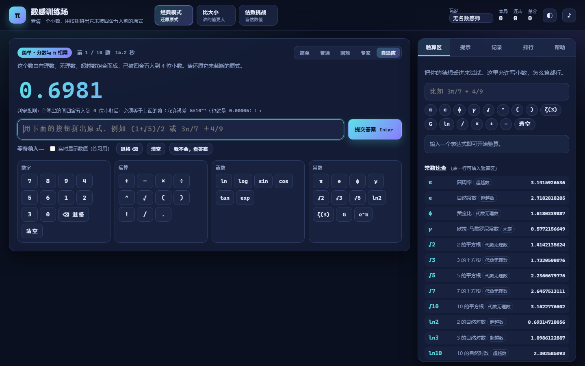

  

# Number Sense Trainer · 数感训练场

**Rebuild the unreduced expression behind a rounded number — plus estimation and comparison mini-games.**

还原一个四舍五入数字背后未经约分的原式，另有估数与比大小小游戏。

  

**English** · [简体中文](README_CN.md) · [README index](README.md) · [All projects](../README.md)

## Quick links · 快速入口

| | |
| --- | --- |
| Project portal · 项目总入口 | [etherealnymph.github.io/web-projects/index.html#projects](https://etherealnymph.github.io/web-projects/index.html#projects) |
| Live page · 在线页面 | [https://etherealnymph.github.io/web-projects/number-sense-trainer.html](https://etherealnymph.github.io/web-projects/number-sense-trainer.html) |
| English | [README_EN.md](README_EN.md) |
| 简体中文 | [README_CN.md](README_CN.md) |

### English

The main mode shows a value rounded to four decimals and asks you to reconstruct the expression that produced it, using constants, operators and functions. The playable page is a single generated HTML file; this folder holds the readable source.

### 简体中文

主模式给出一个已四舍五入到四位小数的数值，要求你用常数、运算符与函数拼出它的原式。可玩页面是生成的单个 HTML 文件，这个目录保存可读的源代码。

---

**Contact · 联系方式:** Etherealnymph · [2115487769@qq.com](mailto:2115487769@qq.com)
