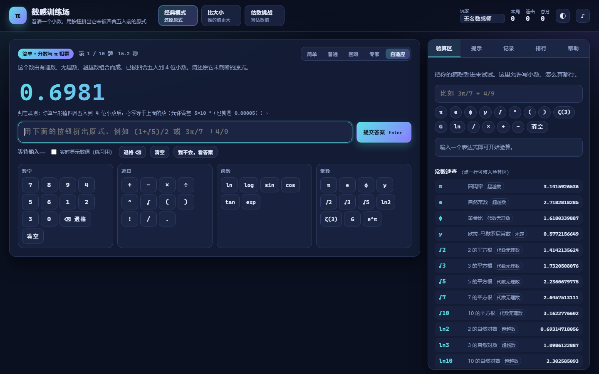

<div align="center">

[](https://etherealnymph.github.io/web-projects/number-sense-trainer.html) [](https://etherealnymph.github.io/web-projects/index.html#projects) 

# 数感训练场

**还原一个四舍五入数字背后未经约分的原式，另有估数与比大小小游戏。**

[](README_EN.md) [](README_CN.md) [](README.md)

[English](README_EN.md) · **简体中文** · [README 索引](README.md) · [全部项目](../README.md)

<a href="docs/screenshot.png"></a>

</div>

## 项目简介

主模式给出一个已四舍五入到四位小数的数值，要求你用常数、运算符与函数拼出它的原式。可玩页面是生成的单个 HTML 文件，这个目录保存可读的源代码。

## 功能

- 经典模式：用数字、运算符、常数与函数拼出原式，误差在 5×10⁻⁵ 内即判定正确。
- 三种模式：经典还原、比大小、估数挑战。
- 四档难度加自适应难度，带每轮计时与连击计分。
- 常数库含 π、e、φ、γ、√2…√10、ln2/3/10、ζ(3) 与卡塔兰常数，并标注代数无理数、超越数或性质未知。
- 零 DOM 依赖的递归下降解析求值器，可在 Node 中直接单元测试。

## 网页入口

| 入口 | 链接 |
| --- | --- |
| 项目总入口 | [etherealnymph.github.io/web-projects/index.html#projects](https://etherealnymph.github.io/web-projects/index.html#projects) |
| 直接页面 | [https://etherealnymph.github.io/web-projects/number-sense-trainer.html](https://etherealnymph.github.io/web-projects/number-sense-trainer.html) |
| 本地 | 直接打开仓库根目录生成的页面（`../number-sense-trainer.html`），或运行 `node build.js` 重新构建。 |

## 项目结构

```text
number-sense-trainer.src/
├─ shell.html          # HTML shell
├─ styles.css
├─ core.js             # constants, tokenizer, parser, generator, scoring
├─ ui.js               # interface and game flow
├─ minigames.js        # comparison + estimation games
├─ build.js            # inlines everything into ../number-sense-trainer.html
├─ test-core.js        # Node tests for the core
├─ e2e-driver.js
├─ docs/screenshot.png
└─ README.md / README_EN.md / README_CN.md
```

## 边界与说明

- `build.js` 会覆盖根目录的 `number-sense-trainer.html`；请改这里的源码，不要直接改生成文件。

## 其他项目

| 项目 | README | 网页 |
| --- | --- | --- |
| **Analog Atlas** / 硅海图谱 | [README](../analog-atlas/README.md) | [打开](https://etherealnymph.github.io/web-projects/analog-atlas/) |
| **Bilingual Dictionary** / 中英双语词典 | [README](../bilingual-dictionary/README.md) | [打开](https://etherealnymph.github.io/web-projects/bilingual-dictionary/) |
| **Blog Platform** / 博客平台 | [README](../blog-platform/README.md) | — *(需服务端)* |
| **Circuit Lab** / 观澜电路 | [README](../circuit-lab/README.md) | [打开](https://etherealnymph.github.io/web-projects/circuit-lab/) |
| **Field Drift** / 场海 | [README](../field-drift/README.md) | [打开](https://etherealnymph.github.io/web-projects/field-drift/) |
| **Fourier Contour** / 圆上之圆 | [README](../fourier-contour/README.md) | [打开](https://etherealnymph.github.io/web-projects/fourier-contour/) |
| **GM/ID Studio** / GM/ID 设计工作台 | [README](../gm-id-studio/README.md) | [打开](https://etherealnymph.github.io/web-projects/gm-id-studio/dist/GM-ID-Studio.html) |
| **Insight Space** / 体悟集 | [README](../insight-space/README.md) | [打开](https://etherealnymph.github.io/web-projects/insight-space/) |
| **Life Guide** / 高性价比人生指南 | [README](../life-guide/README.md) | [打开](https://etherealnymph.github.io/web-projects/life-guide/) |
| **Logic Loom** / 逻辑织机 | [README](../logic-loom/README.md) | [打开](https://etherealnymph.github.io/web-projects/logic-loom/) |
| **Math Competition** / 大学生数学竞赛 | [README](../math-competition/README.md) | [打开](https://etherealnymph.github.io/web-projects/math-competition/web/) |
| **Mini World** / 迷你世界 | [README](../mini-world/README.md) | [打开](https://etherealnymph.github.io/web-projects/mini-world/) |
| **Semiconductor Devices** / 半导体物理与器件 | [README](../semiconductor-devices/README.md) | [打开](https://etherealnymph.github.io/web-projects/semiconductor-devices/) |
| **Silicon Notes** / 硅间札记 | [README](../silicon-notes/README.md) | [打开](https://etherealnymph.github.io/web-projects/silicon-notes/) |
| **Tidal Soundscape** / 潮汐声景 | [README](../soundscape/README.md) | [打开](https://etherealnymph.github.io/web-projects/soundscape/) |
| **SPICE RF Calculator** / TSMC RF 器件计算器 | [README](../spice-rf-calculator/README.md) | [打开](https://etherealnymph.github.io/web-projects/spice-rf-calculator/spice-rf-calculator.html) |
| **Stock Trading Simulator** / 股市训练场 | [README](../stock-trading-simulator/README.md) | [打开](https://etherealnymph.github.io/web-projects/stock-trading-simulator/stock-trading-simulator.html) |
| **Stock Quote API** / A 股行情后端 | [README](../stock-quote-api/README.md) | — *(需服务端)* |


更多单页实验、游戏与工具见[仓库根 README](../README.md)。

## 作者

**Etherealnymph** — [2115487769@qq.com](mailto:2115487769@qq.com)

更多项目：[web-projects](https://github.com/Etherealnymph/web-projects) · [项目总入口](https://etherealnymph.github.io/web-projects/index.html#projects)
