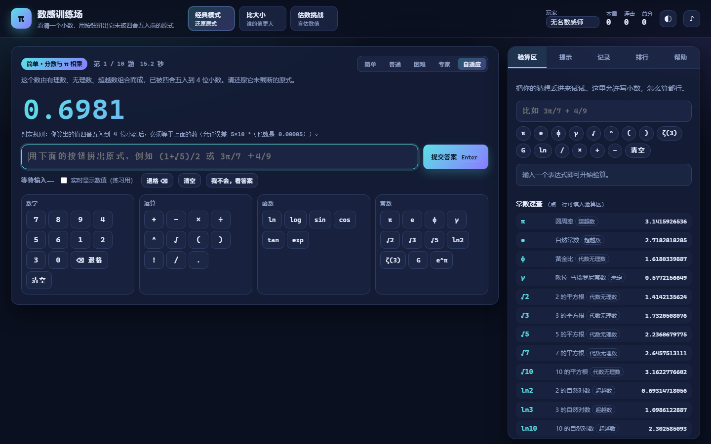

<div align="center">

[](https://etherealnymph.github.io/web-projects/number-sense-trainer.html) [](https://etherealnymph.github.io/web-projects/index.html#projects) 

# Number Sense Trainer

**Rebuild the unreduced expression behind a rounded number — plus estimation and comparison mini-games.**

[](README_EN.md) [](README_CN.md) [](README.md)

**English** · [简体中文](README_CN.md) · [README index](README.md) · [All projects](../README.md)

<a href="docs/screenshot.png"></a>

</div>

## Overview

The main mode shows a value rounded to four decimals and asks you to reconstruct the expression that produced it, using constants, operators and functions. The playable page is a single generated HTML file; this folder holds the readable source.

## Features

- Classic mode: compose the original expression from numbers, operators, constants and functions; answers are accepted within 5×10⁻⁵.
- Three modes: Classic, Bigger-or-Smaller and Estimation Challenge.
- Four difficulty levels plus adaptive difficulty, per-round timer and streak scoring.
- Constant library with π, e, φ, γ, √2…√10, ln 2/3/10, ζ(3) and Catalan, each labelled algebraic, transcendental or unknown.
- A zero-DOM recursive-descent parser/evaluator that is unit-tested in Node.

## Live entry

| Entry | Link |
| --- | --- |
| Project portal | [etherealnymph.github.io/web-projects/index.html#projects](https://etherealnymph.github.io/web-projects/index.html#projects) |
| Direct page | [https://etherealnymph.github.io/web-projects/number-sense-trainer.html](https://etherealnymph.github.io/web-projects/number-sense-trainer.html) |
| Local | Open the generated page at the repository root (`../number-sense-trainer.html`), or rebuild it with `node build.js`. |

## Project structure

```text
number-sense-trainer.src/
├─ shell.html          # HTML shell
├─ styles.css
├─ core.js             # constants, tokenizer, parser, generator, scoring
├─ ui.js               # interface and game flow
├─ minigames.js        # comparison + estimation games
├─ build.js            # inlines everything into ../number-sense-trainer.html
├─ test-core.js        # Node tests for the core
├─ e2e-driver.js
├─ docs/screenshot.png
└─ README.md / README_EN.md / README_CN.md
```

## Boundaries and notes

- `build.js` overwrites the root page `number-sense-trainer.html`; edit the source here, not the generated file.

## Other projects

| Project | README | Live page |
| --- | --- | --- |
| **Analog Atlas** / 硅海图谱 | [README](../analog-atlas/README.md) | [Open](https://etherealnymph.github.io/web-projects/analog-atlas/) |
| **Bilingual Dictionary** / 中英双语词典 | [README](../bilingual-dictionary/README.md) | [Open](https://etherealnymph.github.io/web-projects/bilingual-dictionary/) |
| **Blog Platform** / 博客平台 | [README](../blog-platform/README.md) | — *(server-side)* |
| **Circuit Lab** / 观澜电路 | [README](../circuit-lab/README.md) | [Open](https://etherealnymph.github.io/web-projects/circuit-lab/) |
| **Field Drift** / 场海 | [README](../field-drift/README.md) | [Open](https://etherealnymph.github.io/web-projects/field-drift/) |
| **Fourier Contour** / 圆上之圆 | [README](../fourier-contour/README.md) | [Open](https://etherealnymph.github.io/web-projects/fourier-contour/) |
| **GM/ID Studio** / GM/ID 设计工作台 | [README](../gm-id-studio/README.md) | [Open](https://etherealnymph.github.io/web-projects/gm-id-studio/dist/GM-ID-Studio.html) |
| **Insight Space** / 体悟集 | [README](../insight-space/README.md) | [Open](https://etherealnymph.github.io/web-projects/insight-space/) |
| **Life Guide** / 高性价比人生指南 | [README](../life-guide/README.md) | [Open](https://etherealnymph.github.io/web-projects/life-guide/) |
| **Logic Loom** / 逻辑织机 | [README](../logic-loom/README.md) | [Open](https://etherealnymph.github.io/web-projects/logic-loom/) |
| **Math Competition** / 大学生数学竞赛 | [README](../math-competition/README.md) | [Open](https://etherealnymph.github.io/web-projects/math-competition/web/) |
| **Mini World** / 迷你世界 | [README](../mini-world/README.md) | [Open](https://etherealnymph.github.io/web-projects/mini-world/) |
| **Semiconductor Devices** / 半导体物理与器件 | [README](../semiconductor-devices/README.md) | [Open](https://etherealnymph.github.io/web-projects/semiconductor-devices/) |
| **Silicon Notes** / 硅间札记 | [README](../silicon-notes/README.md) | [Open](https://etherealnymph.github.io/web-projects/silicon-notes/) |
| **Tidal Soundscape** / 潮汐声景 | [README](../soundscape/README.md) | [Open](https://etherealnymph.github.io/web-projects/soundscape/) |
| **SPICE RF Calculator** / TSMC RF 器件计算器 | [README](../spice-rf-calculator/README.md) | [Open](https://etherealnymph.github.io/web-projects/spice-rf-calculator/spice-rf-calculator.html) |
| **Stock Trading Simulator** / 股市训练场 | [README](../stock-trading-simulator/README.md) | [Open](https://etherealnymph.github.io/web-projects/stock-trading-simulator/stock-trading-simulator.html) |
| **Stock Quote API** / A 股行情后端 | [README](../stock-quote-api/README.md) | — *(server-side)* |


More single-page labs, games and tools are listed in the [repository README](../README.md).

## Author

**Etherealnymph** — [2115487769@qq.com](mailto:2115487769@qq.com)

More projects: [web-projects](https://github.com/Etherealnymph/web-projects) · [portal](https://etherealnymph.github.io/web-projects/index.html#projects)
