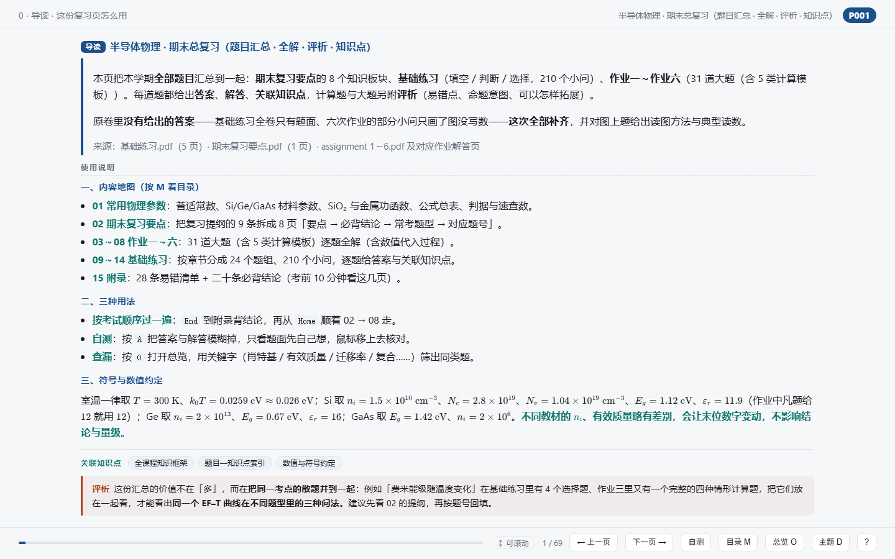

  

# Semiconductor Devices · 半导体物理与器件

**A one-page-per-question final-exam review for semiconductor physics and devices.**

一页一题、可离线放映的半导体物理与器件期末总复习。

  

**English** · [简体中文](README_CN.md) · [README index](README.md) · [All projects](../README.md)

## Quick links · 快速入口

| | |
| --- | --- |
| Project portal · 项目总入口 | [etherealnymph.github.io/web-projects/index.html#projects](https://etherealnymph.github.io/web-projects/index.html#projects) |
| Live page · 在线页面 | [https://etherealnymph.github.io/web-projects/semiconductor-devices/](https://etherealnymph.github.io/web-projects/semiconductor-devices/) |
| English | [README_EN.md](README_EN.md) |
| 简体中文 | [README_CN.md](README_CN.md) |
| Original detailed notes / 原详细说明 | [README_ORIGINAL.md](README_ORIGINAL.md) |

### English

All of this semester's questions in one place: 210 basic-practice sub-questions and 31 assignment problems, each with an answer, a full solution, linked knowledge points and commentary. Pages render with bundled KaTeX, so the review works without a network.

### 简体中文

把本学期全部题目汇总到一起：210 个基础练习小问与 31 道作业大题，每题给出答案、完整解答、关联知识点与评析。公式使用随包 KaTeX 渲染，断网也能复习。

---

**Contact · 联系方式:** Etherealnymph · [2115487769@qq.com](mailto:2115487769@qq.com)
