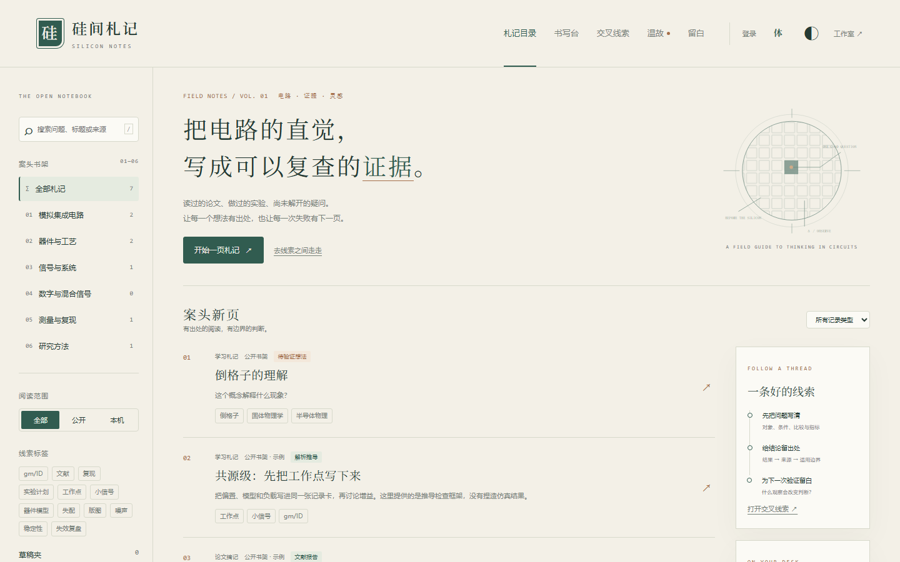

  

# Silicon Notes · 硅间札记

**A local-first notebook that turns circuit intuition into traceable evidence.**

把电路直觉写成可复查证据的本地优先笔记站。

  

**English** · [简体中文](README_CN.md) · [README index](README.md) · [All projects](../README.md)

## Quick links · 快速入口

| | |
| --- | --- |
| Project portal · 项目总入口 | [etherealnymph.github.io/web-projects/index.html#projects](https://etherealnymph.github.io/web-projects/index.html#projects) |
| Live page · 在线页面 | [https://etherealnymph.github.io/web-projects/silicon-notes/](https://etherealnymph.github.io/web-projects/silicon-notes/) |
| English | [README_EN.md](README_EN.md) |
| 简体中文 | [README_CN.md](README_CN.md) |
| Original detailed notes / 原详细说明 | [README_ORIGINAL.md](README_ORIGINAL.md) |

### English

Silicon Notes is built for chip-design study: read a paper, run an experiment, record a failure — then connect the three. Drafts are local until you explicitly publish, and every claim carries a scope, a source and an evidence type.

### 简体中文

硅间札记面向芯片设计学习：读一篇论文、做一次实验、记一次失败，再把三者连起来。草稿默认留在本机，只有明确发布才会上传；每条主张都带适用边界、来源与证据类型。

---

**Contact · 联系方式:** Etherealnymph · [2115487769@qq.com](mailto:2115487769@qq.com)
