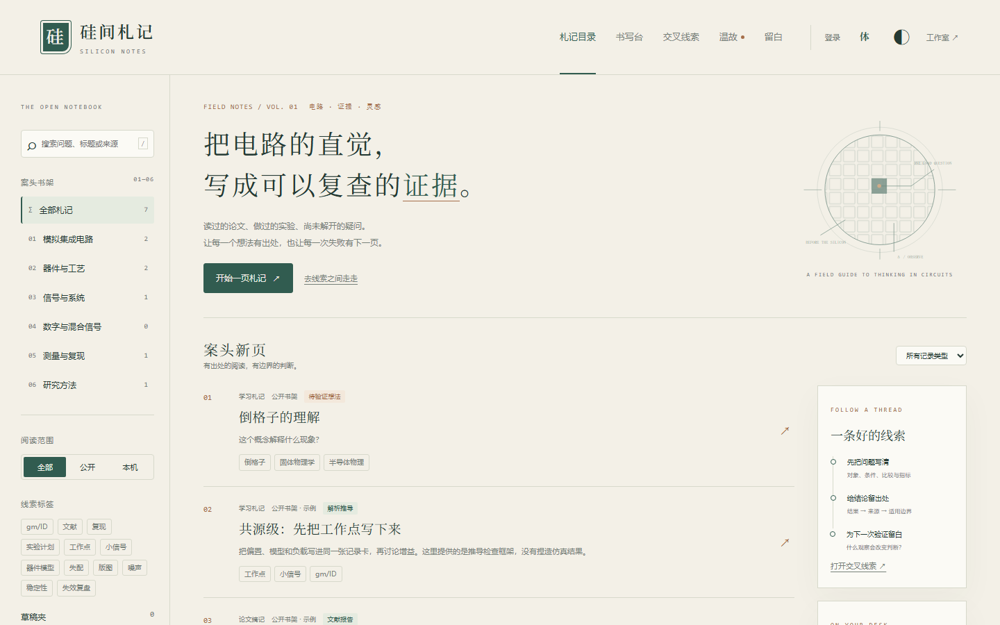

<div align="center">

[](https://etherealnymph.github.io/web-projects/silicon-notes/) [](https://etherealnymph.github.io/web-projects/index.html#projects) 

# 硅间札记

**把电路直觉写成可复查证据的本地优先笔记站。**

[](README_EN.md) [](README_CN.md) [](README.md)

[English](README_EN.md) · **简体中文** · [README 索引](README.md) · [全部项目](../README.md)

<a href="docs/screenshot.png"></a>

</div>

## 项目简介

硅间札记面向芯片设计学习：读一篇论文、做一次实验、记一次失败，再把三者连起来。草稿默认留在本机，只有明确发布才会上传；每条主张都带适用边界、来源与证据类型。

## 功能

- 课程书架与五种模板：学习札记、实验、论文、失败复盘、想法；支持正文与来源的多关键词搜索。
- 安全 Markdown 与本地 LaTeX 公式预览；输入约 700 毫秒后自动保存，Ctrl/Cmd+S 立即保存。
- 明确的发布边界：草稿与本机记录存在 IndexedDB，只有明确发布才会进入 Supabase 或静态目录。
- 证据结构：问题、主张、适用边界、下一步；每项结果记录证据类型、条件与来源。
- `[[双链]]`、并排比较，以及始终标记为待验证的规则式提纲。
- 温故卡片（10 分钟 → 1 → 3 → 7 … 180 天）与事务式 JSON 备份导入。

## 网页入口

| 入口 | 链接 |
| --- | --- |
| 项目总入口 | [etherealnymph.github.io/web-projects/index.html#projects](https://etherealnymph.github.io/web-projects/index.html#projects) |
| 直接页面 | [https://etherealnymph.github.io/web-projects/silicon-notes/](https://etherealnymph.github.io/web-projects/silicon-notes/) |
| 本地 | 在根目录起服务（`python3 -m http.server 8123`），打开 `http://localhost:8123/silicon-notes/`；模块需要 HTTP 环境。 |

## 项目结构

```text
silicon-notes/
├─ index.html
├─ js/                     # router, editor, storage, publishing
├─ styles.css
├─ data/library.json       # static public catalogue
├─ supabase/               # schema and SQL
├─ tests/                  # frontend and data tests
├─ tools/
├─ vendor/                 # pinned local SDKs
├─ docs/                   # guides + screenshot
└─ README.md / README_EN.md / README_CN.md
```

原详细说明：[README_ORIGINAL.md](README_ORIGINAL.md)。

## 边界与说明

- “本机”表示不上传，不代表加密。能访问浏览器配置或设备的人可能读到本机记录。

## 其他项目

| 项目 | README | 网页 |
| --- | --- | --- |
| **Analog Atlas** / 硅海图谱 | [README](../analog-atlas/README.md) | [打开](https://etherealnymph.github.io/web-projects/analog-atlas/) |
| **Bilingual Dictionary** / 中英双语词典 | [README](../bilingual-dictionary/README.md) | [打开](https://etherealnymph.github.io/web-projects/bilingual-dictionary/) |
| **Blog Platform** / 博客平台 | [README](../blog-platform/README.md) | — *(需服务端)* |
| **Circuit Lab** / 观澜电路 | [README](../circuit-lab/README.md) | [打开](https://etherealnymph.github.io/web-projects/circuit-lab/) |
| **Field Drift** / 场海 | [README](../field-drift/README.md) | [打开](https://etherealnymph.github.io/web-projects/field-drift/) |
| **Fourier Contour** / 圆上之圆 | [README](../fourier-contour/README.md) | [打开](https://etherealnymph.github.io/web-projects/fourier-contour/) |
| **GM/ID Studio** / GM/ID 设计工作台 | [README](../gm-id-studio/README.md) | [打开](https://etherealnymph.github.io/web-projects/gm-id-studio/dist/GM-ID-Studio.html) |
| **Insight Space** / 体悟集 | [README](../insight-space/README.md) | [打开](https://etherealnymph.github.io/web-projects/insight-space/) |
| **Life Guide** / 高性价比人生指南 | [README](../life-guide/README.md) | [打开](https://etherealnymph.github.io/web-projects/life-guide/) |
| **Logic Loom** / 逻辑织机 | [README](../logic-loom/README.md) | [打开](https://etherealnymph.github.io/web-projects/logic-loom/) |
| **Math Competition** / 大学生数学竞赛 | [README](../math-competition/README.md) | [打开](https://etherealnymph.github.io/web-projects/math-competition/web/) |
| **Mini World** / 迷你世界 | [README](../mini-world/README.md) | [打开](https://etherealnymph.github.io/web-projects/mini-world/) |
| **Number Sense Trainer** / 数感训练场 | [README](../number-sense-trainer.src/README.md) | [打开](https://etherealnymph.github.io/web-projects/number-sense-trainer.html) |
| **Semiconductor Devices** / 半导体物理与器件 | [README](../semiconductor-devices/README.md) | [打开](https://etherealnymph.github.io/web-projects/semiconductor-devices/) |
| **Tidal Soundscape** / 潮汐声景 | [README](../soundscape/README.md) | [打开](https://etherealnymph.github.io/web-projects/soundscape/) |
| **SPICE RF Calculator** / TSMC RF 器件计算器 | [README](../spice-rf-calculator/README.md) | [打开](https://etherealnymph.github.io/web-projects/spice-rf-calculator/spice-rf-calculator.html) |
| **Stock Trading Simulator** / 股市训练场 | [README](../stock-trading-simulator/README.md) | [打开](https://etherealnymph.github.io/web-projects/stock-trading-simulator/stock-trading-simulator.html) |
| **Stock Quote API** / A 股行情后端 | [README](../stock-quote-api/README.md) | — *(需服务端)* |


更多单页实验、游戏与工具见[仓库根 README](../README.md)。

## 作者

**Etherealnymph** — [2115487769@qq.com](mailto:2115487769@qq.com)

更多项目：[web-projects](https://github.com/Etherealnymph/web-projects) · [项目总入口](https://etherealnymph.github.io/web-projects/index.html#projects)
