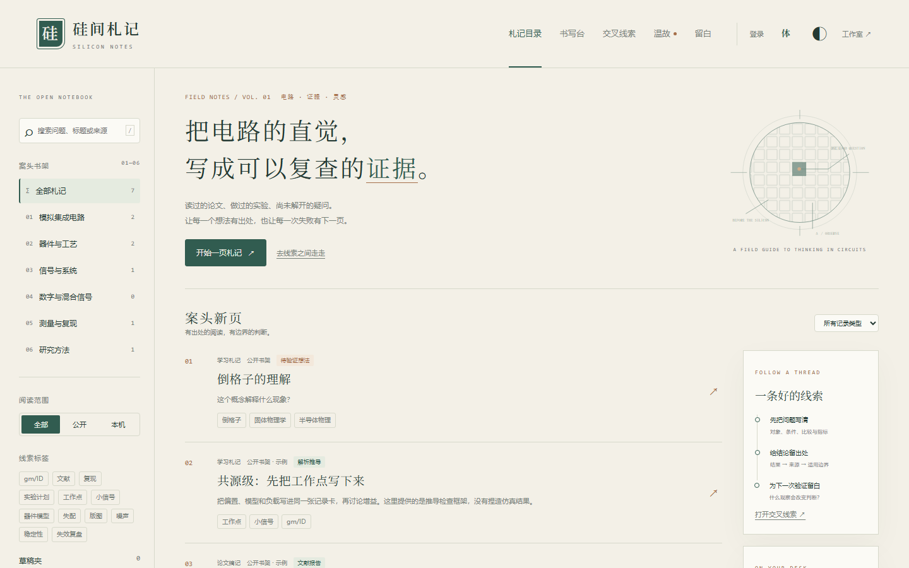

<div align="center">

[](https://etherealnymph.github.io/web-projects/silicon-notes/) [](https://etherealnymph.github.io/web-projects/index.html#projects) 

# Silicon Notes

**A local-first notebook that turns circuit intuition into traceable evidence.**

[](README_EN.md) [](README_CN.md) [](README.md)

**English** · [简体中文](README_CN.md) · [README index](README.md) · [All projects](../README.md)

<a href="docs/screenshot.png"></a>

</div>

## Overview

Silicon Notes is built for chip-design study: read a paper, run an experiment, record a failure — then connect the three. Drafts are local until you explicitly publish, and every claim carries a scope, a source and an evidence type.

## Features

- Course shelf with five templates — study note, experiment, paper, failure review, idea — and multi-keyword search across text and sources.
- Safe Markdown plus local LaTeX preview; drafts autosave after ~700 ms and Ctrl/Cmd+S saves immediately.
- Explicit publication boundary: drafts and local records live in IndexedDB; only an explicit publish reaches Supabase or the static catalogue.
- Evidence structure: question, claim, scope, next step; each result records an evidence type, conditions and a source.
- `[[wikilinks]]`, side-by-side comparison and rule-based outlines that are always marked as unverified.
- Spaced-repetition cards (10 min → 1 → 3 → 7 … 180 days) and JSON backups with transactional import.

## Live entry

| Entry | Link |
| --- | --- |
| Project portal | [etherealnymph.github.io/web-projects/index.html#projects](https://etherealnymph.github.io/web-projects/index.html#projects) |
| Direct page | [https://etherealnymph.github.io/web-projects/silicon-notes/](https://etherealnymph.github.io/web-projects/silicon-notes/) |
| Local | Serve the root (`python3 -m http.server 8123`) and open `http://localhost:8123/silicon-notes/`; modules need HTTP. |

## Project structure

```text
silicon-notes/
├─ index.html
├─ js/                     # router, editor, storage, publishing
├─ styles.css
├─ data/library.json       # static public catalogue
├─ supabase/               # schema and SQL
├─ tests/                  # frontend and data tests
├─ tools/
├─ vendor/                 # pinned local SDKs
├─ docs/                   # guides + screenshot
└─ README.md / README_EN.md / README_CN.md
```

Original detailed notes (Chinese): [README_ORIGINAL.md](README_ORIGINAL.md).

## Boundaries and notes

- 'Local' means not uploaded — not encrypted. Anyone with the browser profile or device may read local records.

## Other projects

| Project | README | Live page |
| --- | --- | --- |
| **Analog Atlas** / 硅海图谱 | [README](../analog-atlas/README.md) | [Open](https://etherealnymph.github.io/web-projects/analog-atlas/) |
| **Bilingual Dictionary** / 中英双语词典 | [README](../bilingual-dictionary/README.md) | [Open](https://etherealnymph.github.io/web-projects/bilingual-dictionary/) |
| **Blog Platform** / 博客平台 | [README](../blog-platform/README.md) | — *(server-side)* |
| **Circuit Lab** / 观澜电路 | [README](../circuit-lab/README.md) | [Open](https://etherealnymph.github.io/web-projects/circuit-lab/) |
| **Field Drift** / 场海 | [README](../field-drift/README.md) | [Open](https://etherealnymph.github.io/web-projects/field-drift/) |
| **Fourier Contour** / 圆上之圆 | [README](../fourier-contour/README.md) | [Open](https://etherealnymph.github.io/web-projects/fourier-contour/) |
| **GM/ID Studio** / GM/ID 设计工作台 | [README](../gm-id-studio/README.md) | [Open](https://etherealnymph.github.io/web-projects/gm-id-studio/dist/GM-ID-Studio.html) |
| **Insight Space** / 体悟集 | [README](../insight-space/README.md) | [Open](https://etherealnymph.github.io/web-projects/insight-space/) |
| **Life Guide** / 高性价比人生指南 | [README](../life-guide/README.md) | [Open](https://etherealnymph.github.io/web-projects/life-guide/) |
| **Logic Loom** / 逻辑织机 | [README](../logic-loom/README.md) | [Open](https://etherealnymph.github.io/web-projects/logic-loom/) |
| **Math Competition** / 大学生数学竞赛 | [README](../math-competition/README.md) | [Open](https://etherealnymph.github.io/web-projects/math-competition/web/) |
| **Mini World** / 迷你世界 | [README](../mini-world/README.md) | [Open](https://etherealnymph.github.io/web-projects/mini-world/) |
| **Number Sense Trainer** / 数感训练场 | [README](../number-sense-trainer.src/README.md) | [Open](https://etherealnymph.github.io/web-projects/number-sense-trainer.html) |
| **Semiconductor Devices** / 半导体物理与器件 | [README](../semiconductor-devices/README.md) | [Open](https://etherealnymph.github.io/web-projects/semiconductor-devices/) |
| **Tidal Soundscape** / 潮汐声景 | [README](../soundscape/README.md) | [Open](https://etherealnymph.github.io/web-projects/soundscape/) |
| **SPICE RF Calculator** / TSMC RF 器件计算器 | [README](../spice-rf-calculator/README.md) | [Open](https://etherealnymph.github.io/web-projects/spice-rf-calculator/spice-rf-calculator.html) |
| **Stock Trading Simulator** / 股市训练场 | [README](../stock-trading-simulator/README.md) | [Open](https://etherealnymph.github.io/web-projects/stock-trading-simulator/stock-trading-simulator.html) |
| **Stock Quote API** / A 股行情后端 | [README](../stock-quote-api/README.md) | — *(server-side)* |


More single-page labs, games and tools are listed in the [repository README](../README.md).

## Author

**Etherealnymph** — [2115487769@qq.com](mailto:2115487769@qq.com)

More projects: [web-projects](https://github.com/Etherealnymph/web-projects) · [portal](https://etherealnymph.github.io/web-projects/index.html#projects)
