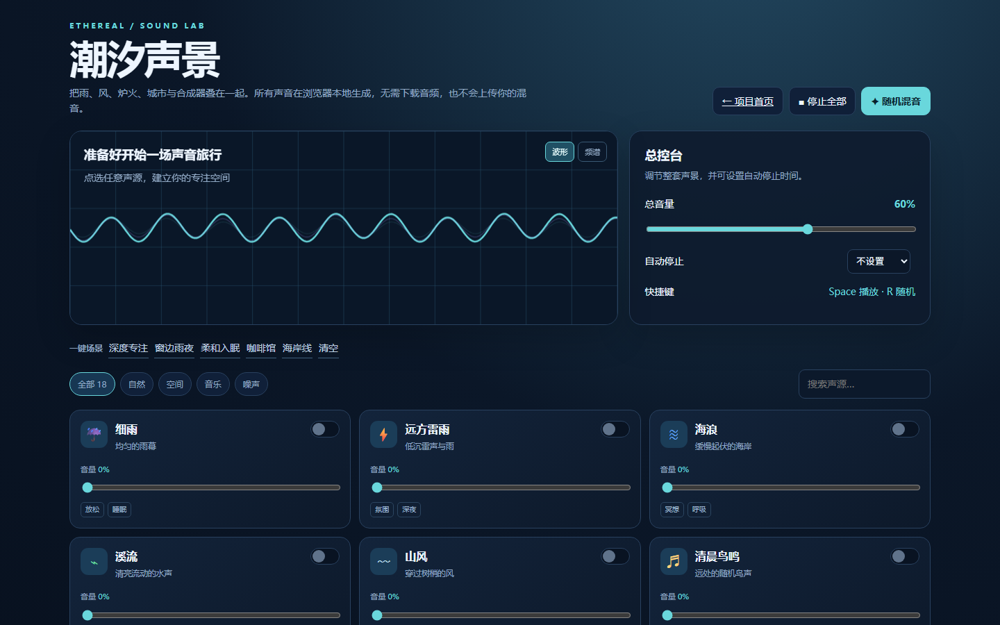

  

# Tidal Soundscape · 潮汐声景

**Real-time synthesized soundscapes: mix 18 natural, spatial, musical and noise layers for focus, sleep or rest.**

实时合成的潮汐声景：混合 18 种自然、空间、音乐与噪声层，用于专注、睡眠与放松。

  

**English** · [简体中文](README_CN.md) · [README index](README.md) · [All projects](../README.md)

## Quick links · 快速入口

| | |
| --- | --- |
| Project portal · 项目总入口 | [etherealnymph.github.io/web-projects/index.html#projects](https://etherealnymph.github.io/web-projects/index.html#projects) |
| Live page · 在线页面 | [https://etherealnymph.github.io/web-projects/soundscape/](https://etherealnymph.github.io/web-projects/soundscape/) |
| English | [README_EN.md](README_EN.md) |
| 简体中文 | [README_CN.md](README_CN.md) |

### English

Every sound here is generated live with the Web Audio API. Mix rain, wind, fire, café, trains and synth pads to taste, save a scene, set a sleep timer — no audio files are downloaded and nothing is uploaded.

### 简体中文

所有声音都由 Web Audio API 实时合成。按喜好混合雨、风、炉火、咖啡馆、列车与合成器铺底，保存场景、设置自动停止——不下载音频文件，也不上传任何内容。

---

**Contact · 联系方式:** Etherealnymph · [2115487769@qq.com](mailto:2115487769@qq.com)
