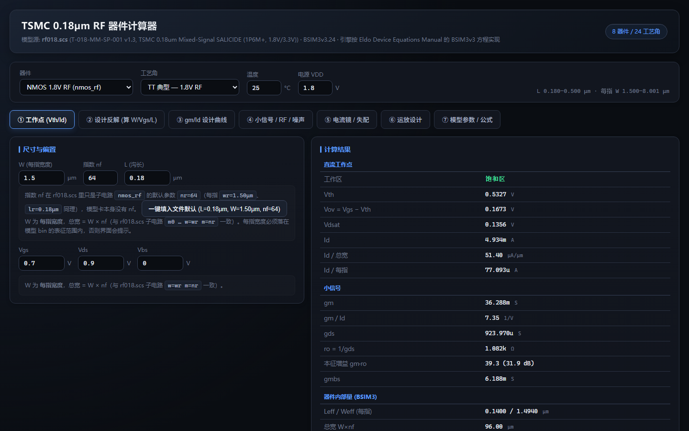

  

# SPICE RF Calculator · TSMC RF 器件计算器

**A BSIM3v3.24 DC / small-signal / RF calculator driven by a TSMC 0.18 µm RF model card.**

由 TSMC 0.18 µm RF 模型卡驱动的 BSIM3v3.24 直流 / 小信号 / RF 计算器。

  

**English** · [简体中文](README_CN.md) · [README index](README.md) · [All projects](../README.md)

## Quick links · 快速入口

| | |
| --- | --- |
| Project portal · 项目总入口 | [etherealnymph.github.io/web-projects/index.html#projects](https://etherealnymph.github.io/web-projects/index.html#projects) |
| Live page · 在线页面 | [https://etherealnymph.github.io/web-projects/spice-rf-calculator/spice-rf-calculator.html](https://etherealnymph.github.io/web-projects/spice-rf-calculator/spice-rf-calculator.html) |
| English | [README_EN.md](README_EN.md) |
| 简体中文 | [README_CN.md](README_CN.md) |

### English

Pick a device and a corner, set geometry and bias, and read the operating point, small-signal parameters and RF figures without leaving the browser. The engine follows BSIM3v3 and parses the Spectre sections of `rf018.scs`.

### 简体中文

选择器件与工艺角，设定尺寸和偏置，就能在浏览器里读出工作点、小信号参数与 RF 指标。计算引擎按 BSIM3v3 实现，并解析 `rf018.scs` 的 Spectre 段落。

---

**Contact · 联系方式:** Etherealnymph · [2115487769@qq.com](mailto:2115487769@qq.com)
