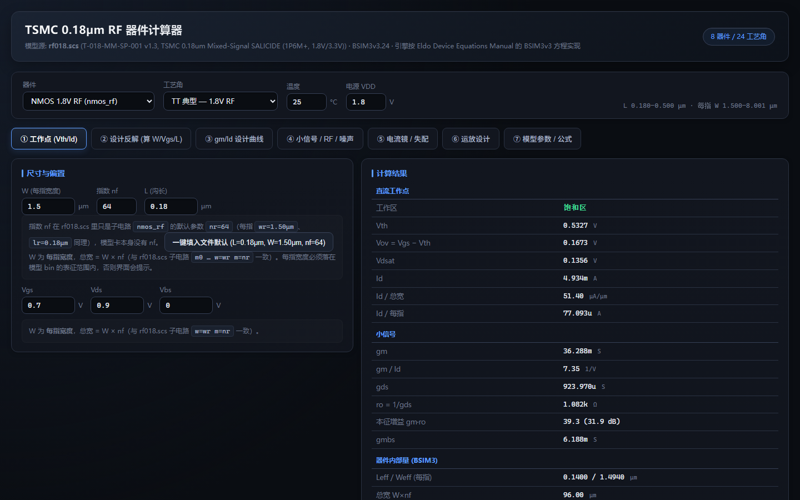

<div align="center">

[](https://etherealnymph.github.io/web-projects/spice-rf-calculator/spice-rf-calculator.html) [](https://etherealnymph.github.io/web-projects/index.html#projects) 

# TSMC RF 器件计算器

**由 TSMC 0.18 µm RF 模型卡驱动的 BSIM3v3.24 直流 / 小信号 / RF 计算器。**

[](README_EN.md) [](README_CN.md) [](README.md)

[English](README_EN.md) · **简体中文** · [README 索引](README.md) · [全部项目](../README.md)

<a href="docs/screenshot.png"></a>

</div>

## 项目简介

选择器件与工艺角，设定尺寸和偏置，就能在浏览器里读出工作点、小信号参数与 RF 指标。计算引擎按 BSIM3v3 实现，并解析 `rf018.scs` 的 Spectre 段落。

## 功能

- 8 种器件、24 个工艺角，可调温度、VDD 与几何尺寸。
- 七个页签：工作点、设计反算（W/Vgs/L）、gm/Id 设计曲线、小信号 / RF / 噪声、电流镜与失配、运放设计、模型参数与公式。
- 给出 Vth、Vov、Vdsat、Id、gm、gds、gm·ro、gmbs、Leff/Weff、Cgg 与 fT，并判定工作区。
- 解析 `rf018.scs` 的 Spectre 段落与 BSIM3v3.24 参数；引擎按 Eldo Device Equations Manual 实现。
- 支持每指宽度与倍数（nf、m），便于按版图定尺寸。
- 纯本地文件：无需服务端，也无需构建。

## 网页入口

| 入口 | 链接 |
| --- | --- |
| 项目总入口 | [etherealnymph.github.io/web-projects/index.html#projects](https://etherealnymph.github.io/web-projects/index.html#projects) |
| 直接页面 | [https://etherealnymph.github.io/web-projects/spice-rf-calculator/spice-rf-calculator.html](https://etherealnymph.github.io/web-projects/spice-rf-calculator/spice-rf-calculator.html) |
| 本地 | 直接打开 `spice-rf-calculator/spice-rf-calculator.html`，或在根目录起服务后打开 `http://127.0.0.1:8123/spice-rf-calculator/spice-rf-calculator.html`。 |

## 项目结构

```text
spice-rf-calculator/
├─ spice-rf-calculator.html   # entry
├─ spice-models.js            # model data / parameter tables
├─ spice-engine.js            # BSIM3v3 equations
├─ spice-ui.js                # controls and readouts
├─ spice-device.js            # device and corner selection
├─ spice-app.js               # tabs and wiring
├─ spice-tool.css
└─ docs/screenshot.png
```

## 边界与说明

- 模型参数属于其来源模型卡。再次分发前请确认授权；计算结果仅供估算与教学。

## 其他项目

| 项目 | README | 网页 |
| --- | --- | --- |
| **Analog Atlas** / 硅海图谱 | [README](../analog-atlas/README.md) | [打开](https://etherealnymph.github.io/web-projects/analog-atlas/) |
| **Bilingual Dictionary** / 中英双语词典 | [README](../bilingual-dictionary/README.md) | [打开](https://etherealnymph.github.io/web-projects/bilingual-dictionary/) |
| **Blog Platform** / 博客平台 | [README](../blog-platform/README.md) | — *(需服务端)* |
| **Circuit Lab** / 观澜电路 | [README](../circuit-lab/README.md) | [打开](https://etherealnymph.github.io/web-projects/circuit-lab/) |
| **Field Drift** / 场海 | [README](../field-drift/README.md) | [打开](https://etherealnymph.github.io/web-projects/field-drift/) |
| **Fourier Contour** / 圆上之圆 | [README](../fourier-contour/README.md) | [打开](https://etherealnymph.github.io/web-projects/fourier-contour/) |
| **GM/ID Studio** / GM/ID 设计工作台 | [README](../gm-id-studio/README.md) | [打开](https://etherealnymph.github.io/web-projects/gm-id-studio/dist/GM-ID-Studio.html) |
| **Insight Space** / 体悟集 | [README](../insight-space/README.md) | [打开](https://etherealnymph.github.io/web-projects/insight-space/) |
| **Life Guide** / 高性价比人生指南 | [README](../life-guide/README.md) | [打开](https://etherealnymph.github.io/web-projects/life-guide/) |
| **Logic Loom** / 逻辑织机 | [README](../logic-loom/README.md) | [打开](https://etherealnymph.github.io/web-projects/logic-loom/) |
| **Math Competition** / 大学生数学竞赛 | [README](../math-competition/README.md) | [打开](https://etherealnymph.github.io/web-projects/math-competition/web/) |
| **Mini World** / 迷你世界 | [README](../mini-world/README.md) | [打开](https://etherealnymph.github.io/web-projects/mini-world/) |
| **Number Sense Trainer** / 数感训练场 | [README](../number-sense-trainer.src/README.md) | [打开](https://etherealnymph.github.io/web-projects/number-sense-trainer.html) |
| **Semiconductor Devices** / 半导体物理与器件 | [README](../semiconductor-devices/README.md) | [打开](https://etherealnymph.github.io/web-projects/semiconductor-devices/) |
| **Silicon Notes** / 硅间札记 | [README](../silicon-notes/README.md) | [打开](https://etherealnymph.github.io/web-projects/silicon-notes/) |
| **Tidal Soundscape** / 潮汐声景 | [README](../soundscape/README.md) | [打开](https://etherealnymph.github.io/web-projects/soundscape/) |
| **Stock Trading Simulator** / 股市训练场 | [README](../stock-trading-simulator/README.md) | [打开](https://etherealnymph.github.io/web-projects/stock-trading-simulator/stock-trading-simulator.html) |
| **Stock Quote API** / A 股行情后端 | [README](../stock-quote-api/README.md) | — *(需服务端)* |


更多单页实验、游戏与工具见[仓库根 README](../README.md)。

## 作者

**Etherealnymph** — [2115487769@qq.com](mailto:2115487769@qq.com)

更多项目：[web-projects](https://github.com/Etherealnymph/web-projects) · [项目总入口](https://etherealnymph.github.io/web-projects/index.html#projects)
