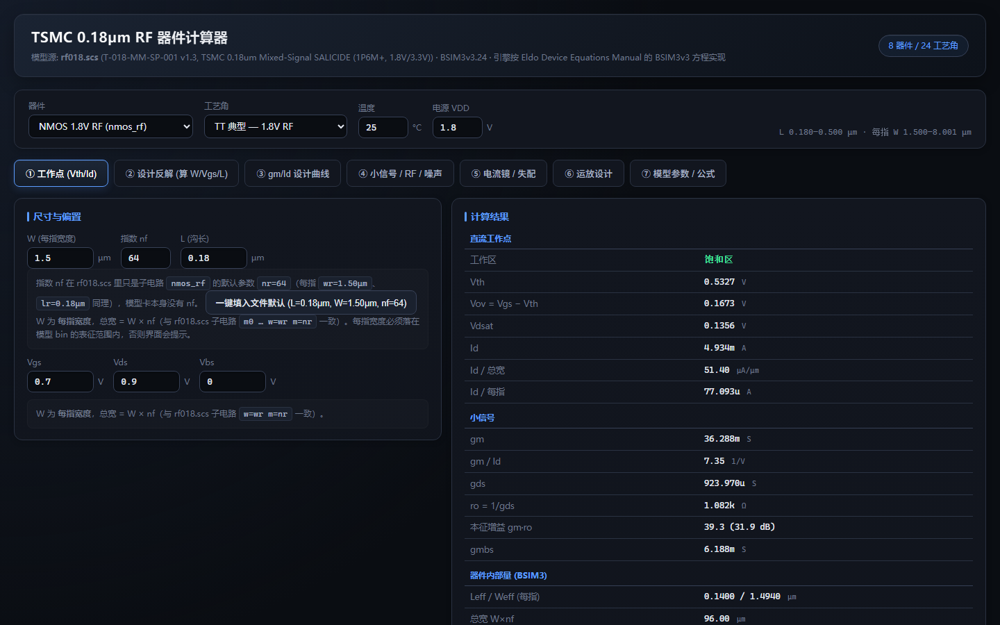

<div align="center">

[](https://etherealnymph.github.io/web-projects/spice-rf-calculator/spice-rf-calculator.html) [](https://etherealnymph.github.io/web-projects/index.html#projects) 

# SPICE RF Calculator

**A BSIM3v3.24 DC / small-signal / RF calculator driven by a TSMC 0.18 µm RF model card.**

[](README_EN.md) [](README_CN.md) [](README.md)

**English** · [简体中文](README_CN.md) · [README index](README.md) · [All projects](../README.md)

<a href="docs/screenshot.png"></a>

</div>

## Overview

Pick a device and a corner, set geometry and bias, and read the operating point, small-signal parameters and RF figures without leaving the browser. The engine follows BSIM3v3 and parses the Spectre sections of `rf018.scs`.

## Features

- Eight devices and 24 process corners, with temperature, VDD and geometry controls.
- Seven tabs: operating point, design back-solve (W/Vgs/L), gm/Id curves, small-signal/RF/noise, current mirror & mismatch, op-amp design, model equations.
- Reads Vth, Vov, Vdsat, Id, gm, gds, gm·ro, gmbs, Leff/Weff, Cgg and fT, with operating-region detection.
- Parses the Spectre sections of `rf018.scs` and BSIM3v3.24 parameters; the engine follows the Eldo Device Equations Manual.
- Per-finger and multiplier handling (nf, m) for layout-aware sizing.
- Plain local files: no server, no build step.

## Live entry

| Entry | Link |
| --- | --- |
| Project portal | [etherealnymph.github.io/web-projects/index.html#projects](https://etherealnymph.github.io/web-projects/index.html#projects) |
| Direct page | [https://etherealnymph.github.io/web-projects/spice-rf-calculator/spice-rf-calculator.html](https://etherealnymph.github.io/web-projects/spice-rf-calculator/spice-rf-calculator.html) |
| Local | Open `spice-rf-calculator/spice-rf-calculator.html` directly, or serve the root and open `http://127.0.0.1:8123/spice-rf-calculator/spice-rf-calculator.html`. |

## Project structure

```text
spice-rf-calculator/
├─ spice-rf-calculator.html   # entry
├─ spice-models.js            # model data / parameter tables
├─ spice-engine.js            # BSIM3v3 equations
├─ spice-ui.js                # controls and readouts
├─ spice-device.js            # device and corner selection
├─ spice-app.js               # tabs and wiring
├─ spice-tool.css
└─ docs/screenshot.png
```

## Boundaries and notes

- Model parameters belong to their source model card. Check the licence before redistributing them; results are for estimation and teaching.

## Other projects

| Project | README | Live page |
| --- | --- | --- |
| **Analog Atlas** / 硅海图谱 | [README](../analog-atlas/README.md) | [Open](https://etherealnymph.github.io/web-projects/analog-atlas/) |
| **Bilingual Dictionary** / 中英双语词典 | [README](../bilingual-dictionary/README.md) | [Open](https://etherealnymph.github.io/web-projects/bilingual-dictionary/) |
| **Blog Platform** / 博客平台 | [README](../blog-platform/README.md) | — *(server-side)* |
| **Circuit Lab** / 观澜电路 | [README](../circuit-lab/README.md) | [Open](https://etherealnymph.github.io/web-projects/circuit-lab/) |
| **Field Drift** / 场海 | [README](../field-drift/README.md) | [Open](https://etherealnymph.github.io/web-projects/field-drift/) |
| **Fourier Contour** / 圆上之圆 | [README](../fourier-contour/README.md) | [Open](https://etherealnymph.github.io/web-projects/fourier-contour/) |
| **GM/ID Studio** / GM/ID 设计工作台 | [README](../gm-id-studio/README.md) | [Open](https://etherealnymph.github.io/web-projects/gm-id-studio/dist/GM-ID-Studio.html) |
| **Insight Space** / 体悟集 | [README](../insight-space/README.md) | [Open](https://etherealnymph.github.io/web-projects/insight-space/) |
| **Life Guide** / 高性价比人生指南 | [README](../life-guide/README.md) | [Open](https://etherealnymph.github.io/web-projects/life-guide/) |
| **Logic Loom** / 逻辑织机 | [README](../logic-loom/README.md) | [Open](https://etherealnymph.github.io/web-projects/logic-loom/) |
| **Math Competition** / 大学生数学竞赛 | [README](../math-competition/README.md) | [Open](https://etherealnymph.github.io/web-projects/math-competition/web/) |
| **Mini World** / 迷你世界 | [README](../mini-world/README.md) | [Open](https://etherealnymph.github.io/web-projects/mini-world/) |
| **Number Sense Trainer** / 数感训练场 | [README](../number-sense-trainer.src/README.md) | [Open](https://etherealnymph.github.io/web-projects/number-sense-trainer.html) |
| **Semiconductor Devices** / 半导体物理与器件 | [README](../semiconductor-devices/README.md) | [Open](https://etherealnymph.github.io/web-projects/semiconductor-devices/) |
| **Silicon Notes** / 硅间札记 | [README](../silicon-notes/README.md) | [Open](https://etherealnymph.github.io/web-projects/silicon-notes/) |
| **Tidal Soundscape** / 潮汐声景 | [README](../soundscape/README.md) | [Open](https://etherealnymph.github.io/web-projects/soundscape/) |
| **Stock Trading Simulator** / 股市训练场 | [README](../stock-trading-simulator/README.md) | [Open](https://etherealnymph.github.io/web-projects/stock-trading-simulator/stock-trading-simulator.html) |
| **Stock Quote API** / A 股行情后端 | [README](../stock-quote-api/README.md) | — *(server-side)* |


More single-page labs, games and tools are listed in the [repository README](../README.md).

## Author

**Etherealnymph** — [2115487769@qq.com](mailto:2115487769@qq.com)

More projects: [web-projects](https://github.com/Etherealnymph/web-projects) · [portal](https://etherealnymph.github.io/web-projects/index.html#projects)
