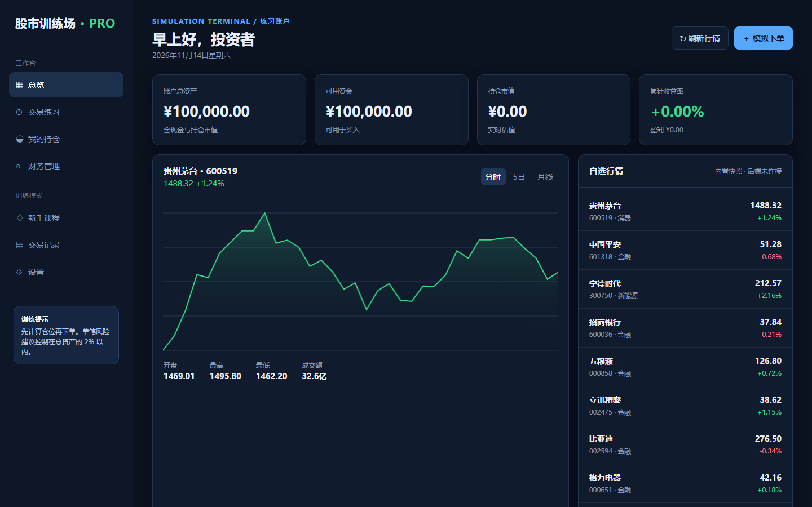

<div align="center">

[](https://etherealnymph.github.io/web-projects/stock-trading-simulator/stock-trading-simulator.html) [](https://etherealnymph.github.io/web-projects/index.html#projects) 

# 股市训练场

**带可选 FastAPI + AKShare 行情后端的 A 股模拟交易终端。**

[](README_EN.md) [](README_CN.md) [](README.md)

[English](README_EN.md) · **简体中文** · [README 索引](README.md) · [全部项目](../README.md)

<a href="docs/screenshot.png"></a>

</div>

## 项目简介

面向 A 股投资的练习终端：行情、自选、模拟下单、持仓、交易记录与个人收支。内置行情快照可直接离线使用，也可以接本地 FastAPI 服务获取真实行情。

## 功能

- 总资产、可用资金、持仓市值与累计收益总览；分时 / 5 日 / 月线行情图。
- 自选行情、模拟下单、持仓、交易记录与盈亏核算。
- 财务管理：在交易账户之外记录日常支出。
- 新手课程与训练提示，例如仓位计算与单笔 2% 风险上限。
- 内置快照可离线运行；FastAPI 后端通过 AKShare 提供实时行情，带 30 秒缓存。
- 明确仅用于学习：不连接券商、不产生真实订单，也不构成投资建议。

## 网页入口

| 入口 | 链接 |
| --- | --- |
| 项目总入口 | [etherealnymph.github.io/web-projects/index.html#projects](https://etherealnymph.github.io/web-projects/index.html#projects) |
| 直接页面 | [https://etherealnymph.github.io/web-projects/stock-trading-simulator/stock-trading-simulator.html](https://etherealnymph.github.io/web-projects/stock-trading-simulator/stock-trading-simulator.html) |
| 本地 | 直接打开 `stock-trading-simulator/stock-trading-simulator.html`，或在根目录起服务后打开 `http://127.0.0.1:8123/stock-trading-simulator/stock-trading-simulator.html`。 |

## 项目结构

```text
stock-trading-simulator/
├─ stock-trading-simulator.html   # front end, open directly
├─ backend/                       # FastAPI + AKShare quote service
│  ├─ main.py
│  ├─ requirements.txt
│  └─ README.md
├─ docs/screenshot.png
└─ README.md / README_EN.md / README_CN.md
```

原详细说明：[README_ORIGINAL.md](README_ORIGINAL.md)。

## 边界与说明

- 行情来自 AKShare 封装的东方财富公开数据，非交易时段可能延迟或不可用。

## 其他项目

| 项目 | README | 网页 |
| --- | --- | --- |
| **Analog Atlas** / 硅海图谱 | [README](../analog-atlas/README.md) | [打开](https://etherealnymph.github.io/web-projects/analog-atlas/) |
| **Bilingual Dictionary** / 中英双语词典 | [README](../bilingual-dictionary/README.md) | [打开](https://etherealnymph.github.io/web-projects/bilingual-dictionary/) |
| **Blog Platform** / 博客平台 | [README](../blog-platform/README.md) | — *(需服务端)* |
| **Circuit Lab** / 观澜电路 | [README](../circuit-lab/README.md) | [打开](https://etherealnymph.github.io/web-projects/circuit-lab/) |
| **Field Drift** / 场海 | [README](../field-drift/README.md) | [打开](https://etherealnymph.github.io/web-projects/field-drift/) |
| **Fourier Contour** / 圆上之圆 | [README](../fourier-contour/README.md) | [打开](https://etherealnymph.github.io/web-projects/fourier-contour/) |
| **GM/ID Studio** / GM/ID 设计工作台 | [README](../gm-id-studio/README.md) | [打开](https://etherealnymph.github.io/web-projects/gm-id-studio/dist/GM-ID-Studio.html) |
| **Insight Space** / 体悟集 | [README](../insight-space/README.md) | [打开](https://etherealnymph.github.io/web-projects/insight-space/) |
| **Life Guide** / 高性价比人生指南 | [README](../life-guide/README.md) | [打开](https://etherealnymph.github.io/web-projects/life-guide/) |
| **Logic Loom** / 逻辑织机 | [README](../logic-loom/README.md) | [打开](https://etherealnymph.github.io/web-projects/logic-loom/) |
| **Math Competition** / 大学生数学竞赛 | [README](../math-competition/README.md) | [打开](https://etherealnymph.github.io/web-projects/math-competition/web/) |
| **Mini World** / 迷你世界 | [README](../mini-world/README.md) | [打开](https://etherealnymph.github.io/web-projects/mini-world/) |
| **Number Sense Trainer** / 数感训练场 | [README](../number-sense-trainer.src/README.md) | [打开](https://etherealnymph.github.io/web-projects/number-sense-trainer.html) |
| **Semiconductor Devices** / 半导体物理与器件 | [README](../semiconductor-devices/README.md) | [打开](https://etherealnymph.github.io/web-projects/semiconductor-devices/) |
| **Silicon Notes** / 硅间札记 | [README](../silicon-notes/README.md) | [打开](https://etherealnymph.github.io/web-projects/silicon-notes/) |
| **Tidal Soundscape** / 潮汐声景 | [README](../soundscape/README.md) | [打开](https://etherealnymph.github.io/web-projects/soundscape/) |
| **SPICE RF Calculator** / TSMC RF 器件计算器 | [README](../spice-rf-calculator/README.md) | [打开](https://etherealnymph.github.io/web-projects/spice-rf-calculator/spice-rf-calculator.html) |
| **Stock Quote API** / A 股行情后端 | [README](../stock-quote-api/README.md) | — *(需服务端)* |


更多单页实验、游戏与工具见[仓库根 README](../README.md)。

## 作者

**Etherealnymph** — [2115487769@qq.com](mailto:2115487769@qq.com)

更多项目：[web-projects](https://github.com/Etherealnymph/web-projects) · [项目总入口](https://etherealnymph.github.io/web-projects/index.html#projects)
